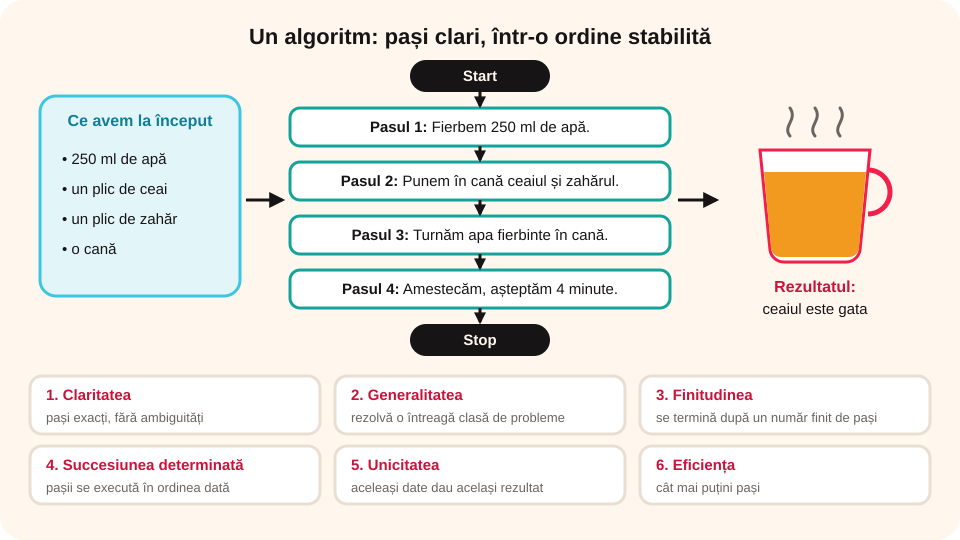

## Ce vei învăța azi

- ce este un **algoritm**;
- care sunt cele **șase proprietăți** ale unui algoritm;
- să recunoști și să corectezi **formulările ambigue** sau fără sfârșit.

## Să ne amintim

Multe lucruri le facem zilnic la fel, pas cu pas: ne pregătim de școală, facem un ceai, ne spălăm pe dinți.

## Lecția pe scurt

### Doi algoritmi din viața de zi cu zi

**Programul de dimineață**

```
Start
Pasul 1: Ne sculăm.
Pasul 2: Ne spălăm.
Pasul 3: Ne îmbrăcăm.
Pasul 4: Mâncăm micul dejun.
Stop
```

**Prepararea unui ceai**

```
Start
Pasul 1: Fierbem 250 ml de apă.
Pasul 2: Punem în cană un plic de ceai și un plic de zahăr.
Pasul 3: Turnăm apa fierbinte în cană.
Pasul 4: Amestecăm și așteptăm patru minute.
Stop
```

În ambele cazuri facem un **număr clar de pași**, într-o **ordine stabilită**.

> Un **algoritm** este o succesiune de operații, într-o ordine bine precizată, prin care rezolvi o problemă sau îndeplinești o sarcină.



### Proprietățile algoritmilor

1. **Claritatea**: pașii sunt descriși exact, fără să poată fi înțeleși în mai multe feluri (fără **ambiguități**).
2. **Generalitatea**: algoritmul rezolvă o **întreagă clasă** de probleme, nu doar un caz.
3. **Finitudinea**: algoritmul ajunge la rezultat după un **număr finit** de pași.
4. **Succesiunea determinată a pașilor**: pașii se execută în ordinea în care sunt scriși; dacă trebuie sărit la alt pas, se spune clar la care.
5. **Unicitatea**: pornind de la aceleași date, obții **mereu același rezultat**.
6. **Eficiența**: rezolvă sarcina în **cât mai puțini pași**.

### Formulări greșite

| Formulare | Ce proprietate lipsește | Corectare |
|---|---|---|
| „Dacă ninge, stau acasă **sau** merg la teatru.” | **claritatea**: nu știi ce va face | „Dacă ninge sau dacă sunt obosit, stau acasă.” |
| „Scrieți numerele naturale pare.” | **finitudinea**: nu se termină niciodată | „Scrieți numerele naturale pare mai mici decât 1000.” |
| „Un vârf de cuțit de sare.” | **unicitatea**: fiecare pune altă cantitate | „2 grame de sare.” |

## Exemplu rezolvat

**Care enunț are proprietatea de finitudine?**

- a) Scrie numerele naturale impare → nu se termină.
- b) Scrie numerele naturale mai mari decât 1 → nu se termină.
- c) **Scrie numerele naturale pare mai mici decât 20** → se oprește la 18. ✓

## Aplicații interactive

```cartonase
# Proprietățile algoritmilor
Claritate = Pașii sunt descriși exact, fără ambiguități.
Generalitate = Rezolvă o întreagă clasă de probleme.
Finitudine = Se termină după un număr finit de pași.
Succesiune determinată = Pașii se execută într-o ordine bine stabilită.
Unicitate = Aceleași date de pornire dau mereu același rezultat.
Eficiență = Rezolvă sarcina într-un număr minim de pași.
```

```quiz
# Ce proprietate lipsește?
„Scrieți numerele naturale pare.” Ce proprietate lipsește?
- claritatea
* finitudinea
- eficiența
Explicație: Șirul numerelor pare nu se termină niciodată.

„Adaugă un vârf de cuțit de sare.” Ce proprietate lipsește?
- generalitatea
* unicitatea
- finitudinea
Explicație: Fiecare om pune altă cantitate, deci rezultatul diferă.

„Dacă ninge, stau acasă sau merg la teatru.” Ce proprietate lipsește?
* claritatea
- succesiunea determinată
- eficiența

Care enunț are proprietatea de finitudine?
- Scrie numerele naturale impare.
- Scrie numerele naturale mai mari decât 1.
* Scrie numerele naturale pare mai mici decât 20.
```

```completare
# Completează definiția cu: finită, operații, prelucrare, rezultat.
Un algoritm este o succesiune [finită] și bine ordonată de [operații] bine definite, care realizează o [prelucrare] a unor date, oferind un [rezultat] final.
```

```ordonare
# Algoritmul pentru prepararea ceaiului: pune pașii în ordine.
Fierbem 250 ml de apă
Punem în cană un plic de ceai și unul de zahăr
Turnăm apa fierbinte în cană
Amestecăm și așteptăm patru minute
```

## Exersează

1. Ce este un algoritm? Care sunt proprietățile lui?
2. Scrie pașii a doi algoritmi din viața ta: cum te speli pe dinți, drumul spre școală, o rețetă.
3. Scrie pașii pentru încărcarea unui stilou cu cerneală (stilou cu pompiță).
4. Reformulează enunțul „Trimiteți mașina Anei.”, astfel încât să nu mai fie ambiguu.
5. Sunt clare sau ambigue anunțurile „Vând câine: mănâncă orice și îi plac copiii.” și „Angajăm dădacă pentru fetiță în vârstă.”? De ce?
6. **Portofoliu:** găsește trei formulări ambigue. Explică de ce sunt ambigue și cum le-ai corecta.

## Pe scurt

Un **algoritm** este o succesiune ordonată de pași pentru rezolvarea unei probleme. El trebuie să fie **clar**, **general**, **finit**, cu **pași în ordine**, **unic** (același rezultat) și **eficient**.
