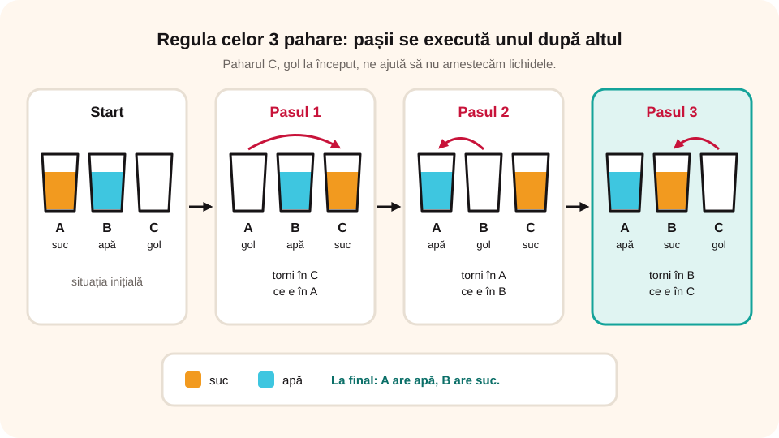

> **Competențe specifice (Anexa 15):** CS 2.1, CS 2.3

## Ce vei învăța azi

- ce este un **algoritm secvențial**;
- **algoritmul de interschimbare** („regula celor 3 pahare”);
- să scrii algoritmi secvențiali simpli: criptarea unui mesaj, calcule matematice.

## Să ne amintim

Proprietățile unui algoritm sunt: claritatea, generalitatea, finitudinea, succesiunea determinată a pașilor, unicitatea și eficiența.

## Lecția pe scurt

### Ce este un algoritm secvențial

Gândește-te cum te îmbraci dimineața: tricoul, șosetele, pantalonii, apoi pantofii. Dacă ai încălța întâi pantofii și apoi ai pune șosetele... ar fi o problemă! **Ordinea contează.**

> Un **algoritm secvențial** este un algoritm în care pașii se execută **liniar**, unul după altul, **în ordinea în care apar**, de la început până la sfârșit.

### A. Interschimbarea – regula celor 3 pahare

Paharul A are suc, paharul B are apă. Vrei să schimbi conținutul între ele. Nu poți turna direct, pentru că lichidele s-ar amesteca. Îți trebuie un **al treilea pahar gol, C**.

| Pas | Ce faci | A | B | C |
|---|---|---|---|---|
| start | | suc | apă | gol |
| 1 | torni în C ce e în A | gol | apă | suc |
| 2 | torni în A ce e în B | apă | gol | suc |
| 3 | torni în B ce e în C | apă | suc | gol |

Algoritmul este clar, funcționează pentru orice lichide, are **numărul minim de pași (3)** și dă mereu același rezultat.



### B. Criptarea unui mesaj

Codificăm literele: a = 01, b = 02, c = 03, d = 04... iar spațiul = 00. Mesajul „da” devine **0401**:

```
Start
Pasul 1: Caut codul literei „d”.
Pasul 2: Scriu codul găsit (04).
Pasul 3: Caut codul literei „a”.
Pasul 4: Scriu codul găsit (01).
Stop
```

### C. Tabla înmulțirii cu 5

```
Start
Pasul 1: Introducem 1.
Pasul 2: Îl înmulțim cu 5.
Pasul 3: Afișăm rezultatul.
Pasul 4: Introducem 2.
... (la fel până la 10)
Stop
```

Pentru fiecare număr de la 1 la 10 sunt **3 pași** (introducem, înmulțim, afișăm), deci **3 × 10 = 30 de pași**.

### D. Aria unui dreptunghi

```
Start
Pasul 1: Introducem lungimea laturii mici.
Pasul 2: Introducem lungimea laturii mari.
Pasul 3: Calculăm aria = latura mică × latura mare.
Pasul 4: Afișăm aria.
Stop
```

## Exemplu rezolvat

**Algoritm pentru aria unui pătrat cu latura cunoscută:**

```
Start
Pasul 1: Introducem lungimea laturii, l.
Pasul 2: Calculăm aria = l × l.
Pasul 3: Afișăm aria.
Stop
```

Pentru l = 6, aria = 6 × 6 = **36**.

## Aplicații interactive

```ordonare
# Regula celor 3 pahare: pune pașii în ordine.
Torni în paharul C lichidul din paharul A
Torni în paharul A lichidul din paharul B
Torni în paharul B lichidul din paharul C
```

```adevarat-fals
F: Într-un algoritm secvențial nu contează ordinea operațiilor. | Pașii se execută exact în ordinea în care sunt scriși.
A: Algoritmul de interschimbare se mai numește „regula celor 3 pahare”.
F: Într-un algoritm secvențial, acțiunile se repetă circular. | Acțiunile se execută liniar, o singură dată, de la început până la sfârșit.
```

```completare
# Criptează cu regula a = 01, b = 02, c = 03, d = 04, e = 05, spațiu = 00.
Mesajul „da” devine [0401]. Mesajul „bac” devine [020103]. Mesajul „ce” devine [0305].
```

```ordonare
# Algoritmul pentru aria dreptunghiului: pune pașii în ordine.
Introducem lungimea laturii mici
Introducem lungimea laturii mari
Calculăm aria ca produs al celor două laturi
Afișăm aria
```

```quiz
# Gândește!
Câți pași are algoritmul pentru tabla înmulțirii cu 5 (fără Start și Stop)?
- 10
* 30
- 15
Explicație: Pentru fiecare dintre cele 10 numere sunt 3 pași: introducem, înmulțim, afișăm.

Câte pahare îți trebuie ca să schimbi între ele conținutul a două pahare?
- 2
* 3
- 4
```

## Exersează

1. Dă trei exemple de activități de zi cu zi care pot fi scrise ca algoritm.
2. Ce este un algoritm secvențial?
3. Folosind regula celor 3 pahare, scrie un algoritm care schimbă conținutul a trei pahare: A (ceai), B (apă), C (lapte), astfel încât la final A să aibă apă, B lapte și C ceai. Indicație: folosește un pahar gol D și interschimbă întâi A cu B, apoi B cu C.
4. Criptează mesajul „Merg la bibliotecă” cu regula de la algoritmul B.
5. Modifică algoritmul D astfel încât să afișeze și **perimetrul** dreptunghiului.
6. **Portofoliu:** inventează propria regulă de criptare și scrie algoritmul care codifică mesajul „Joc tenis”.

## Pe scurt

Într-un **algoritm secvențial**, pașii se execută **unul după altul**, în ordinea în care sunt scriși. Exemple: **regula celor 3 pahare** (interschimbarea), criptarea unui mesaj, calculul unei arii.
