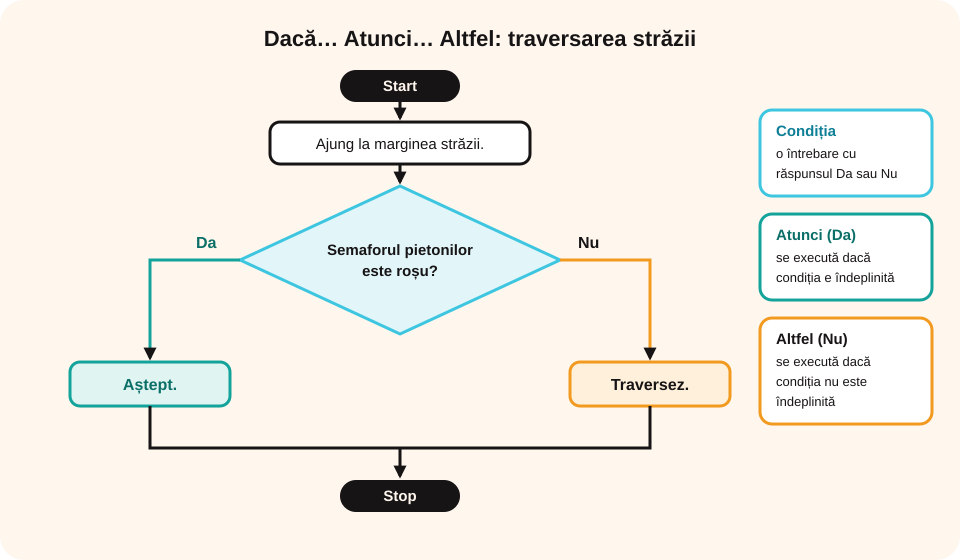

> **Competențe specifice (Anexa 15):** CS 2.1, CS 2.3

## Ce vei învăța azi

- ce este **structura alternativă (decizională)**: **Dacă… Atunci… Altfel**;
- cazul în care **nu se face nimic** dacă condiția nu e îndeplinită;
- să scrii condiții cu **operatori relaționali** (=, ≠, <, >, ≤, ≥) și condiții compuse cu **și** / **sau**;
- să scrii algoritmi cu **decizii**, inclusiv cu **decizii una în alta**.

## Să ne amintim

Într-un algoritm secvențial, pașii se execută unul după altul, „în linie dreaptă”. În viața reală însă, de multe ori **alegem** ce facem în funcție de o situație.

## Lecția pe scurt

### Dacă... Atunci... Altfel

```
Dacă vremea este frumoasă,
   Atunci merg cu bicicleta în parc.
   Altfel citesc o carte.
```

- **condiția**: *vremea este frumoasă*;
- **acțiunea 1** (după **Atunci**): se execută dacă **condiția este îndeplinită**;
- **acțiunea 2** (după **Altfel**): se execută dacă **condiția NU este îndeplinită**.

### Fără „Altfel”

```
Dacă vremea este frumoasă,
   Atunci merg cu bicicleta în parc.
```

Dacă vremea nu e frumoasă, **nu se face nimic** (în orice caz, nu mergi cu bicicleta).

> **Structura alternativă (decizională)** este formată dintr-o **condiție** și **două acțiuni** (sau secvențe de acțiuni): dacă condiția este îndeplinită se face prima acțiune, altfel a doua. În cazul particular fără „Altfel”, dacă condiția nu e îndeplinită nu se face nimic.

### Condiții cu operatori relaționali

Multe condiții din viața de zi cu zi sunt **comparații**. Le scriem cu **operatori relaționali**:

| În cuvinte | Operator | Exemplu de condiție |
|---|---|---|
| este egal cu | `=` | nota = 10 |
| este diferit de | `≠` (în informatică `<>`) | răspunsul ≠ 0 |
| este mai mic decât | `<` | temperatura < 0 °C |
| este mai mare decât | `>` | vârsta > 12 ani |
| este cel mult (mai mic sau egal) | `≤` (`<=`) | prețul ≤ 10 lei |
| este cel puțin (mai mare sau egal) | `≥` (`>=`) | nota ≥ 5 |

O condiție are mereu răspunsul **Da (adevărat)** sau **Nu (fals)**. Exemplu: dacă nota este 7, condiția *nota ≥ 5* este **adevărată**, iar *nota = 10* este **falsă**.

```
Dacă temperatura < 0 °C,
   Atunci îmi pun mănușile.
   Altfel le las acasă.
```

> **Atenție la „cel puțin” și „cel mult”!** „Poți intra dacă ai **cel puțin** 12 ani” înseamnă vârsta **≥ 12**: un copil de exact 12 ani **poate** intra. „Mai mare decât 12” (vârsta > 12) l-ar lăsa afară.

### Condiții compuse (diverse)

Uneori trebuie verificate **două condiții deodată**. Le legăm cu **și** sau cu **sau**:

- **și**: ambele condiții trebuie să fie adevărate. *Dacă am terminat temele **și** afară este soare, Atunci merg la joacă.*
- **sau**: ajunge ca **una** să fie adevărată. *Dacă plouă **sau** temperatura < 5 °C, Atunci iau geaca groasă.*

```
Dacă vârsta ≥ 7 și vârsta ≤ 14,
   Atunci plătești bilet de copil.
   Altfel plătești bilet întreg.
```

Pentru vârsta 10: 10 ≥ 7 este adevărat **și** 10 ≤ 14 este adevărat → bilet de copil. Pentru vârsta 16: 16 ≤ 14 este fals → bilet întreg.

### A. Traversarea străzii la semafor

```
Start
Pasul 1: Ajung la marginea străzii.
Pasul 2: Dacă semaforul pietonilor este roșu,
            Atunci aștept.
            Altfel traversez.
Stop
```



### B. Labirintul

- **La o bifurcație** cu ambele drumuri libere: *Dacă* ambele drumuri sunt accesibile, *Atunci* merg la stânga, *Altfel* merg la dreapta.
- **Obstacol în stânga**: *Dacă* există un obstacol pe drumul din stânga, *Atunci* merg la dreapta, *Altfel* merg la stânga.
- **Înfundătură**: *Dacă* drumul se înfundă, *Atunci* mă întorc, *Altfel* merg înainte.

### C. Decizii una în alta: cumpărarea fructelor

Ai 10 lei și vrei 1 kg de fructe. Preferi cireșele.

```
Start
Pasul 1: Merg la piață.
Pasul 2: Dacă prețul cireșelor ≤ 10 lei/kg,
            Atunci cumpăr cireșe.
            Altfel
               Dacă prețul căpșunilor ≤ 10 lei/kg,
                  Atunci cumpăr căpșuni.
                  Altfel nu cumpăr nimic.
Stop
```

Aici o structură alternativă este **cuprinsă în alta**.

## Exemplu rezolvat

**Ana are 100 de lei și trebuie să plătească o factură de 60 de lei. Poate cumpăra un stilou?**

```
Start
Pasul 1: Calculez cât rămâne: 100 – 60 = 40 de lei.
Pasul 2: Dacă prețul stiloului ≤ 40 de lei,
            Atunci cumpăr stiloul.
            Altfel nu cumpăr stiloul.
Stop
```

Dacă stiloul costă 35 de lei → îl cumpără. Dacă costă 45 de lei → nu îl cumpără.

## Aplicații interactive

```categorii
# Condiție sau acțiune?
Condiție: semaforul pietonilor este roșu, vremea este frumoasă, drumul se înfundă, prețul cireșelor este cel mult 10 lei
Acțiune: aștept, traversez, citesc o carte, mă întorc
```

```quiz
# Urmărește algoritmul.
„Dacă semaforul pietonilor este roșu, Atunci aștept, Altfel traversez.” Semaforul este verde. Ce faci?
- aștept
* traversez
- nu fac nimic
Explicație: Condiția (semaforul este roșu) nu este îndeplinită, deci se execută acțiunea de după Altfel.

Cireșele costă 12 lei/kg, iar căpșunile 9 lei/kg. Ai 10 lei. Ce cumperi?
- cireșe
* căpșuni
- nimic
Explicație: Cireșele depășesc 10 lei, așa că verifici căpșunile: 9 ≤ 10, deci cumperi căpșuni.

„Dacă vremea este frumoasă, Atunci merg în parc.” Plouă. Ce faci?
- merg în parc
* nu se execută nicio acțiune din această structură
- citesc o carte
Explicație: Structura nu are Altfel, deci dacă nu e frumos nu se face nimic.
```

```ordonare
# Algoritmul de traversare a străzii: pune rândurile în ordine.
Start
Ajung la marginea străzii
Dacă semaforul pietonilor este roșu
Atunci aștept
Altfel traversez
Stop
```

```completare
# Completează.
Structura alternativă se mai numește structură [decizională]. Ea este formată dintr-o [condiție] și două acțiuni. Acțiunea de după cuvântul [Atunci] se execută dacă condiția este îndeplinită, iar cea de după [Altfel] dacă nu este îndeplinită.
```

```completare
# Scrie operatorul relațional potrivit: =, ≠, <, >, ≤, ≥.
„Nota este cel puțin 5” se scrie nota [≥|>=] 5. „Prețul este cel mult 10 lei” se scrie prețul [≤|<=] 10. „Temperatura este sub 0 grade” se scrie temperatura [<] 0. „Răspunsul nu este 0” se scrie răspunsul [≠|<>] 0.
```

```quiz
# Condiții cu operatori relaționali
„Dacă nota ≥ 5, Atunci ești promovat, Altfel mai înveți.” Nota este 5. Ce se întâmplă?
* ești promovat
- mai înveți
Explicație: 5 ≥ 5 este adevărat, pentru că „≥” înseamnă „mai mare sau egal”.

„Dacă vârsta ≥ 7 și vârsta ≤ 14, Atunci bilet de copil, Altfel bilet întreg.” Ce bilet primește un copil de 15 ani?
- bilet de copil
* bilet întreg
Explicație: 15 ≤ 14 este fals, iar la „și” trebuie ca ambele condiții să fie adevărate.

„Dacă plouă sau temperatura < 5 °C, Atunci iau geaca groasă.” Nu plouă, dar sunt 2 °C. Iei geaca groasă?
* da
- nu
Explicație: La „sau” ajunge ca o condiție să fie adevărată: 2 < 5.
```

```eseu
Creează un algoritm pentru o situație din viața ta (de exemplu, alegerea hainelor după vreme, intrarea la un film după vârstă sau un joc de ghicit). Algoritmul trebuie să aibă cel puțin o secvență de pași, o decizie cu un operator relațional (<, >, ≤, ≥, =, ≠) și o condiție compusă cu „și” sau „sau”. Scrie-l în limbaj natural, cu Start, pași numerotați și Stop, apoi verifică-l pentru două situații diferite.
Cuvinte: 50-200
Barem: pași clari, numerotați, cu Start și Stop (claritate, finitudine, succesiune determinată); o structură Dacă… Atunci… Altfel cu un operator relațional folosit corect (atenție la ≤ / ≥ pentru „cel mult” / „cel puțin”); o condiție compusă cu „și” sau „sau”; verificarea pentru două seturi de date, cu rezultatul corect pentru fiecare.
```

## Exersează

1. Ce este o structură decizională? Cum se mai numește?
2. Modifică algoritmul de traversare pentru o stradă **fără semafor**: te asiguri că nu vin mașini din stânga și din dreapta.
3. Ești într-un labirint și întâlnești un vrăjitor care te lasă să treci doar dacă răspunzi corect la o întrebare. Scrie algoritmul.
4. Vlad participă la o cursă de mașinuțe teleghidate și o roată e gata să se rupă. Scrie algoritmul cu două finaluri posibile.
5. Stabilește programul de după-amiază: depinde dacă ai teme și cum este vremea.
6. **Portofoliu:** alege o activitate care se repetă în viața ta și care conține cel puțin o decizie. Scrie algoritmul ei.

## Pe scurt

**Structura alternativă**: **Dacă** condiția este îndeplinită, **Atunci** se face acțiunea 1, **Altfel** acțiunea 2. Dacă lipsește „Altfel” și condiția nu e îndeplinită, nu se face nimic. Deciziile pot fi și **una în alta**. Condițiile folosesc des **operatori relaționali** (=, ≠, <, >, ≤, ≥) și se pot lega cu **și** / **sau**.
