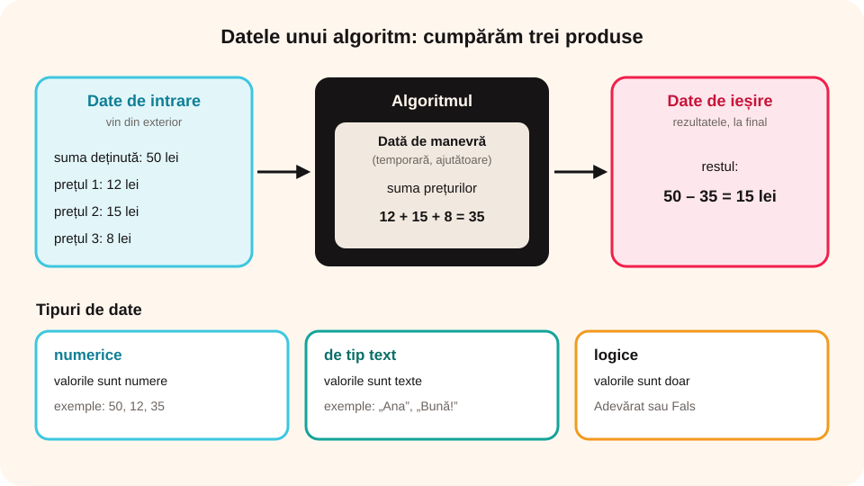

## Ce vei învăța azi

- ce sunt **datele** unui algoritm: **de intrare**, **de ieșire** și **de manevră**;
- diferența dintre **constante** și **variabile**;
- ce **tipuri de date** există: numerice, de tip text, logice.

## Să ne amintim

Ai scris algoritmi secvențiali și algoritmi cu decizii. Ca să ajungi la rezultat, te gândești la **acțiuni** și la **ordinea** lor, dar și la **ce îți trebuie** ca să pornești.

## Lecția pe scurt

### Datele unui algoritm

Când cumperi ceva: pui bani în portofel, mergi la magazin, ceri produsul, plătești și primești produsul. **Banii** intră în algoritm, iar **produsul** iese din el.

**Datele** sunt informațiile cu care lucrează un algoritm:

- **date de intrare**: le primește algoritmul **din exterior**, ca să poată porni;
- **date de ieșire**: le dă algoritmul **la final**; sunt **rezultatele**;
- **date de manevră**: date **temporare**, de care algoritmul are nevoie ca să ajungă de la intrare la ieșire.

**Exemplu: lapte cu cacao.** Date de intrare: 6 g de cacao, 10 g de zahăr, 200 ml de lapte, o cană de 250 ml. Dată de ieșire: laptele cu cacao.

**Exemplu: cumpărarea a trei produse.** Ai o sumă de bani și vrei trei produse.

- date de intrare: suma ta și cele trei prețuri;
- dată de manevră: **suma prețurilor** (o calculezi doar ca să te ajute);
- dată de ieșire: câți bani îți rămân.

```
Start
Pasul 1: Introducem suma deținută și cele trei prețuri.
Pasul 2: Calculăm suma prețurilor.
Pasul 3: Dacă suma deținută < suma prețurilor,
            Atunci nu putem cumpăra cele trei produse.
            Altfel calculăm restul = suma deținută – suma prețurilor.
Stop
```



### Constante și variabile

**Exemplu: bancomatul.** Comisionul de retragere este **mereu 5 lei**.

- `si`: suma inițială de pe card (**variabilă**);
- `e`: suma pe care o retragi (**variabilă**);
- `c = 5`: comisionul (**constantă**);
- `sr = si – e – c`: suma rămasă (**variabilă**).

> **Constantele** nu își schimbă valoarea în timpul algoritmului (un comision fix, o reducere fixă, dimensiunile unui labirint). **Variabilele** își schimbă valoarea în timpul algoritmului (suma de pe card, distanța parcursă de un personaj).

- Fiecare constantă sau variabilă are un **nume**, care **nu se schimbă** pe parcursul algoritmului.
- Numele trebuie să fie **unic**: nu pot exista două date cu același nume în același algoritm.

### Tipuri de date

1. **numerice**: au ca valori **numere**;
2. **de tip text**: au ca valori **texte** (nume, propoziții);
3. **logice**: au valorile **Adevărat** sau **Fals**.

În calcule poți folosi doar date **de același tip**. De exemplu, nu poți aduna un număr cu un nume.

## Exemplu rezolvat

**Variabila B se schimbă după formula B = (B × 2 + 6) × 5. Valoarea inițială a lui B este 20. Care este noua valoare?**

B = (20 × 2 + 6) × 5 = (40 + 6) × 5 = 46 × 5 = **230**.

Aici **B** este **variabilă** (își schimbă valoarea), iar **2**, **6** și **5** sunt **constante**.

## Aplicații interactive

```categorii
# Algoritmul bancomatului: sortează datele.
Date de intrare variabile: suma inițială de pe card, suma pe care o retragi
Dată de intrare constantă: comisionul fix de 5 lei
Dată de ieșire (variabilă): suma rămasă pe card
```

```categorii
# Ce tip de date este?
Numerică: 125, -7, 1024
De tip text: Ana, Bună ziua!, București
Logică: Adevărat, Fals
```

```adevarat-fals
F: Datele de manevră sunt și date de ieșire. | Datele de manevră sunt temporare; ele ajută la calcul, dar nu sunt rezultatul.
A: Într-un algoritm de calcul al unui produs, rezultatul este dată de ieșire.
A: Datele de intrare pot fi variabile sau constante.
A: Valoarea unei variabile poate fi egală cu valoarea unei constante.
F: Numele unei variabile se poate schimba în timpul algoritmului. | Numele rămâne același; doar valoarea se schimbă.
```

```completare
# Calculează.
Pe card ai si = 200 de lei, retragi e = 50 de lei, comisionul este c = 5 lei. Rămân sr = [145] de lei. Dacă B = 20 și B = (B × 2 + 6) × 5, noua valoare a lui B este [230].
```

```quiz
# Alege răspunsul corect.
La algoritmul pentru cumpărarea a trei produse, suma prețurilor este:
- dată de intrare
* dată de manevră
- dată de ieșire
Explicație: O calculezi doar ca să afli dacă îți ajung banii și cât îți rămâne.

Care dată este constantă?
* comisionul fix de 5 lei la bancomat
- suma de bani de pe card
- distanța parcursă de un personaj în labirint
```

## Exersează

1. Ce sunt datele de intrare și datele de ieșire?
2. Care sunt datele de intrare și de ieșire când cumperi o ciocolată caldă de la un automat cu monede?
3. Modifică algoritmul pentru cumpărarea produselor, ca să verifici dacă îți ajung banii pentru **patru** produse. Care sunt datele de intrare, de manevră și de ieșire?
4. Scrie un algoritm care calculează **câtul** a două numere naturale. În ce caz **nu** se poate face împărțirea? Ce face algoritmul atunci?
5. La algoritmul bancomatului adaugă plata unei facturi `f`, cu un comision fix de 2 lei (`c1`). Câți bani rămân?
6. **Portofoliu:** scrie un algoritm care transformă o capacitate din MB în KB (1 MB = 1024 KB). Evidențiază datele de intrare, de ieșire, variabilele și constantele.

## Pe scurt

Datele unui algoritm sunt **de intrare** (de la început), **de ieșire** (rezultatele) și **de manevră** (temporare). **Constantele** nu se schimbă, **variabilele** se schimbă, iar fiecare are un **nume unic**. Datele pot fi **numerice**, **de tip text** sau **logice**.
