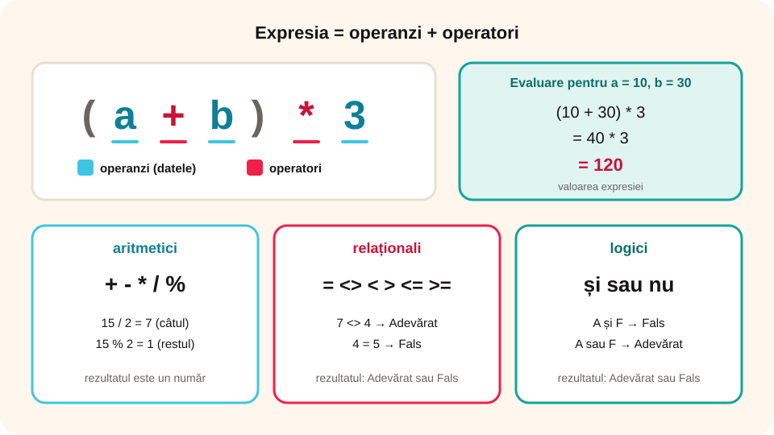

> **Competențe specifice (Anexa 15):** CS 2.1, CS 2.3

## Ce vei învăța azi

- ce sunt **operanzii**, **operatorii** și **expresiile**;
- operatorii **aritmetici**, **relaționali** și **logici** din informatică;
- să **evaluezi** o expresie, adică să îi afli valoarea.

## Să ne amintim

La matematică ai lucrat cu operații (+, –, ×, :) și cu comparații (=, ≠, <, >, ≤, ≥). De exemplu, 177 – 2 × (56 – 2) = 69, iar 2 × 3 < 7 este **adevărat**.

## Lecția pe scurt

### Definiții

- **Operanzii** sunt datele: constante, variabile sau expresii puse între paranteze.
- **Operatorii** arată ce operații se fac cu operanzii.
- O **expresie** este o combinație finită de operanzi și operatori.
- **Evaluarea expresiei** înseamnă calcularea rezultatului, iar rezultatul se numește **valoarea expresiei**.



### Operatorii aritmetici

| Operator | Înseamnă | Exemplu | Valoare |
|---|---|---|---|
| `+` | adunare | 4 + 5 | 9 |
| `-` | scădere | 7 - 4 | 3 |
| `*` | înmulțire | 3 * 6 | 18 |
| `/` | împărțire întreagă (câtul) | 14 / 2 | 7 |
| `%` | restul împărțirii întregi | 15 % 2 | 1 |

**Ordinea operațiilor:**

1. întâi **parantezele**, de la cele din interior spre exterior;
2. apoi `*`, `/`, `%`;
3. la final `+` și `-`.

Exemplu: (10 + 2) / 2 = 12 / 2 = **6**.

**Cu variabile:** dacă a = 10 și b = 30:

- a * b + b = 10 * 30 + 30 = **330**
- (a + b) * 3 = 40 * 3 = **120**
- ((b - a) + 2) / 2 = (20 + 2) / 2 = **11**
- ((b % a) + 4) * 3 = (0 + 4) * 3 = **12**

### Operatorii relaționali (de comparație)

`=` (egal), `<>` (diferit), `<` (mai mic), `>` (mai mare), `<=` (mai mic sau egal), `>=` (mai mare sau egal).

O expresie cu operatori relaționali are **valoarea de adevăr** **Adevărat** sau **Fals**:

- 4 = 5 → **Fals**
- 7 <> 4 → **Adevărat**
- a * b + b = 330 → **Adevărat** (pentru a = 10, b = 30)
- (a + b) * 3 < 50 → **Fals**, pentru că 120 nu este mai mic decât 50

### Operatorii logici: și, sau, nu

Fie P: „Joc fotbal” și Q: „Joc tenis”.

| P | Q | P **sau** Q | P **și** Q |
|---|---|---|---|
| A | A | A | A |
| A | F | A | F |
| F | A | A | F |
| F | F | F | F |

- **P sau Q** este adevărată dacă **cel puțin una** dintre propoziții este adevărată.
- **P și Q** este adevărată doar dacă **amândouă** sunt adevărate.
- **nu P** (negația) este adevărată când P este falsă și falsă când P este adevărată.

**Reguli pentru negație:**

- nu (P sau Q) = nu P **și** nu Q. „Nu joc nici fotbal, nici tenis.”
- nu (P și Q) = nu P **sau** nu Q.
- nu (a < b) = a >= b; nu (a > b) = a <= b; nu (a = b) = a <> b.

Expresiile logice și cele de comparație sunt folosite ca **condiții** în structurile decizionale.

## Exemplu rezolvat

**a = 12, b = 15, c = 9. Cât este (b + a) / c + 1?**

(15 + 12) / 9 + 1 = 27 / 9 + 1 = 3 + 1 = **4**.

**P este adevărată, Q falsă, R adevărată. Cât este (P sau Q) și R?**

(A sau F) = **A**, apoi A și A = **Adevărat**.

## Aplicații interactive

```categorii
# Ce fel de operator este?
Aritmetic: +, -, *, /, %
Relațional: =, <>, <, >, <=, >=
Logic: și, sau, nu
```

```completare
# Evaluează expresiile (a = 10, b = 30).
15 % 2 = [1]. (10 + 2) / 2 = [6]. a * b + b = [330]. (a + b) * 3 = [120]. ((b % a) + 4) * 3 = [12].
```

```adevarat-fals
# Valoarea de adevăr
F: 7 este număr impar și 13 este număr par. | „și” cere ca ambele să fie adevărate, dar 13 este impar.
A: Pământul se rotește în jurul Soarelui sau Soarele se rotește în jurul Pământului. | Pentru „sau” ajunge ca o propoziție să fie adevărată.
A: 1 = 1 și 7 < 12.
F: „+” și „–” sunt operatori relaționali. | Sunt operatori aritmetici.
A: „și”, „sau”, „nu” sunt operatori logici.
```

```quiz
# Calculează.
a = 12, b = 15, c = 9. Cât este (b + a) / c + 1?
- 3
* 4
- 20
- 0

P adevărată, Q falsă, R adevărată. Cât este (P sau Q) și R?
* Adevărat
- Fals

Care expresie este echivalentă cu nu (x > y)?
- x < y
* x <= y
- x <> y
```

```categorii
# Asociază expresiile echivalente.
x >= y: (x > y) sau (x = y)
nu (x > y): x <= y
x <> y: nu (x = y)
```

## Exersează

1. Fie P: „Îmi plac merele” și Q: „Îmi plac perele”. Fă tabelul de adevăr pentru P și Q, P sau Q, nu Q.
2. Scrie negația propozițiilor „9 + 19 = 28” și „După miercuri urmează joi”.
3. Ce înseamnă „Nu joc fotbal sau tenis” comparat cu „Nu joc nici fotbal, nici tenis”?
4. **Portofoliu:** scrie câte trei exemple de expresii cu operatori aritmetici, relaționali și logici și evaluează-le.

## Pe scurt

Operatorii **aritmetici** (`+ - * / %`) dau numere. Operatorii **relaționali** (`= <> < > <= >=`) și **logici** (**și**, **sau**, **nu**) dau **Adevărat** sau **Fals**. Expresia se evaluează începând cu **parantezele**, apoi `* / %` și la final `+ -`.
