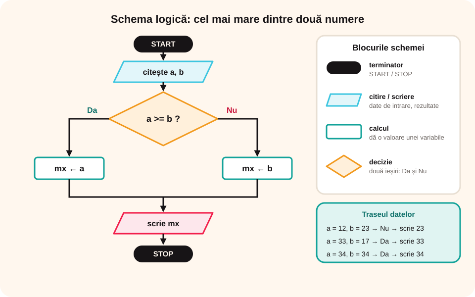

> **Competențe specifice (Anexa 15):** CS 2.2, CS 2.3

## Ce vei învăța azi

- cele trei moduri de a descrie un algoritm: **limbaj natural**, **pseudocod** și **schemă logică**;
- blocurile unei scheme logice;
- să **urmărești traseul datelor** printr-un algoritm, pentru diferite valori de intrare.

## Să ne amintim

Calculatorul rezolvă probleme cu ajutorul **programelor**. Înainte de a scrie un program, trebuie să scrii **algoritmul**.

## Lecția pe scurt

### Trei moduri de a descrie un algoritm

1. **Limbajul natural** (cum ai scris până acum): este cel mai simplu, dar e greu de urmărit la probleme complicate, poate fi neclar și nu îl înțelege cine nu vorbește limba.
2. **Pseudocodul (limbajul algoritmic)**: folosește **cuvinte standard** (`citește`, `scrie`, `dacă... atunci... altfel`, `repetă`, `sfârșit`) după reguli precise, adică după o **sintaxă**.
3. **Schema logică**: un **desen** din blocuri grafice legate prin săgeți.

### Blocurile schemei logice

| Bloc | Rol |
|---|---|
| **terminator** (START / STOP) | marchează începutul și sfârșitul |
| **de citire** | introduce datele de intrare |
| **de scriere** | afișează rezultatele |
| **de calcul** (dreptunghi) | dă o valoare unei variabile |
| **de decizie** (romb) | verifică o condiție; are două ieșiri, **Da** și **Nu** |

### Studiu de caz 1: cel mai mare dintre două numere

Date de intrare: `a`, `b`. Dată de ieșire: `mx`, cel mai mare număr.

**În limbaj natural:**

1. Introducem numerele a și b.
2. Dacă a este mai mare sau egal cu b,
3. Atunci mx primește valoarea lui a.
4. Altfel mx primește valoarea lui b.
5. Afișăm mx.

**În pseudocod:**

```
citește a, b (numere naturale)
dacă a >= b
   atunci mx ← a
   altfel mx ← b
scrie mx
```

Săgeata `←` înseamnă „**primește valoarea**” (atribuire).

**Schema logică:** START → citește a, b → romb `a >= b?` → pe **Da**: `mx ← a`; pe **Nu**: `mx ← b` → scrie mx → STOP.



**Traseul datelor:**

| Intrare | a >= b este | mx | Se afișează |
|---|---|---|---|
| a = 12, b = 23 | Fals | b = 23 | 23 |
| a = 33, b = 17 | Adevărat | a = 33 | 33 |
| a = 34, b = 34 | Adevărat | a = 34 | 34 |

### Studiu de caz 2: perimetrul pătratului

Se dă un număr natural a, latura pătratului. Latura **nu poate fi 0**, deci verificăm întâi acest lucru.

```
citește a (număr natural)
dacă a = 0
   atunci scrie „Număr incorect”
   altfel P ← 4 * a
          scrie P
```

| Intrare | a = 0 este | Se afișează |
|---|---|---|
| a = 0 | Adevărat | „Număr incorect” |
| a = 20 | Fals | P = 4 * 20 = **80** |

### Cum descrii în cuvinte ce face un algoritm

Când primești un algoritm scris de altcineva, îl poți explica în **limbaj natural** urmând patru pași:

1. **Ce date primește?** (datele de intrare)
2. **Ce calcule face, în ordine?** (secvența de operații)
3. **Ce condiții verifică și ce se întâmplă pe fiecare ramură?** (deciziile)
4. **Ce afișează la final?** (datele de ieșire)

**Exemplu:**

```
citește n (număr natural)
dacă n % 2 = 0
   atunci scrie „par”
   altfel scrie „impar”
```

**Descrierea:** algoritmul primește un număr natural n. Calculează restul împărțirii lui n la 2 și verifică dacă este egal cu 0. Dacă da, numărul se împarte exact la 2 și se afișează „par”; altfel se afișează „impar”. **Pe scurt: algoritmul spune dacă un număr este par sau impar.**

## Exemplu rezolvat

**Care este rezultatul pentru a = 3, b = 2, c = 9?**

```
citește a, b, c
dacă b > 7 atunci r ← (a + b) * c
altfel
   dacă a > 0 atunci r ← c % a + b
   altfel scrie „Nu avem rezultat”
```

- b > 7 → 2 > 7 este **Fals**, deci mergem pe „altfel”.
- a > 0 → 3 > 0 este **Adevărat**, deci r ← 9 % 3 + 2 = 0 + 2 = **2**.

## Aplicații interactive

```cartonase
# Blocurile schemei logice
Terminator = START și STOP: începutul și sfârșitul algoritmului.
Bloc de citire = Introduce datele de intrare.
Bloc de scriere = Afișează rezultatele.
Bloc de calcul = Dă o valoare unei variabile (atribuire).
Bloc de decizie = Romb care verifică o condiție; are ieșirile Da și Nu.
```

```completare
# Urmărește traseul datelor (maximul a două numere).
Pentru a = 12, b = 23 se afișează [23]. Pentru a = 33, b = 17 se afișează [33]. La perimetrul pătratului, pentru a = 20 se afișează [80], iar pentru a = 0 se afișează „Număr [incorect]”.
```

```quiz
# Alege răspunsul corect.
Reprezentarea grafică a unui algoritm cu ajutorul blocurilor se numește:
- pseudocod
* schemă logică
- program

Care este rezultatul algoritmului pentru n = 9? „dacă n < 8 atunci (dacă n > 5 atunci scrie ## altfel scrie #) altfel scrie ###”
- #
- ##
* ###
Explicație: 9 < 8 este Fals, deci se execută ramura „altfel”: scrie ###.

Un algoritm primește 12 și 10 și dă 22; primește 2 și 2 și dă 4; primește 4 și 30 și dă 34. Care este regula?
* adună cele două numere
- înmulțește cele două numere
- scade al doilea număr din primul
```

```ordonare
# Pune în ordine pseudocodul pentru maximul a două numere.
citește a, b
dacă a >= b
atunci mx ← a
altfel mx ← b
scrie mx
```

```adevarat-fals
A: În pseudocod, „mx ← a” înseamnă că mx primește valoarea lui a.
F: Blocul de decizie are o singură ieșire. | Are două ieșiri: Da și Nu.
A: Ultima cifră a unui număr natural este restul împărțirii lui la 10 (x % 10).
```

```quiz
# Ce face algoritmul? Alege descrierea corectă.
„citește a, b; dacă a < b atunci scrie b - a altfel scrie a - b”
- afișează suma numerelor
* afișează diferența dintre numărul mai mare și cel mai mic
- afișează mereu a - b
Explicație: Dacă a < b, scade a din b; altfel scade b din a. Rezultatul nu este niciodată negativ.

„citește x; dacă x >= 5 atunci scrie „promovat” altfel scrie „nepromovat””
* verifică dacă o notă este de trecere
- calculează media
- afișează nota mărită cu 5

„citește l; dacă l > 0 atunci P ← 4 * l, scrie P altfel scrie „Eroare””
- calculează aria unui pătrat
* calculează perimetrul unui pătrat, dacă latura este pozitivă
- afișează mereu „Eroare”
```

```eseu
Descrie în limbaj natural, pas cu pas, ce face algoritmul următor și spune pe scurt ce problemă rezolvă: „citește a, b, c; mx ← a; dacă b > mx atunci mx ← b; dacă c > mx atunci mx ← c; scrie mx”. Urmărește apoi traseul datelor pentru a = 4, b = 9, c = 7 și pentru a = 8, b = 2, c = 8.
Cuvinte: 50-180
Barem: datele de intrare a, b, c și de ieșire mx; mx primește întâi valoarea lui a; se compară pe rând b și c cu mx și, dacă sunt mai mari, mx primește valoarea lor; algoritmul afișează cel mai mare dintre cele trei numere; traseul: pentru 4, 9, 7 → mx devine 4, apoi 9, rămâne 9 → afișează 9; pentru 8, 2, 8 → mx = 8, 2 > 8 fals, 8 > 8 fals → afișează 8.
```

## Exersează

1. Modifică Studiul de caz 1 astfel încât să afișeze **maximul a trei numere**.
2. Scrie algoritmul și schema logică pentru interschimbarea valorilor a două variabile a și b. Exemplu: intrare a = 10, b = 20; ieșire a = 20, b = 10. Gândește-te la regula celor 3 pahare!
3. Afișează **ultima cifră** a unui număr x, folosind `%`. Exemplu: x = 345 → 5.
4. Calculează-ți **media** pe semestru din trei note. Exemplu: 9, 10, 10 → media 9,67, care rotunjită dă 10.
5. Se dau a și b. Dacă **ambele sunt pare**, afișează triplul sumei lor; dacă **ambele sunt impare**, afișează diferența lor; altfel, afișează câtul împărțirii lui a la b.
6. **Portofoliu:** care sunt datele de intrare, de ieșire și cazurile speciale în algoritmul care afișează **predecesorul** și **succesorul** unui număr natural? (Indiciu: 0 nu are predecesor natural.)

## Pe scurt

Un algoritm se poate descrie în **limbaj natural**, în **pseudocod** (`citește`, `dacă`, `scrie`, `←`) sau prin **schemă logică** (blocuri: terminator, citire, scriere, calcul, decizie). **Traseul datelor** îți arată ce se întâmplă pas cu pas, pentru valori date.
