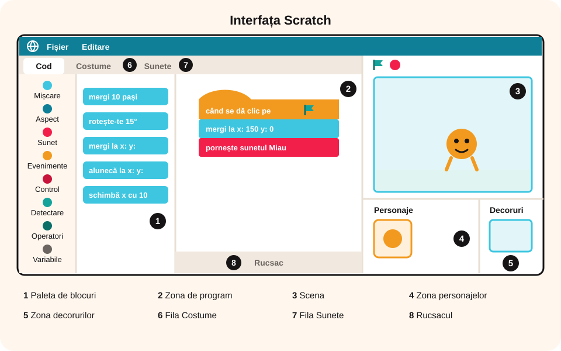
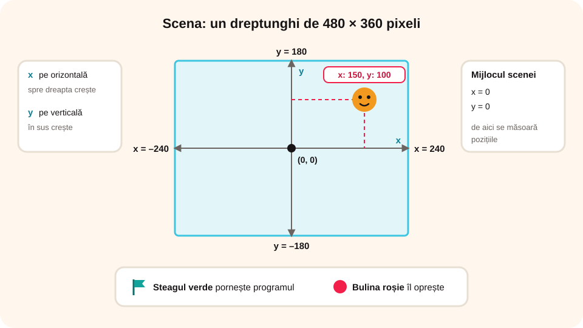

## Ce vei învăța azi

- ce este un **mediu de dezvoltare** și ce este **Scratch**;
- care sunt părțile **interfeței Scratch** și ce categorii de blocuri există;
- să faci **primul tău program** în Scratch.

## Să ne amintim

Ai învățat ce este un algoritm și cum îl scrii. Acum vei transforma algoritmii în **programe** pe care le execută calculatorul.

## Lecția pe scurt

### Medii de dezvoltare și Scratch

Un **mediu de dezvoltare** este un set de programe în care poți **scrie, executa și testa** un program. Unele sunt **medii grafice interactive**, foarte ușor de folosit: **Scratch**, ScratchJr, Blockly, Alice.

**Scratch** a fost creat la **MIT Media Lab** (SUA), iar prima versiune a apărut în **mai 2007**. Este făcut pentru copiii de 8–16 ani, ca să creeze programe, jocuri, povești interactive și animații.

Scratch este un **limbaj de programare vizual**: programele se fac **îmbinând blocuri colorate**, ca piesele unui puzzle. Mai multe blocuri lipite între ele formează un **script**.

> **Știai că?** Numele vine de la „scratching”, tehnica prin care DJ-ii mișcă discurile de vinil ca să creeze efecte sonore. La fel, în Scratch combini blocuri, sunete și imagini ca să creezi un program.

### Cum intri în Scratch

- **online**: pe `https://scratch.mit.edu/`, apeși **Creează**;
- **offline**: îl instalezi de pe `https://scratch.mit.edu/download`.

Cu butonul cu **globul pământesc** alegi **limba română**. Personajul care apare la fiecare proiect nou este **pisoiul Scratch**.

### Interfața Scratch

1. **Paleta de blocuri**: blocurile, grupate pe categorii, fiecare cu culoarea ei;
2. **Zona de program**: aici tragi blocurile (**drag and drop**) și construiești scripturile;
3. **Scena**: aici vezi rezultatul;
4. **Zona personajelor**;
5. **Zona decorurilor**;
6. **Fila Costume**;
7. **Fila Sunete**;
8. **Rucsacul**: muți personaje, sunete și scripturi dintr-un proiect în altul.



### Categoriile de blocuri

| Categorie | La ce folosește |
|---|---|
| **Mișcare** | poziția și direcția personajelor |
| **Aspect** | cum arată personajele (costume, mesaje, efecte) |
| **Sunet** | sunetele |
| **Evenimente** | ce declanșează scripturile (steagul verde, o tastă, un clic) |
| **Control** | execuția programului (așteptare, decizii, repetări) |
| **Detectare** | interacțiunea cu ce e în jur (atingere, întrebări) |
| **Operatori** | calcule și comparații |
| **Variabile** | variabilele |
| **Blocurile mele** | blocuri create de tine |
| **Extensii** | blocuri în plus: **Muzică**, **Creion**, Detectare video, Text în vorbire, Traducere |

### Scena

- Scena este un dreptunghi de **480 × 360 pixeli**. Un **pixel (px)** este un punct mic dintr-o imagine (*PICture ELement*).
- Poziția unui personaj se dă prin **coordonatele x** (pe orizontală) și **y** (pe verticală), măsurate față de **mijlocul scenei**, unde x = 0 și y = 0.
- **Steagul verde** pornește programul, iar **bulina roșie** îl oprește.



### Personaje, costume, decoruri

- Un personaj îl poți **încărca** de pe calculator, alege **Surpriză**, **desena** sau **alege** din bibliotecă.
- Un personaj poate avea mai multe **costume** (ipostaze). O **animație** este o succesiune de costume.
- Decorurile se gestionează la fel ca personajele.

### Instrucțiunile se execută în ordine

Un personaj poate avea **mai multe scripturi**. Blocurile dintr-un script se execută **unul după altul, de sus în jos**. Un bloc se șterge cu clic dreapta → **Șterge** sau trăgându-l înapoi în paletă.

### Meniul Fișier

**Nou**, **Salvează acum**, **Salvează o copie**, **Încarcă de pe calculator**, **Salvează pe calculatorul tău**. Proiectele Scratch au extensia `.sb3`. Ca să **partajezi** un proiect cu comunitatea Scratch îți trebuie un cont (doar cu acordul părinților).

## Exemplu rezolvat: primul program

1. Din **Evenimente** tragi blocul „când se dă clic pe steagul verde”.
2. Din **Mișcare** tragi „mergi la x: … y: …” și îl lipești dedesubt; scrii **x = 150**.
3. Din **Sunet** tragi „pornește sunetul Miau”.
4. Apeși **steagul verde**: pisoiul se mută la dreapta și miaună. 🎉

## Aplicații interactive

```categorii
# În ce categorie găsești blocul?
Mișcare: mergi la x y, alunecă la x y
Aspect: spune Bună!, schimbă costumul
Evenimente: când se dă clic pe steagul verde, când tasta spațiu este apăsată
Sunet: pornește sunetul
```

```quiz
# Alege răspunsul corect.
Ce dimensiune are scena în Scratch?
* 480 × 360 pixeli
- 360 × 240 pixeli
- 640 × 480 pixeli

Ce este un script în Scratch?
- un personaj
* mai multe blocuri lipite între ele
- un decor

Ce extensie are un proiect Scratch salvat pe calculator?
- .jpg
* .sb3
- .txt

Ce butoane pornesc și opresc programul?
* steagul verde și bulina roșie
- butonul Creează și rucsacul
- fila Costume și fila Sunete
```

```cartonase
# Părțile interfeței Scratch
Paleta de blocuri = Blocurile, grupate pe categorii colorate.
Zona de program = Aici tragi blocurile și construiești scripturile.
Scena = Aici vezi rezultatul programului (480 × 360 px).
Costum = O ipostază a unui personaj; mai multe costume fac o animație.
Rucsacul = Muți personaje, sunete și scripturi între proiecte.
```

```ordonare
# Primul program: pune blocurile în ordine.
când se dă clic pe steagul verde
mergi la x: 150 y: 0
pornește sunetul Miau
```

```adevarat-fals
A: Scratch este un limbaj de programare vizual.
A: Poți încărca în Scratch, ca personaj, un desen făcut în Paint.
F: Un personaj poate avea un singur script. | Un personaj poate avea mai multe scripturi.
A: Blocurile dintr-un script se execută de sus în jos.
```

## Exersează

1. Creează proiectul `PrimulProiect`. Parcurge toate categoriile, trage blocuri în zona de program, apoi șterge-le.
2. Fă primul program din exemplul rezolvat. Adaugă un alt personaj și un decor. Salvează proiectul pe calculator.
3. Deschide trei proiecte din comunitatea Scratch. Ce personaje au? Ce scripturi?
4. Cum încarci în Scratch un desen făcut în Paint?
5. Cum și unde salvezi un program Scratch?
6. **Portofoliu:** salvează programul din exemplul rezolvat ca `Proiect1.sb3` în folderul `Portofoliu`.

## Pe scurt

**Scratch** este un limbaj vizual: îmbini **blocuri** în **scripturi**. Interfața are **paleta de blocuri**, **zona de program**, **scena** (480 × 360 px, cu coordonatele x și y) și zonele pentru **personaje** și **decoruri**. **Steagul verde** pornește programul.
