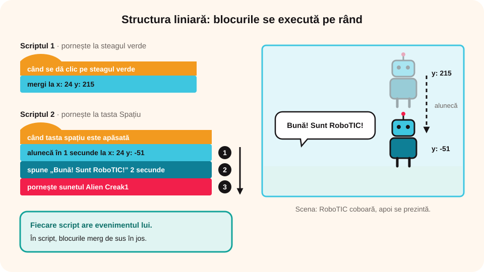

## Ce vei învăța azi

- să faci un program Scratch cu **structură liniară** (blocurile se execută pe rând, de sus în jos);
- să folosești **evenimente** diferite pentru scripturi diferite;
- să poziționezi, să faci să alunece, să vorbească și să scoată sunete un personaj.

## Să ne amintim

Într-un **algoritm secvențial**, acțiunile se execută una după alta, în ordinea în care apar:

```
Pasul 1: se execută acțiunea 1
Pasul 2: se execută acțiunea 2
...
Pasul n: se execută acțiunea n
```

## Lecția pe scurt

### Scripturi și evenimente

- Un personaj poate avea **mai multe scripturi**, fiecare pornit de alt **eveniment**: steagul verde, apăsarea unei taste, un clic pe personaj, atingerea marginii.
- Și **decorurile** pot avea scripturi.
- În fiecare script, blocurile se execută **liniar**, de sus în jos.

### Program: „RoboTIC se prezintă”

**Problema:** RoboTIC (robotul desenat de tine în Paint) coboară din partea de sus a ecranului. Când ajunge pe pământ, se prezintă copiilor.

**Pregătire:**

1. Ștergi pisoiul Scratch (coșul de gunoi de lângă personaj).
2. **Încarci un personaj**: `RoboTIC.jpg` din folderul `Lucru`.
3. **Încarci un decor**: `decor1.jpg`.
4. Îl pui pe RoboTIC la **x = 24, y = 215**, cu corpul ieșit în afara scenei.
5. Adaugi din bibliotecă un **nor (Cloud)** la **x = 20, y = 167**, ca să-i ascundă picioarele.

**Scriptul 1**, la steagul verde, pune personajul la locul de start:

```
când se dă clic pe steagul verde
mergi la x: 24 y: 215
```

**Scriptul 2**, la tasta Spațiu: RoboTIC coboară, se prezintă și scoate un sunet, pe rând:

```
când tasta spațiu este apăsată
alunecă în 1 secunde la x: 24 y: -51
spune „Bună! Sunt RoboTIC!” timp de 2 secunde
pornește sunetul Alien Creak1
```

- **alunecă** (din *Mișcare*) mută personajul treptat, în timpul dat;
- **spune** (din *Aspect*) afișează un mesaj într-un balon;
- sunetul îl alegi din **fila Sunete → Alege un sunet** și îl folosești cu blocul din *Sunet*.

Salvezi proiectul ca `Prezentare RoboTIC.sb3`. Apeși **steagul verde**, apoi **Spațiu**.

> **Fundalul transparent:** RoboTIC a fost desenat pe fundal alb. Pe un cer albastru s-ar vedea dreptunghiul alb din jurul lui. De aceea personajele au de obicei **fundal transparent**.



### Sunetul tău

Dacă ai microfon: **fila Sunete → Înregistrare**, apeși **Înregistrează**, apoi **Oprește** și **Salvează**. Sunetul apare în lista personajului.

## Exemplu rezolvat

**Un personaj pornește de la x = 10, y = 10 și alunecă pe rând la stânga, la dreapta, în sus și în jos, apoi scoate un sunet.**

```
când se dă clic pe steagul verde
mergi la x: 10 y: 10
alunecă în 1 secunde la x: -100 y: 10
alunecă în 1 secunde la x: 100 y: 10
alunecă în 1 secunde la x: 100 y: 120
alunecă în 1 secunde la x: 100 y: -100
pornește sunetul Pop
```

Este o **structură liniară**: blocurile se execută **unul după altul**.

## Aplicații interactive

```ordonare
# Scriptul 2 al lui RoboTIC: pune blocurile în ordine.
când tasta spațiu este apăsată
alunecă în 1 secunde la x: 24 y: -51
spune „Bună! Sunt RoboTIC!”
pornește sunetul Alien Creak1
```

```quiz
# Alege răspunsul corect.
Ce face blocul „alunecă în 1 secunde la x: 24 y: -51”?
- mută personajul instantaneu
* mută personajul treptat, într-o secundă, până la punctul dat
- rotește personajul
Explicație: y = -51 înseamnă 51 de pixeli mai jos de mijlocul scenei.

Ce înseamnă y = 215 pentru RoboTIC?
* personajul este foarte sus, parțial în afara scenei
- personajul este în mijlocul scenei
- personajul este la marginea stângă

De ce se folosesc personaje cu fundal transparent?
- ca să ocupe mai puțin loc
* ca să nu se vadă un dreptunghi alb în jurul lor pe decor
- ca să se miște mai repede
```

```adevarat-fals
F: O structură liniară în Scratch poate conține blocuri dintr-o singură categorie. | Poate conține blocuri din orice categorii: Mișcare, Aspect, Sunet etc.
A: Un personaj poate avea mai multe scripturi, fiecare putând fi o structură liniară.
A: Scratch are o bibliotecă de sunete care pot fi folosite în scripturi.
A: Poți înregistra propria voce în fila Sunete, dacă ai microfon.
```

```categorii
# Ce eveniment pornește scriptul?
Steagul verde: RoboTIC se pune la locul de start
Tasta spațiu: RoboTIC coboară și se prezintă
```

## Exersează

1. Adaugă alt sunet pentru momentul în care RoboTIC aterizează.
2. Adaugă un script la tasta „a” cu blocul „modifică efectul culoare cu 25” din *Aspect*. Ce se întâmplă? Încearcă și alte efecte.
3. Adaugă încă două personaje (unul **Surpriză**, unul ales de tine) care intră pe scenă din părți diferite și se prezintă.
4. Fă programul din exemplul rezolvat.
5. **Portofoliu:** caută în comunitatea Scratch un program cu structuri liniare și descrie cum funcționează.

## Pe scurt

Într-un program cu **structură liniară**, blocurile se execută **pe rând, de sus în jos**. Fiecare script pornește la un **eveniment** (steagul verde, o tastă), iar blocurile din *Mișcare*, *Aspect* și *Sunet* fac personajul să se miște, să vorbească și să scoată sunete.
