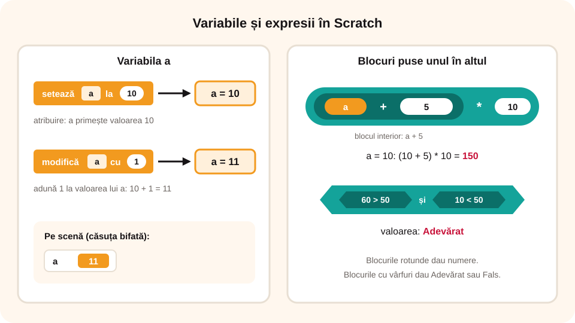

> **Competențe specifice (Anexa 15):** CS 3.2

## Ce vei învăța azi

- să **creezi** o variabilă în Scratch, să îi **dai o valoare** și să o **modifici**;
- să construiești **expresii** cu blocurile din categoria **Operatori**;
- să folosești extensia **Creion (Stilou)** ca să desenezi.

## Să ne amintim

**Constantele** nu își schimbă valoarea în timpul algoritmului, **variabilele** da. Ele pot fi operanzi în expresii cu operatori **aritmetici**, **relaționali** și **logici**.

## Lecția pe scurt

### Variabilele în Scratch (categoria Variabile)

1. **Creezi** o variabilă cu butonul **Creează o variabilă** și îi dai un nume. Dacă bifezi căsuța de lângă ea, valoarea apare pe scenă.
2. **Îi dai o valoare** cu blocul **„setează [a] la (10)”**; aceasta este **atribuirea**.
3. **O modifici** cu blocul **„modifică [a] cu (1)”**, care adună 1 la valoarea ei.

### Operatorii (categoria Operatori)

| Tip | Blocuri |
|---|---|
| aritmetici | `( ) + ( )`, `( ) - ( )`, `( ) * ( )`, `( ) / ( )`, `( ) mod ( )` (restul împărțirii) |
| relaționali | `( ) < ( )`, `( ) > ( )`, `( ) = ( )` |
| logici | `< > și < >`, `< > sau < >`, `nu < >` |

Blocurile se pot **pune unul în altul**: tragi al doilea bloc în locul unui operand din primul. Așa construiești **expresii complexe**. Expresiile logice și relaționale vor fi **condiții** în structurile decizionale.

**Exemple** (a = 10):

| Expresie | Valoare |
|---|---|
| 10 + (3 * (20 - 3)) | 61 |
| (a + 5) * 10 | 150 |
| (60 > 50) și (10 < 50) | Adevărat |
| nu (a < 5) | Adevărat |



### Programul „RoboOperații”

Variabilelor **a** și **b** li se dau valori la început, iar RoboTIC spune suma, diferența, produsul, câtul și restul.

```
când se dă clic pe steagul verde
setează [a] la 20
setează [b] la 6
spune (alătură „a+b=” (a + b)) timp de 2 secunde
spune (alătură „a-b=” (a - b)) timp de 2 secunde
spune (alătură „a*b=” (a * b)) timp de 2 secunde
spune (alătură „a/b=” (a / b)) timp de 2 secunde
spune (alătură „a mod b=” (a mod b)) timp de 2 secunde
```

Blocul **„alătură () ()”** lipește un text de o valoare. De exemplu, „a+b=” lângă 26 dă „a+b=26”.

> **Atenție:** în Scratch, blocul `/` dă rezultatul **cu zecimale**: 20 / 6 = 3,333... Restul împărțirii îl afli cu `mod`: 20 mod 6 = 2.

### „Stiloul magic” (extensia Creion)

Adaugi extensia **Creion** cu butonul **Adaugă o extensie**. Cele mai importante blocuri:

- **„pune creionul jos”**: de acum, personajul **desenează** când se mișcă;
- **„ridică creionul”**: personajul **nu mai desenează**.

Mai sunt blocuri pentru **culoarea** și **grosimea** liniei. În „Stiloul magic”, personajul Bit este condus cu **săgețile**. La fiecare pas desenează o linie, iar grosimea de pornire este dată de o variabilă **x**.

## Exemplu rezolvat

**Calculează:** `(100 – 7 * 54) + 2 * (2 + 7 * 8)`

- 7 * 54 = 378, deci 100 – 378 = **–278**;
- 7 * 8 = 56, deci 2 + 56 = 58, iar 2 * 58 = **116**;
- –278 + 116 = **–162**.

În Scratch construiești expresia din blocuri de operatori puse unul în altul și o pui într-un bloc „spune”, la apăsarea tastei 1.

## Aplicații interactive

```categorii
# Ce face blocul sau butonul?
Atribuire: setează a la 10
Modificare: modifică a cu 1
Creare: Creează o variabilă
```

```completare
# Evaluează (a = 10).
10 + (3 * (20 - 3)) = [61]. (a + 5) * 10 = [150]. 20 mod 6 = [2]. (100 - 7 * 54) + 2 * (2 + 7 * 8) = [-162|–162|−162].
```

```quiz
# Alege răspunsul corect.
Variabila scor are valoarea 5. Se execută „modifică [scor] cu 3”. Ce valoare are scor?
- 3
* 8
- 15

Ce valoare are expresia (60 > 50) și (10 < 50)?
* Adevărat
- Fals

Ce face blocul „pune creionul jos”?
- șterge desenul
* personajul începe să deseneze când se mișcă
- schimbă culoarea personajului

În ce categorie găsești blocurile pentru calcule și comparații?
- Variabile
* Operatori
- Control
```

```adevarat-fals
A: Blocul „alătură () ()” lipește un text de o valoare.
F: Valoarea unei variabile nu se poate afișa pe scenă. | Bifezi căsuța de lângă variabilă și valoarea apare pe scenă.
A: Blocurile de operatori se pot pune unul în altul, ca să formezi expresii complexe.
```

## Exersează

1. Care sunt tipurile de operatori din Scratch?
2. Modifică programul RoboOperații: dă alte valori lui a și b și urmărește rezultatele.
3. Fă un script în care un personaj afișează rezultatul expresiei (100 – 7 * 54) + 2 * (2 + 7 * 8), la apăsarea tastei 1. Salvează-l ca `Operatie1.sb3`.
4. Fă un script cu trei variabile, în care personajul spune suma lor. Salvează-l ca `Suma.sb3`.
5. Adaugă extensia Creion și fă un personaj care desenează un pătrat.
6. **Portofoliu:** copiază `Operatie1.sb3` și `Suma.sb3` în folderul `Portofoliu`.

## Pe scurt

În Scratch **creezi** variabile, le **setezi** (atribuire) și le **modifici**. Cu blocurile din **Operatori** construiești expresii aritmetice, relaționale și logice, iar **„alătură”** lipește un text de o valoare. Extensia **Creion** îți permite să desenezi.
