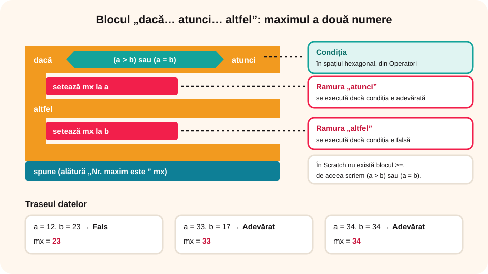

## Ce vei învăța azi

- să folosești blocurile **„dacă… atunci”** și **„dacă… atunci… altfel”** din categoria **Control**;
- să **citești date** de la tastatură cu blocul **„întreabă și așteaptă”**;
- să programezi **maximul a două numere** și un **joc de tip labirint**.

## Să ne amintim

Structura alternativă: **Dacă** condiția este adevărată, **Atunci** se execută secvența A, **Altfel** secvența B. Uneori lipsește ramura **Altfel**.

## Lecția pe scurt

### Blocurile de decizie

În categoria **Control** există **două** blocuri de decizie:

- **„dacă < > atunci”**: are o singură ramură;
- **„dacă < > atunci … altfel …”**: are două ramuri.

**Condiția** (o expresie relațională sau logică, din *Operatori* sau *Detectare*) se pune în spațiul **hexagonal** mai închis la culoare. E mai ușor să construiești întâi condiția și apoi să o tragi la locul ei.

### A. Maximul dintre două numere

```
citește a, b
dacă a >= b
   atunci mx ← a
   altfel mx ← b
scrie mx
```

**Pașii în Scratch:**

1. Creezi variabilele **a**, **b**, **mx**.
2. La steagul verde, le **inițializezi cu 0** (script pus pe decor).
3. Citești valorile: blocul **„întreabă (Care este primul număr?) și așteaptă”** din *Detectare*. Ce scrie utilizatorul ajunge în blocul **„răspuns”**, apoi: **„setează [a] la (răspuns)”**. La fel pentru b.
4. Construiești condiția **a >= b**. În Scratch nu există blocul `>=`, așa că o scrii ca **(a > b) sau (a = b)**.
5. Pui structura **„dacă… atunci… altfel”**: pe *atunci* „setează [mx] la (a)”, pe *altfel* „setează [mx] la (b)”.
6. Afișezi: **„spune (alătură „Nr. maxim este ” (mx))”** și pornești un sunet de felicitare.



### B. Deplasarea printr-un labirint

Pereții labirintului și obstacolele sunt desenate cu **negru**, ca un zid, iar ieșirea este marcată cu **roșu**. Personajul se mișcă cu **săgețile**, câte **5 pixeli**.

```
Dacă personajul atinge culoarea neagră
   Atunci se întoarce la pasul anterior
   Altfel
      Dacă personajul atinge culoarea roșie
         Atunci spune „Bravo!”
```

Pentru **săgeata dreapta**, de exemplu:

```
când tasta săgeată dreapta este apăsată
modifică x cu 5
dacă < atinge culoarea negru? > atunci
   modifică x cu -5
altfel
   dacă < atinge culoarea roșu? > atunci
      spune „Bravo!”
```

Pentru stânga: x cu **–5**; pentru sus: y cu **5**; pentru jos: y cu **–5**. Aici o decizie este **cuprinsă în alta**.

## Exemplu rezolvat

**Traseul datelor** pentru maximul a două numere:

| a | b | (a > b) sau (a = b) | mx | RoboX spune |
|---|---|---|---|---|
| 12 | 23 | Fals | 23 | „Nr. maxim este 23” |
| 33 | 17 | Adevărat | 33 | „Nr. maxim este 33” |
| 34 | 34 | Adevărat | 34 | „Nr. maxim este 34” |

## Aplicații interactive

```ordonare
# Programul „Maxim”: pune pașii în ordine.
Creezi variabilele a, b și mx
La steagul verde le inițializezi cu 0
Citești a și b cu „întreabă și așteaptă”
Verifici condiția (a > b) sau (a = b)
Setezi mx la a sau la b
Personajul spune maximul
```

```quiz
# Alege răspunsul corect.
În ce categorie găsești blocurile de decizie?
- Evenimente
* Control
- Mișcare

Câte tipuri de blocuri de decizie are Scratch?
- unul
* două: „dacă… atunci” și „dacă… atunci… altfel”
- patru

Ce condiție folosești în Scratch pentru a >= b?
* (a > b) sau (a = b)
- (a > b) și (a = b)
- nu (a > b)

În labirint, personajul apasă săgeata sus și atinge negrul. Ce trebuie să facă?
- modifică y cu 5
* modifică y cu -5, adică se întoarce
- spune „Bravo!”
```

```categorii
# Poate fi condiție într-un bloc „dacă”?
Da, este o condiție: a > b, atinge culoarea roșu?, (a = 0) sau (b = 0)
Nu, nu este o condiție: a + b, alătură text și număr, setează a la 5
```

```adevarat-fals
A: Ce scrie utilizatorul la „întreabă și așteaptă” ajunge în blocul „răspuns”.
F: Blocul „dacă… atunci” trebuie să aibă mereu și ramura „altfel”. | Există și varianta cu o singură ramură.
A: În jocul Labirint, o structură de decizie este cuprinsă în alta.
```

## Exersează

1. La ce folosește structura de decizie?
2. Dă câte un exemplu de folosire pentru fiecare dintre cele două blocuri de decizie din Scratch.
3. Modifică programul Labirint astfel încât pasul să nu mai fie mereu 5 px, ci o **variabilă** citită de la tastatură.
4. Lucru în grup: desenează în Paint propriul labirint, încarcă-l ca decor și programează un personaj să îl parcurgă.
5. Ce alte blocuri pentru detectarea marginii găsești în categoria *Detectare*?
6. **Portofoliu:** salvează proiectele `Maxim.sb3` și `Labirint.sb3` în folderul `Portofoliu`.

## Pe scurt

În Scratch, decizia se face cu **„dacă… atunci”** sau **„dacă… atunci… altfel”** (categoria **Control**). Condiția se construiește cu **Operatori** sau **Detectare**. Datele se citesc cu **„întreabă și așteaptă”** și **„răspuns”**.
