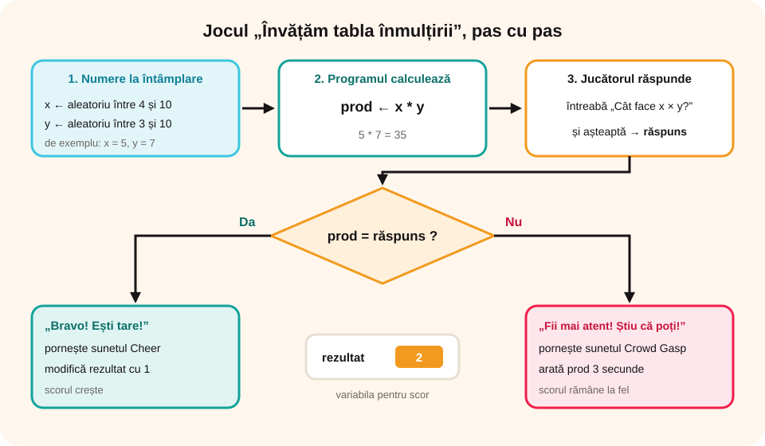

## Ce vei învăța azi

- să **analizezi** un joc educațional făcut în Scratch;
- să folosești blocul **„număr aleatoriu între … și …”**;
- să **îmbunătățești** un program, adăugând un **scor**.

## Să ne amintim

Știi să folosești **variabile**, **operatori**, blocul **„întreabă și așteaptă”** și structura **„dacă… atunci… altfel”**.

## Lecția pe scurt

### Jocul „Învățăm tabla înmulțirii”

**Ce face:** alege la întâmplare două numere, **x** (între 4 și 10) și **y** (între 3 și 10), și le afișează. Personajul RoboY te întreabă cât fac înmulțite.

- Dacă răspunzi **corect**: „Bravo! Ești tare!” și sunetul **Cheer**.
- Dacă răspunzi **greșit**: „Fii mai atent! Știu că poți!”, sunetul **Crowd Gasp** și, timp de 3 secunde, **răspunsul corect**.

**Datele:**

- de intrare: **x**, **y** și **răspuns** (ce scrie jucătorul);
- de ieșire: **prod** (produsul calculat de program).

**Scriptul**, care pornește la clic pe RoboY:

```
când se dă clic pe acest personaj
setează [x] la (număr aleatoriu între 4 și 10)
setează [y] la (număr aleatoriu între 3 și 10)
setează [prod] la (x * y)
întreabă „Cât face x × y?” și așteaptă
dacă < prod = răspuns > atunci
   spune „Bravo! Ești tare!”
   pornește sunetul Cheer
altfel
   spune „Fii mai atent! Știu că poți!”
   pornește sunetul Crowd Gasp
   arată prod timp de 3 secunde
```



### Traseul datelor

| x | y | prod | răspuns | prod = răspuns | Ce se întâmplă |
|---|---|---|---|---|---|
| 5 | 7 | 35 | 35 | Adevărat | „Bravo! Ești tare!”, Cheer |
| 6 | 8 | 48 | 30 | Fals | „Fii mai atent!”, Crowd Gasp, apare 48 |

### Îmbunătățire: scorul

1. Creezi variabila **rezultat** și o afișezi pe scenă.
2. La steagul verde: **„setează [rezultat] la 0”**.
3. Pe ramura de răspuns **corect** adaugi: **„modifică [rezultat] cu 1”**.

| x | y | prod | răspuns | Corect? | rezultat |
|---|---|---|---|---|---|
| 5 | 7 | 35 | 35 | da | 0 + 1 = **1** |
| 6 | 8 | 48 | 30 | nu | rămâne **1** |
| 4 | 3 | 12 | 12 | da | 1 + 1 = **2** |

## Exemplu rezolvat

**Ce schimbi ca să ai doar exerciții din tabla înmulțirii cu 5?**

Înlocuiești „setează [x] la (număr aleatoriu între 4 și 10)” cu **„setează [x] la 5”**. Acum **x** devine practic o **constantă** (mereu 5), iar **y**, **prod** și **răspuns** rămân **variabile**.

## Aplicații interactive

```completare
# Urmărește programul.
x = 7, y = 6. Variabila prod primește valoarea [42]. Jucătorul scrie 42, deci condiția prod = răspuns este [Adevărat|adevărată]. Scorul era 3 și devine [4].
```

```quiz
# Alege răspunsul corect.
x = 6, y = 8, jucătorul scrie 30. Ce se întâmplă?
- „Bravo! Ești tare!”
* „Fii mai atent! Știu că poți!” și apare răspunsul corect, 48
- programul se oprește

Ce modifici ca exercițiile să poată avea și factorii 1 și 2?
* limitele de jos ale numerelor aleatorii, de exemplu „număr aleatoriu între 1 și 10”
- sunetele
- numele personajului

Pe ce ramură adaugi „modifică [rezultat] cu 1”?
* pe ramura „atunci”, pentru răspunsul corect
- pe ramura „altfel”
- înainte de întrebare
```

```categorii
# Date de intrare sau dată de ieșire?
Date de intrare: x, y, răspuns
Dată de ieșire: prod
```

```ordonare
# Pune în ordine blocurile jocului.
setează x la un număr aleatoriu între 4 și 10
setează y la un număr aleatoriu între 3 și 10
setează prod la x * y
întreabă cât face x × y și așteaptă
dacă prod = răspuns atunci Bravo, altfel arată răspunsul corect
```

## Exersează

1. Lucru în grup: propuneți îmbunătățiri pentru joc, de exemplu animații, efecte grafice sau sunete înregistrate de voi pentru un frate mai mic.
2. Ce modificări faci ca factorii să poată fi și 1 și 2?
3. Adaptează programul pentru **tabla împărțirii**. Atenție: împărțitorul trebuie să fie diferit de 0, iar împărțirea trebuie să fie fără rest. Indiciu: alege întâi câtul și împărțitorul, apoi calculează deîmpărțitul = cât × împărțitor.
4. Fă un program care transformă capacitatea unui hard-disk: la tasta 1 o afișează în MB, la tasta 2 în KB (1 MB = 1024 KB).
5. **Portofoliu:** salvează proiectul `Tabla înmulțirii` în folderul `Portofoliu`.

## Pe scurt

Jocul folosește **numere aleatorii**, **variabile** (x, y, prod, răspuns), **„întreabă și așteaptă”** și **„dacă… atunci… altfel”** ca să verifice răspunsul. Cu variabila **rezultat** ții **scorul**: o pornești de la 0 și o mărești cu 1 la fiecare răspuns corect.
