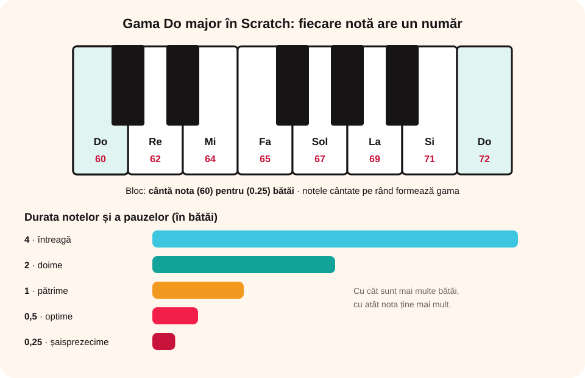

## Ce vei învăța azi

- să adaugi extensia **Muzică**;
- să alegi un **instrument** și să cânți **note** cu o anumită **durată**;
- să programezi **gama Do major** și să adaugi **pauze**.

## Să ne amintim

Până acum ai folosit sunetele din categoria **Sunet**. Acum vei compune muzică!

## Lecția pe scurt

### Extensia Muzică

Apeși **Adaugă o extensie** (jos, în stânga) și alegi **Muzică**. Primești blocuri noi:

- **„setează instrumentul la (1) Pian”**: alegi instrumentul (pian, chitară, violoncel, flaut, saxofon, cor...);
- **„cântă nota (60) pentru (0.25) bătăi”**: cânți o notă cu o durată;
- **„pauză (0.25) bătăi”**: o pauză între note;
- **„setează tempoul la ()”**: viteza cântecului.

Când dai clic pe numărul notei, apare o **claviatură de pian** din care alegi nota.

### Notele și numerele lor

| Notă | Do | Re | Mi | Fa | Sol | La | Si | Do |
|---|---|---|---|---|---|---|---|---|
| joase | 48 | 50 | 52 | 53 | 55 | 57 | 59 | 60 |
| înalte | 60 | 62 | 64 | 65 | 67 | 69 | 71 | 72 |

### Durata notelor și a pauzelor

| Durată (bătăi) | 4 | 2 | 1 | 0,5 | 0,25 |
|---|---|---|---|---|---|
| Nota / pauza | întreagă | doime | pătrime | optime | șaisprezecime |



### Gama Do major la pian

```
când se dă clic pe steagul verde
setează instrumentul la (1) Pian
cântă nota 60 pentru 0.25 bătăi   (Do)
cântă nota 62 pentru 0.25 bătăi   (Re)
cântă nota 64 pentru 0.25 bătăi   (Mi)
cântă nota 65 pentru 0.25 bătăi   (Fa)
cântă nota 67 pentru 0.25 bătăi   (Sol)
cântă nota 69 pentru 0.25 bătăi   (La)
cântă nota 71 pentru 0.25 bătăi   (Si)
cântă nota 72 pentru 0.25 bătăi   (Do)
```

Este un **algoritm secvențial**: notele sunt cântate una după alta. Pentru pauze intercalezi blocul **„pauză (…) bătăi”**.

## Exemplu rezolvat

**Gama Do major în ordine inversă, la saxofon:**

```
setează instrumentul la (11) Saxofon
cântă nota 72 (Do) → 71 (Si) → 69 (La) → 67 (Sol) → 65 (Fa) → 64 (Mi) → 62 (Re) → 60 (Do)
```

Folosești aceleași blocuri, dar notele merg **descrescător**, de la 72 la 60.

## Aplicații interactive

```categorii
# Ce număr are nota? (octava de la 60 la 72)
Do: 60
Re: 62
Mi: 64
Fa: 65
Sol: 67
La: 69
Si: 71
```

```ordonare
# Gama Do major: pune notele în ordine.
Do (60)
Re (62)
Mi (64)
Fa (65)
Sol (67)
La (69)
Si (71)
Do (72)
```

```adevarat-fals
A: Din extensia Muzică poți alege instrumentul cu care se cântă.
F: Durata unei note nu poate fi schimbată. | O alegi în al doilea câmp al blocului „cântă nota”, de exemplu 0.25 sau 1 bătaie.
A: Pentru a adăuga extensia Muzică apeși butonul „Adaugă o extensie”.
```

```quiz
# Alege răspunsul corect.
Ce durată în bătăi are o notă întreagă?
* 4
- 1
- 0,25

Ce număr are nota Do înalt, de după Si (71)?
- 70
* 72
- 60

Cum adaugi o pauză între două note?
- cu blocul „spune”
* cu blocul „pauză (…) bătăi”
- cu steagul verde
```

## Exersează

1. Încearcă toate instrumentele din listă. Care îți plac cel mai mult?
2. Schimbă durata notelor din gamă și adaugă pauze. Creează-ți propria variantă.
3. Pune blocul „setează tempoul la ()” la început și mărește treptat valoarea. Ce se întâmplă?
4. Dă cinci exemple de instrumente pe care le poți folosi în Scratch.
5. Programează melodia „În pădurea cu alune” după partitura din manual.
6. **Portofoliu:** caută partitura unui cântec care îți place și programează-l să cânte la clic pe un personaj. Salvează-l ca `Cantecel.sb3`.

## Pe scurt

Cu extensia **Muzică** alegi **instrumentul** și cânți **note** (Do = 60, Re = 62, Mi = 64, Fa = 65, Sol = 67, La = 69, Si = 71, Do = 72) cu o **durată** în bătăi (4, 2, 1, 0,5, 0,25). Între note poți pune **pauze**.
