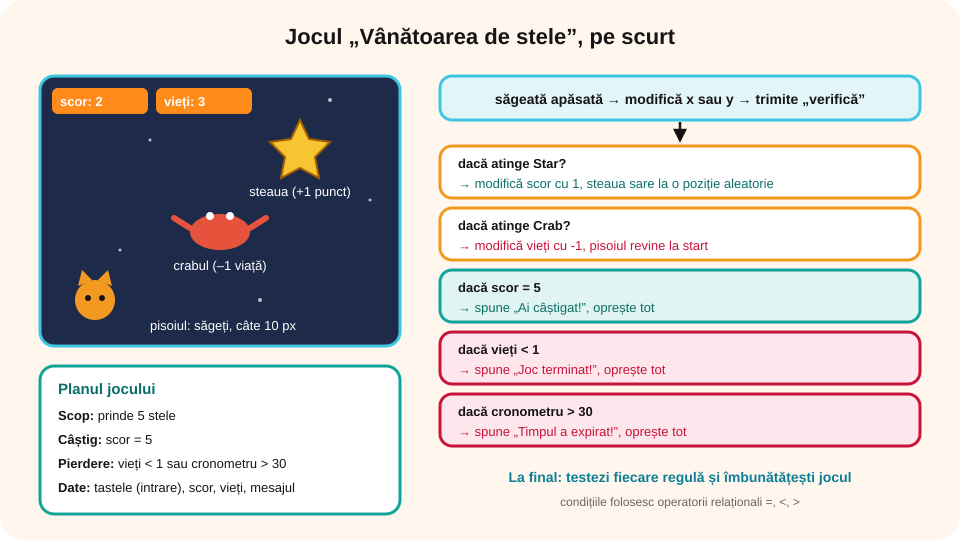

> **Competențe specifice (Anexa 15):** CS 2.2, CS 3.2, CS 3.3

## Ce vei învăța azi

- cum **planifici** un joc: scopul, regulile, cum se câștigă și cum se pierde;
- să construiești pas cu pas un **joc digital** în Scratch, cu **secvențe** de blocuri și **decizii**;
- să folosești **variabile** pentru **scor** și **vieți** și **operatori relaționali** în condiții (`=`, `<`, `>`);
- să **testezi** jocul și să îl **îmbunătățești**.

## Să ne amintim

- Blocurile dintr-un script se execută **pe rând**, de sus în jos (structura liniară).
- Blocul **„dacă < > atunci”** execută blocurile din interior doar dacă **condiția** este adevărată.
- **„setează [scor] la 0”** dă o valoare unei variabile, iar **„modifică [scor] cu 1”** o mărește.
- Blocul **„număr aleatoriu între … și …”** alege un număr la întâmplare.

## Lecția pe scurt

### Pasul 1. Planificăm jocul

Înainte de a programa, scrie pe caiet **planul jocului**. Așa știi exact ce ai de făcut.

| Ce stabilești | În jocul „Vânătoarea de stele” |
|---|---|
| **Scopul** | pisoiul trebuie să prindă **5 stele** |
| **Personajele** | pisoiul (jucătorul), steaua, crabul (obstacolul) |
| **Comenzile** | pisoiul se mișcă cu **săgețile**, câte 10 pixeli |
| **Regulile** | o stea prinsă = **+1 punct**, iar steaua sare în alt loc; atingerea crabului = **–1 viață**, iar pisoiul revine la start |
| **Câștig** | scor = 5 |
| **Pierdere** | vieți = 0 **sau** au trecut mai mult de 30 de secunde |
| **Datele** | de intrare: tastele apăsate de jucător; variabile: **scor**, **vieți**; de ieșire: mesajul final și scorul afișat pe scenă |



### Pasul 2. Pregătim scena

1. Creezi un proiect nou și îl salvezi ca `VanatoareaDeStele.sb3`.
2. Alegi un **decor** din bibliotecă, de exemplu **Stars** (cer înstelat).
3. Păstrezi **pisoiul** și îl micșorezi la **50%** (câmpul *Mărime*).
4. Adaugi din bibliotecă personajele **Star** (steaua) și **Crab**. Pui crabul în mijlocul scenei (x: 0, y: 0).

### Pasul 3. Creăm variabilele

Din categoria **Variabile** → **Creează o variabilă**: **scor** și **vieți**, „pentru toate personajele”. Lasă bifate căsuțele, ca jucătorul să le vadă pe scenă.

### Pasul 4. Pornirea jocului (scriptul pisoiului)

```
când se dă clic pe steagul verde
setează [scor] la 0
setează [vieți] la 3
mergi la x: -200 y: -130
spune „Prinde 5 stele în 30 de secunde! Ferește-te de crab!” timp de 3 secunde
resetează cronometrul
```

Este o **secvență**: blocurile se execută pe rând. **Ordinea contează**: cronometrul pornește de la 0 abia după ce jucătorul a citit regulile.

### Pasul 5. Mișcarea cu săgețile

Pentru fiecare săgeată faci câte un script. La final, fiecare **trimite mesajul „verifică”** (din *Evenimente*), ca toate verificările să stea într-un singur loc:

```
când tasta săgeată dreapta este apăsată
modifică x cu 10
trimite mesajul [verifică]
```

Stânga: x cu **–10**. Sus: y cu **10**. Jos: y cu **–10**.

### Pasul 6. Deciziile jocului

Tot la pisoi, scriptul care pornește când primește mesajul „verifică”:

```
când primesc [verifică]
dacă < atinge [Star]? > atunci
   modifică [scor] cu 1
   pornește sunetul Collect
   trimite mesajul [stea nouă]
dacă < atinge [Crab]? > atunci
   modifică [vieți] cu -1
   pornește sunetul Oops
   mergi la x: -200 y: -130
dacă < (scor) = 5 > atunci
   spune „Ai câștigat!” timp de 2 secunde
   oprește [tot]
dacă < (vieți) < 1 > atunci
   spune „Joc terminat!” timp de 2 secunde
   oprește [tot]
dacă < (cronometru) > 30 > atunci
   spune „Timpul a expirat!” timp de 2 secunde
   oprește [tot]
```

- `scor = 5`, `vieți < 1`, `cronometru > 30` sunt condiții cu **operatori relaționali** (din *Operatori*).
- Blocul **„cronometru”** este în *Detectare*; el numără secundele de la ultima resetare.
- **„oprește [tot]”** (din *Control*) oprește toate scripturile: jocul s-a terminat.
- Verificările se fac **după fiecare mișcare** a pisoiului. Dacă jucătorul nu apasă nicio tastă, timpul expirat se anunță la următoarea apăsare. (În clasa a VI-a vei învăța **repetiția**, cu care poți verifica timpul tot timpul.)

### Pasul 7. Steaua care sare

Scripturile **stelei**:

```
când se dă clic pe steagul verde
mergi la x: 100 y: 50

când primesc [stea nouă]
mergi la x: (număr aleatoriu între -220 și 220) y: (număr aleatoriu între -160 și 160)
```

Numerele aleatorii sunt alese astfel încât steaua să rămână pe scenă (scena are x între –240 și 240 și y între –180 și 180).

### Pasul 8. Testăm jocul

Un programator **testează** fiecare regulă. Completează un tabel ca acesta:

| Ce fac | Ce ar trebui să se întâmple | Merge? |
|---|---|---|
| ating steaua | scorul crește cu 1, steaua sare în alt loc | ✓ / ✗ |
| ating crabul | viețile scad cu 1, pisoiul revine la start | ✓ / ✗ |
| prind 5 stele | „Ai câștigat!”, jocul se oprește | ✓ / ✗ |
| ating crabul de 3 ori | „Joc terminat!” | ✓ / ✗ |
| aștept peste 30 de secunde, apoi apăs o săgeată | „Timpul a expirat!” | ✓ / ✗ |

Dacă ceva nu merge, cauți greșeala (de exemplu, ai scris `-10` în loc de `10`) și testezi din nou.

### Pasul 9. Îmbunătățiri (pentru cei curajoși)

- **Crabul se mută și el**: când primește mesajul „stea nouă”, crabul alunecă într-un loc ales la întâmplare.
- **Bonus**, cu o **condiție compusă**: `dacă < (scor = 5) și (cronometru < 15) > atunci spune „Super rapid!”`.
- **Niveluri**: când scorul ajunge la 3, schimbi decorul și mărești pasul pisoiului.
- Un **decor de final**, diferit pentru câștig și pentru pierdere.

## Exemplu rezolvat

**Urmărește jocul.** La început scor = 0 și vieți = 3. Jucătorul prinde două stele, atinge o dată crabul, apoi mai prinde trei stele în 25 de secunde. Ce se întâmplă?

- după două stele: scor = **2**, vieți = 3;
- după crab: scor = 2, vieți = **2**, pisoiul revine la start;
- după încă trei stele: scor = **5** → condiția `scor = 5` este **adevărată** → pisoiul spune „Ai câștigat!”, iar jocul se oprește.
- Condiția `cronometru > 30` nu a mai contat: 25 > 30 este **fals**, iar jocul se oprise oricum.

## Aplicații interactive

```ordonare
# Etapele creării jocului, în ordine.
Planifici jocul: scop, reguli, câștig și pierdere
Alegi decorul și personajele
Creezi variabilele scor și vieți
Programezi pornirea jocului
Programezi mișcarea cu săgețile
Programezi deciziile: stea, crab, câștig, pierdere
Testezi fiecare regulă
Îmbunătățești și salvezi jocul
```

```categorii
# Eveniment, acțiune sau condiție?
Eveniment: când se dă clic pe steagul verde, când tasta săgeată dreapta este apăsată, când primesc verifică
Acțiune: modifică scor cu 1, mergi la x: -200 y: -130, oprește tot
Condiție: atinge Star?, scor = 5, cronometru > 30
```

```quiz
# Urmărește jocul.
Scorul este 4. Pisoiul atinge steaua. Ce se întâmplă?
- scorul rămâne 4
* scorul devine 5, iar pisoiul spune „Ai câștigat!”
- pisoiul pierde o viață
Explicație: Scorul crește la 5, deci condiția scor = 5 devine adevărată.

Viețile sunt 1 și pisoiul atinge crabul. Ce condiție devine adevărată?
* vieți < 1
- scor = 5
- cronometru > 30
Explicație: Viețile devin 0, iar 0 < 1 este adevărat: „Joc terminat!”.

De ce resetăm cronometrul DUPĂ ce pisoiul spune regulile?
* ca jucătorul să aibă 30 de secunde întregi de joc
- ca jocul să fie mai greu
- nu contează ordinea
Explicație: Într-o secvență, ordinea blocurilor contează.

Ce face blocul „trimite mesajul [verifică]”?
- afișează textul „verifică” pe scenă
* pornește scripturile care încep cu „când primesc [verifică]”
- oprește jocul
```

```completare
# Completează.
Blocul care dă variabilei scor valoarea 0 este „[setează] [scor] la 0”. Ca să mărești scorul cu 1 folosești „[modifică] [scor] cu 1”. Jocul se câștigă când scor [=] 5. Blocul care numără secundele se numește [cronometru]. Ca să oprești toate scripturile folosești „oprește [tot]”.
```

```adevarat-fals
A: Înainte de a programa un joc, este bine să îi scrii planul: scop, reguli, câștig, pierdere.
F: Condiția „cronometru > 30” este adevărată după exact 30 de secunde. | Este adevărată doar după ce trec mai mult de 30 de secunde.
A: Variabilele scor și vieți trebuie setate la începutul fiecărui joc.
F: Un joc nu trebuie testat dacă blocurile sunt puse corect. | Testarea arată greșelile pe care nu le vezi doar citind scripturile.
A: În condiția „(scor = 5) și (cronometru < 15)”, ambele părți trebuie să fie adevărate.
```

```eseu
Proiectul tău: creează în Scratch un joc simplu, diferit de „Vânătoarea de stele” (de exemplu, un pește care prinde boabe și fuge de rechin, sau un fluture care adună flori). Cerințe: cel puțin două personaje și un decor; o variabilă pentru scor; mișcare cu tastele; cel puțin trei decizii, dintre care una cu o condiție compusă (și / sau); un mesaj de câștig și unul de pierdere. Scrie aici planul jocului (scop, personaje, comenzi, reguli, câștig, pierdere, date), apoi descrie pe scurt cum l-ai testat.
Cuvinte: 80-250
Barem: plan complet și coerent (scop, personaje, comenzi, reguli, condiții de câștig și de pierdere, datele de intrare și variabilele); decizii descrise cu operatori relaționali corecți (=, <, >); o condiție compusă folosită logic; scorul pornește de la 0 la începutul jocului; testarea fiecărei reguli, cu ce s-a corectat; jocul este salvat ca fișier .sb3.
```

## Exersează

1. Construiește jocul „Vânătoarea de stele” urmând pașii 2–8. Completează tabelul de testare.
2. Schimbă regula de câștig: jucătorul câștigă la **10** stele și are **45** de secunde. Ce blocuri modifici?
3. Adaugă o a doua stea, de altă culoare, care valorează **2 puncte**.
4. Fă crabul să alunece la o poziție aleatorie de fiecare dată când este prinsă o stea.
5. Joacă jocul unui coleg și dă-i două sugestii de îmbunătățire.
6. **Portofoliu:** salvează jocul ca `VanatoareaDeStele.sb3` în folderul `Portofoliu`.

## Pe scurt

Un joc se face **pas cu pas**: îl **planifici** (scop, reguli, câștig, pierdere), pregătești **scena**, creezi **variabilele** (scor, vieți), programezi **pornirea**, **mișcarea** și **deciziile** cu operatori relaționali (`scor = 5`, `vieți < 1`, `cronometru > 30`), apoi îl **testezi** și îl **îmbunătățești**.
