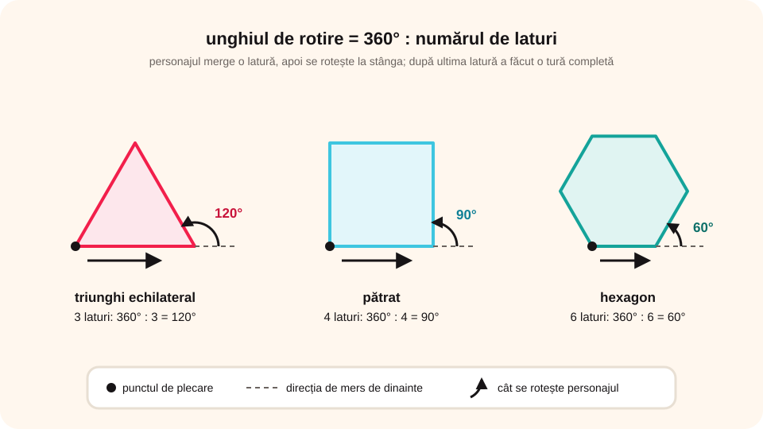

> **Competențe specifice (Anexa 15):** CS 2.1

## Ce vei învăța azi

- să-ți amintești ce este un **algoritm** și caracteristicile lui;
- să desenezi în Scratch cu extensia **Stilou**, folosind **structura secvențială**;
- formula unghiului pentru o **figură cu laturi egale**: **360° : numărul de laturi**;
- să folosești o **structură de decizie** pentru a schimba culoarea;
- să **validezi** un număr introdus de la tastatură.

## Să ne amintim

**Algoritmul** este o succesiune de pași bine precizați, prin care rezolvi o problemă. Are: **claritate**, **generalitate**, **finitudine**, **ordine** a pașilor, **unicitate** și **eficiență**.

Până acum ai folosit două structuri:

- **secvențială** (liniară): pașii se fac unul după altul;
- **de decizie** (alternativă): **dacă** o condiție e adevărată, **atunci** faci ceva, **altfel** altceva.

**Scena Scratch** are **480 × 360** pixeli. Mijlocul scenei are coordonatele **(0, 0)**.

## Lecția pe scurt

### A. Desenarea unei scări

Personajul „merge” pe drumul scării și lasă urmă cu **stiloul**. O treaptă înseamnă două linii perpendiculare: înaintezi, te rotești cu **90°**, înaintezi din nou, te rotești înapoi.

**Date de intrare:** **n**, lungimea unei trepte în pași, număr natural nenul.

```
când tasta spațiu este apăsată
îndreaptă-te în direcția 0     (în sus)
stilou jos
mergi n pași          (urci treapta)
rotește-te dreapta 90°
mergi n pași          (pasul pe treaptă)
rotește-te stânga 90°
mergi n pași          (a doua treaptă)
rotește-te dreapta 90°
mergi n pași
stilou sus
```

Toți pașii sunt **secvențiali**, unul după altul.

### B. Figuri cu laturi egale



Pentru un **pătrat** cu latura de **100** de pași, de patru ori: **mergi 100 de pași**, apoi **rotește-te stânga 90°**.

De ce **90°**? Ca să te întorci de unde ai plecat, faci în total o rotație completă, de **360°**, împărțită în tot atâtea părți câte laturi are figura:

**unghiul = 360° : numărul de laturi**

| Figura | Laturi | Unghi |
|---|---|---|
| triunghi echilateral | 3 | 120° |
| pătrat | 4 | 90° |
| pentagon | 5 | 72° |
| hexagon | 6 | 60° |
| octogon | 8 | 45° |

Cu cât figura are mai multe laturi, cu atât latura trebuie să fie mai **scurtă**, ca figura să încapă pe scenă.

### C. Culoare aleatoare, cu o decizie

La apăsarea tastei **a**, variabila **culoare** primește un număr aleator, **1** sau **2**. După valoarea ei, stiloul își schimbă culoarea:

```
când tasta a este apăsată
setează culoare la (alege aleator între 1 și 2)
dacă culoare = 1 atunci
   setează culoarea stiloului la roșu
   spune „Desenez cu roșu”
altfel
   setează culoarea stiloului la albastru
   spune „Desenez cu albastru”
```

Este o structură de decizie **completă**: are și ramura **altfel**.

### D. Validarea unui număr natural nenul

Datele introduse de la tastatură trebuie **verificate**. Dacă programul așteaptă un număr natural nenul și cineva scrie un text, programul poate greși.

Pentru variabila **a** verificăm:

1. **e număr?** În Scratch, **a + 0** dă **0** când a nu e număr. Deci, dacă **a + 0 = a**, a este un număr.
2. **e pozitiv nenul?** **a > 0**.
3. **e natural (fără zecimale)?** **rotunjește(a) = a**.

Primele două le legăm cu operatorul logic **și**: (a + 0 = a) **și** (a > 0). Rezultatul e **Adevărat** doar dacă **ambele** condiții sunt adevărate.

| a | a+0=a | a>0 | rotunjește(a)=a | Rezultat |
|---|---|---|---|---|
| s | Fals | – | – | Ai greșit! |
| -2 | Adevărat | Fals | – | Ai greșit! |
| 0 | Adevărat | Fals | – | Ai greșit! |
| 2.3 | Adevărat | Adevărat | Fals | Ai greșit! |
| 12 | Adevărat | Adevărat | Adevărat | 12 este natural nenul |

## Exemplu rezolvat: hexagonul

1. Hexagonul are **6** laturi, deci unghiul este **360° : 6 = 60°**.
2. Alegi latura **50** de pași, ca figura să încapă pe scenă.
3. Scriptul: **stilou jos**, apoi de 6 ori „mergi 50 de pași, rotește-te stânga 60°”, apoi **stilou sus**.
4. Verifici: personajul se oprește exact în punctul de plecare.

## Aplicații interactive

```categorii
# Ce unghi de rotire folosești?
120°: triunghi echilateral
90°: pătrat
72°: pentagon
60°: hexagon
45°: octogon
```

```quiz
# Alege răspunsul corect.
Ce coordonate are mijlocul scenei Scratch?
* (0, 0)
- (240, 180)
- (480, 360)

Cum calculezi unghiul de rotire pentru o figură cu n laturi egale?
- 180° : n
* 360° : n
- 90° × n

Ce valoare are expresia (a + 0 = a) dacă a este textul „s”?
- Adevărat
* Fals
Explicație: Pentru un text, a + 0 dă 0, care nu este egal cu „s”.

Când este adevărată expresia (a + 0 = a) și (a > 0)?
- când cel puțin o condiție e adevărată
* doar când ambele condiții sunt adevărate
- niciodată
```

```completare
# Completează.
Pentru un pentagon unghiul de rotire este [72] de grade. Scena Scratch are lățimea de [480] de pixeli și înălțimea de [360] de pixeli. Ca personajul să lase urmă, folosești blocul stilou [jos].
```

```adevarat-fals
A: Desenarea scării folosește doar operații secvențiale.
F: Numărul 2.3 este natural nenul. | Are zecimale, deci rotunjește(2.3) nu este egal cu 2.3.
A: Structura „dacă… atunci… altfel” este o structură de decizie completă.
F: Cu cât o figură are mai multe laturi, cu atât latura trebuie să fie mai lungă. | Latura trebuie să fie mai scurtă, ca figura să încapă pe scenă.
```

## Exersează

1. Scrie un program care desenează un **triunghi echilateral**.
2. Construiește algoritmul pentru un **pentagon** și transpune-l în Scratch.
3. Desenează **trei pătrate**, unul în interiorul altuia.
4. Desenează un **cadou** din patru pătrate, cu o fundă din două triunghiuri.
5. Modifică programul cu culoarea aleatoare astfel încât numărul să fie între **1 și 5**, cu cinci culori diferite.
6. Un program citește **n1** și **n2** și spune „Egale” dacă sunt egale, altfel „Diferite”. Ce afișează pentru 456 și 356? Dar pentru 456 și 456?
7. **Portofoliu:** citește un număr natural **n**. Dacă **10 ≤ n ≤ 100**, desenează cu **roșu** o mașină (un dreptunghi și două cercuri); altfel, desenează cu **verde** o imagine cu un pătrat și trei cercuri.

## Verifică-te

- Care sunt caracteristicile unui algoritm?
- Ce trei condiții verifici ca să știi că un număr e natural nenul?

## Pe scurt

Un **algoritm** este un șir de pași clari. În Scratch desenezi cu **Stilou**: scara folosește pași **secvențiali**, iar o figură cu **n** laturi egale se desenează rotind cu **360° : n**. Cu **„dacă… atunci… altfel”** iei decizii (de exemplu, culoarea). Datele citite se **validează** cu condiții legate prin **și**.
