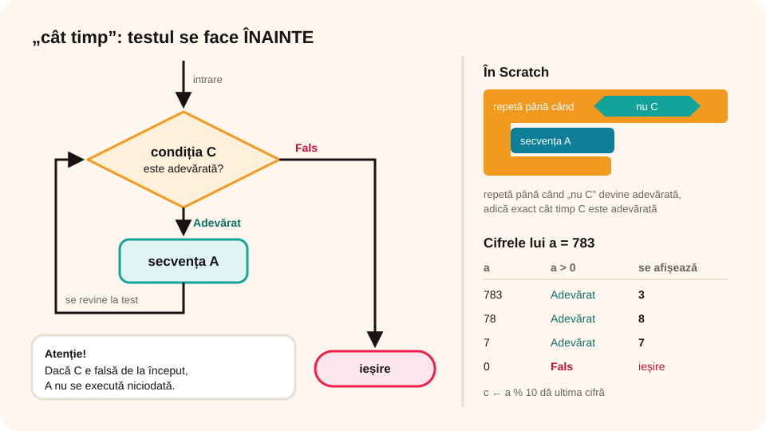

> **Competențe specifice (Anexa 15):** CS 2.1, CS 2.2, CS 2.3, CS 3.3

## Ce vei învăța azi

- ce este o **structură repetitivă** și ce înseamnă **iterație**;
- care sunt cele **trei tipuri** de structuri repetitive;
- cum funcționează structura **„cât timp”** (condiționată anterior, cu **test inițial**);
- cum o scrii în Scratch cu **„repetă până când”**;
- să folosești **operatorii relaționali** (<, >, =, ≤, ≥, ≠) în condiții și să **negi** o condiție;
- să afișezi **cifrele unui număr** în ordine inversă.

## Să ne amintim

Până acum ai folosit structura **secvențială** și structura **de decizie**. Uneori însă trebuie să repeți aceiași pași de mai multe ori.

## Lecția pe scurt

### Structura repetitivă

O **structură repetitivă** (ciclică) execută o secvență de pași **de mai multe ori**: **cât timp** o condiție este adevărată sau **până când** devine adevărată. O repetare se numește **iterație**.

**Trei tipuri:**

1. **condiționată anterior**: cu **test inițial**, număr **necunoscut** de pași;
2. **condiționată posterior**: cu **test final**, număr **necunoscut** de pași;
3. **cu contor**: număr **cunoscut** de pași.

### Structura „cât timp”



```
cât timp (condiția C) execută
   secvența A
```

**Cum funcționează:**

1. Se verifică **condiția C**.
2. Dacă C este **adevărată**, se execută **secvența A** și se revine la pasul 1.
3. Dacă C este **falsă**, se iese din structură.

**De reținut:**

- Testul se face **înainte**: dacă C este **falsă de la început**, secvența A **nu se execută niciodată**.
- În secvența A trebuie să se **schimbe** ceva din condiție, altfel bucla nu se oprește niciodată și programul **se blochează**.

### În Scratch: „repetă până când”

În categoria **Control** găsești blocul **„repetă până când < >”**. El repetă blocurile din interior **până când** condiția devine **adevărată**, adică **cât timp e falsă**. Testul se face tot **la început**.

De aceea, **„cât timp C”** din pseudocod devine în Scratch **„repetă până când < nu C >”**.

### Operatorii relaționali în condiții

Condiția unei structuri repetitive este, de obicei, o **comparație** între două valori. O scriem cu un **operator relațional**. Rezultatul comparației este **Adevărat** sau **Fals**.

| Operator | Se citește | Exemplu | Adevărat pentru a = 5? | În Scratch (Operatori) |
|---|---|---|---|---|
| **<** | mai mic decât | a < 10 | Adevărat | `( ) < ( )` |
| **>** | mai mare decât | a > 10 | Fals | `( ) > ( )` |
| **=** | egal cu | a = 5 | Adevărat | `( ) = ( )` |
| **≤** | mai mic sau egal | a ≤ 5 | Adevărat | `nu < (a) > (5) >` |
| **≥** | mai mare sau egal | a ≥ 6 | Fals | `nu < (a) < (6) >` |
| **≠** | diferit de | a ≠ 0 | Adevărat | `nu < (a) = (0) >` |

Scratch are doar **<**, **>** și **=**. Pe celelalte le construiești cu blocul **„nu”**: „mai mic sau egal” înseamnă „**nu** mai mare”, „mai mare sau egal” înseamnă „**nu** mai mic”, iar „diferit” înseamnă „**nu** egal”. Le poți scrie și cu **„sau”**: a ≤ 5 este (a < 5) **sau** (a = 5).

**Negarea unei condiții** (o folosești când treci de la „cât timp” la „repetă până când”):

| Condiția C | nu C |
|---|---|
| a > 0 | a ≤ 0 |
| a < 10 | a ≥ 10 |
| a = 7 | a ≠ 7 |
| a ≥ n | a < n |

**Exemple de condiții în bucle:**

- „cât timp **a > 0**”: cât timp numărul mai are cifre;
- „cât timp **i ≤ 10**”: cât timp contorul n-a trecut de 10;
- „repetă până când **răspuns = 7**”: până ghicești numărul;
- „cât timp **parola ≠ „tigru7”**”: cât timp parola introdusă e greșită.

**Atenție la limite!** „cât timp i < 10” și „cât timp i ≤ 10” diferă printr-o iterație: pentru i = 1, 2, 3, … prima se oprește după i = 9, a doua după i = 10.

### A. Cifrele unui număr, în ordine inversă

**Enunț:** se citește un număr natural nenul. Afișează-i cifrele începând cu cifra unităților.

**Date de intrare:** **a**, natural nenul. **Date de ieșire:** **c**, cifra afișată.

Folosim operatorul **%** pentru **restul împărțirii**: 8 % 3 = 2, 33 % 3 = 0, 783 % 10 = 3.

**Ideea:** cât timp numărul are cifre (**a > 0**):

- iei **ultima cifră**: c ← a % 10;
- o **afișezi**;
- o **elimini**: scazi cifra și împarți la 10.

```
citește a  (cu validare: natural nenul)
cât timp (a > 0) execută
   c ← a % 10
   scrie c
   a ← a – a % 10
   a ← a / 10
```

**Traseul datelor** pentru a = 783:

| Iterația | a | a > 0 | c | se afișează | a – a%10 | a / 10 |
|---|---|---|---|---|---|---|
| 1 | 783 | Adevărat | 3 | 3 | 780 | 78 |
| 2 | 78 | Adevărat | 8 | 8 | 70 | 7 |
| 3 | 7 | Adevărat | 7 | 7 | 0 | 0 |
| 4 | 0 | Fals | | | | |

Pașii se repetă de atâtea ori câte **cifre** are numărul.

### B. Câți pași face prințesa până la urs?

**Enunț:** o prințesă înaintează spre dreapta, cu pași de **15** pixeli, până **atinge** ursul. Câți pași face?

- **Date de intrare:** dimPas = 15.
- **Date de ieșire:** nrPasi.

Nu știm de la început câți pași sunt: depinde de distanță. Iar dacă prințesa atinge ursul **de la început**, nu face niciun pas. Deci folosim structura cu **test inițial**.

Scriptul, pus la personajul **Prințesa**:

```
când se dă clic pe steagul verde
setează dimPas la 15
setează nrPasi la 0
repetă până când < atinge Urs? >
   mergi (dimPas) pași
   modifică nrPasi cu 1
spune (alătură „Am făcut ” nrPasi)
```

Blocul **„atinge ( )?”** din **Detectare** devine adevărat când personajul atinge alt personaj, marginea scenei sau cursorul.

### C. Ghicește numărul

**Enunț:** calculatorul alege un număr între 1 și 20. Jucătorul încearcă să-l ghicească; după fiecare încercare află dacă numărul ascuns e **mai mare** sau **mai mic**. La final, calculatorul spune din câte încercări a reușit.

Aici condițiile folosesc trei operatori relaționali: **≠** (în buclă), **<** și **>** (în decizii).

```
secret ← aleator între 1 și 20
încercări ← 0
răspuns ← 0
cât timp (răspuns ≠ secret) execută
   citește răspuns
   încercări ← încercări + 1
   dacă (răspuns < secret) atunci scrie „Mai mare!”
   dacă (răspuns > secret) atunci scrie „Mai mic!”
scrie „Bravo! Ai ghicit din ”, încercări, „ încercări.”
```

În Scratch, „cât timp răspuns ≠ secret” devine **„repetă până când < (răspuns) = (secret) >”** (negarea lui ≠ este =). Răspunsul îl citești cu **„întreabă … și așteaptă”** din **Detectare**.

**Traseul datelor** pentru secret = 13:

| Încercarea | răspuns | răspuns ≠ 13 înainte de citire | Mesaj |
|---|---|---|---|
| 1 | 10 | Adevărat (0 ≠ 13) | Mai mare! |
| 2 | 15 | Adevărat (10 ≠ 13) | Mai mic! |
| 3 | 13 | Adevărat (15 ≠ 13) | (niciunul) |
| – | – | Fals (13 = 13) | Bravo! Ai ghicit din 3 încercări. |

## Exemplu rezolvat

Ce afișează algoritmul A pentru **a = 50**?

1. a = 50 > 0: c = 0, se afișează **0**; a devine 5.
2. a = 5 > 0: c = 5, se afișează **5**; a devine 0.
3. a = 0: condiția e falsă, se oprește.

Se afișează **0**, apoi **5**.

## Aplicații interactive

```ordonare
# Cum funcționează „cât timp”? Pune pașii în ordine.
Se verifică condiția
Dacă e adevărată, se execută secvența
Se revine la verificarea condiției
Când condiția devine falsă, se iese din structură
```

```quiz
# Alege răspunsul corect.
Cât este 457 % 10?
- 45
* 7
- 4

De câte ori se execută secvența din „cât timp (a > 0)” pentru a = 0?
* niciodată
- o dată
- la infinit

Ce trebuie să se întâmple în interiorul unei structuri repetitive?
- nimic special
* să se schimbe o variabilă din condiție, ca bucla să se oprească
- să se șteargă toate variabilele

În ce categorie Scratch este blocul „repetă până când”?
- Evenimente
* Control
- Operatori
```

```categorii
# Pentru a = 8, condiția este adevărată sau falsă?
Adevărat: a > 5, a ≤ 8, a ≠ 0, a ≥ 8, a < 10
Fals: a < 8, a = 9, a ≥ 10, a ≠ 8, a > 8
```

```completare
# Neagă condiția (scrie operatorul potrivit).
Negația lui a > 0 este a [≤|<=] 0. Negația lui i ≤ 10 este i [>] 10. Negația lui x = 5 este x [≠|!=] 5. În Scratch, „cât timp a ≠ 0” se scrie „repetă până când a [=] 0”.
```

```quiz
# Operatori relaționali în bucle
De câte ori se execută secvența „scrie i; i ← i + 1” în „cât timp i < 5” dacă i pornește de la 1?
- 5
* 4
- 6
Explicație: Se afișează 1, 2, 3, 4; pentru i = 5 condiția 5 < 5 este falsă.

Dar dacă condiția este „cât timp i ≤ 5”?
* 5
- 4
- 6

Cum scrii în Scratch condiția a ≥ 10?
- (a) > (10)
* nu < (a) < (10) >
- (a) = (10)

În jocul „Ghicește numărul”, bucla se oprește când:
- răspuns < secret
- răspuns ≠ secret
* răspuns = secret
```

```categorii
# Ce tip de structură repetitivă este?
Condiționată anterior: test inițial, poate avea zero iterații
Condiționată posterior: test final, cel puțin o iterație
Cu contor: număr cunoscut de pași
```

```adevarat-fals
A: Structura repetitivă condiționată anterior are un număr necunoscut de iterații.
F: Structura repetitivă condiționată anterior are minimum o iterație. | Dacă condiția e falsă de la început, nu are nicio iterație.
A: Dacă prințesa atinge ursul de la început, nrPasi rămâne 0.
A: O repetare a secvenței se numește iterație.
```

## Exersează

1. Care sunt cele trei tipuri de structuri repetitive?
2. Urmărește algoritmul A pentru **a = 76**. Ce se afișează?
3. Scrie în Scratch un program care afișează **câte cifre pare** are un număr natural nenul.
4. Scrie un program care afișează **câte cifre de 0** are un număr natural nenul.
5. Scrie un program care afișează **a cincea cifră** a unui număr de șapte cifre.
6. Mută personajele din jocul prințesei. Cum se schimbă **nrPasi**?
7. **Portofoliu:** modifică jocul prințesei astfel încât lungimea pasului să fie **citită de la tastatură**.
8. Fă în Scratch jocul **„Ghicește numărul”**. Apoi limitează-l: jucătorul are **cel mult 5 încercări** (bucla se oprește când a ghicit **sau** când încercări = 5). Ce condiție pui în „repetă până când”?
9. Scrie un program care cere o **parolă** până când utilizatorul o scrie corect. Ce operator relațional folosești în condiție?

## Verifică-te

- Care este negația condiției **a ≤ 10**? Cum scrii în Scratch **a ≠ 0**?
- Ce se întâmplă dacă condiția nu devine niciodată falsă?
- Cum scrii în Scratch „cât timp a > 0”?

## Pe scurt

O **structură repetitivă** repetă pași; o repetare este o **iterație**. Structura **„cât timp”** verifică condiția **înainte** de fiecare iterație, deci poate avea **zero** iterații. În Scratch folosești **„repetă până când”**, cu condiția **negată**. Condițiile folosesc **operatori relaționali** (<, >, =, ≤, ≥, ≠); în Scratch ai doar <, > și =, iar pe ceilalți îi faci cu **„nu”**. Cu **% 10** iei ultima cifră a unui număr.
