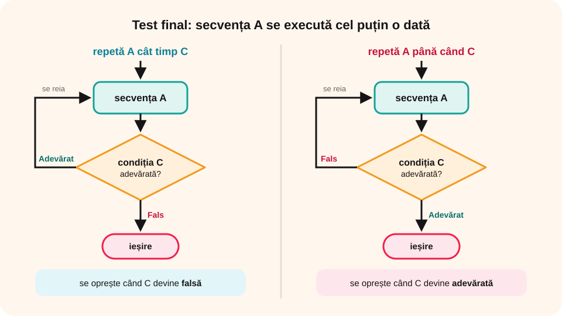

> **Competențe specifice (Anexa 15):** CS 2.2, CS 2.3, CS 3.3

## Ce vei învăța azi

- cum funcționează structura **condiționată posterior** (cu **test final**);
- diferența dintre **„repetă… cât timp”** și **„repetă… până când”**;
- cum **transformi** o structură repetitivă în alta;
- să calculezi **suma cifrelor** unui număr în Scratch.

## Să ne amintim

La structura **„cât timp”** condiția se verifică **înainte**, așa că secvența poate să **nu se execute** deloc. Ultima cifră a lui **a** este **a % 10**.

## Lecția pe scurt

### Două forme



**1. Repetă… cât timp**

```
repetă
   secvența A
cât timp (condiția C)
```

Se execută A, apoi se verifică C. Dacă C e **adevărată**, se reia; dacă e **falsă**, se iese.

**2. Repetă… până când**

```
repetă
   secvența A
până când (condiția C)
```

Se execută A, apoi se verifică C. Dacă C e **falsă**, se reia; dacă e **adevărată**, se iese.

**De reținut:**

- Testul se face **la final**, deci secvența A se execută **cel puțin o dată**.
- Și aici trebuie să se **schimbe** ceva din condiție, altfel bucla nu se termină.

### Transformări

Structurile se pot scrie una prin alta:

| Condiționată posterior | Echivalent cu test inițial |
|---|---|
| repetă A cât timp C | A, apoi: cât timp C execută A |
| repetă A până când C | A, apoi: cât timp **nu** C execută A |

Și invers: **„cât timp C execută A”** este la fel cu **„dacă C atunci (repetă A cât timp C)”**. Decizia asigură că A nu se execută când C e falsă de la început.

### În Scratch

Scratch **nu are** un bloc special cu test final. Folosim tot **„repetă până când”**. Dacă vrei neapărat ca pașii să se execute o dată, îi scrii o dată **înaintea** blocului.

### Suma cifrelor unui număr

**Enunț:** citești un număr natural nenul **a**. Afișează **suma cifrelor** lui.

**Date de intrare:** a. **Date de ieșire:** **S**, suma cifrelor.

**Ideea:** iei ultima cifră (a % 10), o **aduni** la S și o elimini din număr. Repeți **până când** a devine **0**.

```
citește a  (cu validare: natural nenul)
S ← 0
repetă
   S ← S + a % 10
   a ← a – a % 10
   a ← a / 10
cât timp (a ≠ 0)
scrie „Suma cifrelor este: ”, S
```

**Traseul datelor** pentru a = 113:

| Iterația | a la început | a % 10 | S | a la final | a ≠ 0 |
|---|---|---|---|---|---|
| 1 | 113 | 3 | 3 | 11 | Adevărat |
| 2 | 11 | 1 | 4 | 1 | Adevărat |
| 3 | 1 | 1 | 5 | 0 | Fals |

Rezultat: **„Suma cifrelor este: 5”**.

În Scratch, cele două blocuri care elimină ultima cifră (scăderea și împărțirea) pot fi înlocuite cu unul singur: **setează a la (podea din (a / 10))**. **Podea** înseamnă partea întreagă.

## Exemplu rezolvat

Transformă în structură cu test inițial:

```
repetă
   scrie i
   i ← i + 2
până când (i > 9)
```

1. Este o structură **„repetă… până când”**, deci A se execută o dată înainte de test.
2. Scrii A o dată, apoi **cât timp nu (i > 9)**, adică **cât timp i ≤ 9**:

```
scrie i
i ← i + 2
cât timp (i ≤ 9) execută
   scrie i
   i ← i + 2
```

3. Verifici pentru i = 1: ambele variante afișează **1, 3, 5, 7, 9**.

## Aplicații interactive

```categorii
# Ce tip de structură este?
Test inițial: cât timp C execută A
Test final: repetă A cât timp C, repetă A până când C
```

```quiz
# Alege răspunsul corect.
De câte ori se execută cel puțin secvența unei structuri cu test final?
- niciodată
* o dată
- de două ori

„Repetă A până când C” se oprește când:
* C devine adevărată
- C devine falsă
- A se termină de scris

Care este suma cifrelor numărului 2024?
- 6
* 8
- 24

Ce bloc Scratch înlocuiește cele două operații care elimină ultima cifră?
- setează a la (a % 10)
* setează a la (podea din (a / 10))
- setează a la (a + 10)
```

```ordonare
# Suma cifrelor: pune pașii algoritmului în ordine.
Citești numărul a și îl validezi
Setezi suma S la 0
Aduni la S ultima cifră a lui a
Elimini ultima cifră din a
Repeți cât timp a este diferit de 0
Afișezi suma S
```

```adevarat-fals
F: Structura repetitivă condiționată posterior are un număr cunoscut de iterații. | Numărul de iterații este necunoscut.
A: Structura repetitivă condiționată posterior are cel puțin o iterație.
A: Structura condiționată posterior se poate transforma în structură condiționată anterior.
F: Scratch are un bloc special pentru structura cu test final. | Folosim tot „repetă până când”.
```

## Exersează

1. Urmărește algoritmul sumei cifrelor pentru **a = 905**. Ce afișează?
2. Ce afișează programul dacă introduci **e**? Dar **-3.4**?
3. Dă un exemplu de situație din viață în care faci ceva **cel puțin o dată** și apoi verifici dacă repeți.
4. Scrie un algoritm care află **cel mai mic număr** dintr-un șir de zece numere naturale citite pe rând.
5. **Portofoliu:** scrie un program Scratch care afișează, unul câte unul, în ordine crescătoare, **toate numerele impare mai mici decât n**, unde n este citit de la tastatură.

## Verifică-te

- Care e diferența dintre **test inițial** și **test final**?
- Când se oprește „repetă… cât timp”? Dar „repetă… până când”?

## Pe scurt

Structura **condiționată posterior** execută pașii și **apoi** verifică condiția, deci are **cel puțin o iterație**. Are două forme: **„repetă… cât timp C”** (se oprește când C e falsă) și **„repetă… până când C”** (se oprește când C e adevărată). Se poate transforma în structură cu test inițial. Suma cifrelor se calculează adunând **a % 10** până când **a = 0**.
