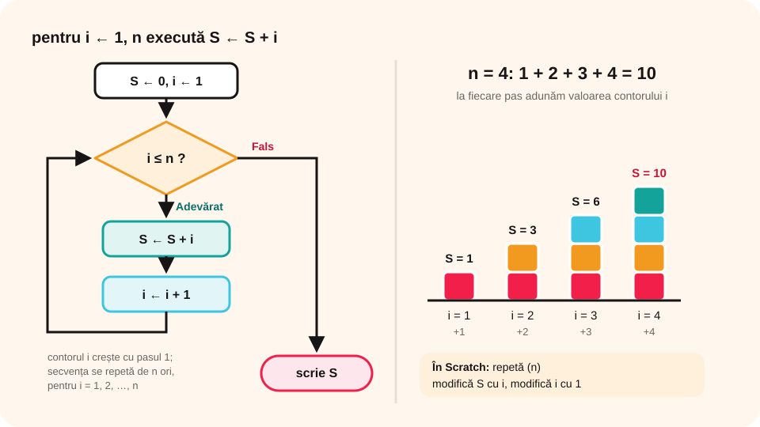

> **Competențe specifice (Anexa 15):** CS 2.1, CS 2.2, CS 2.3, CS 3.3

## Ce vei învăța azi

- cum funcționează structura **„pentru”** (cu **contor**);
- să folosești blocurile **„repetă ( )”** și **„la infinit”** din Scratch;
- să calculezi **suma lui Gauss**: 1 + 2 + … + n;
- să desenezi **scara** și **figurile geometrice** mai scurt, cu repetiție;
- să faci o **animație** din costume.

## Să ne amintim

Când ai desenat scara, ai scris aceiași pași pentru fiecare treaptă. Iar pentru un pătrat ai repetat de **4** ori „mergi, rotește-te”. Când știi **de câte ori** repeți, folosești structura cu **contor**.

## Lecția pe scurt

### Structura „pentru”

```
pentru x ← valoare inițială, valoare finală [, pas] execută
   secvența A
```

Dacă **pasul** lipsește, este **1**.

**Cum funcționează:** variabila **x** (contorul) pornește de la valoarea inițială. La fiecare iterație se execută A, apoi x crește cu **pasul**. Se oprește când x trece de valoarea finală.

- **pas pozitiv**: x **crește** (1, 2, 3, …);
- **pas negativ**: x **scade** (10, 9, 8, …).

**Exemplu:** „pentru x ← 1, 10 execută A” repetă A de **10** ori, pentru x = 1, 2, …, 10.

### În Scratch

În categoria **Control**:

- **„repetă (10)”**: repetă blocurile din interior de un număr dat de ori;
- **„la infinit”**: repetă **fără oprire**, până oprești programul (de exemplu, o rotire continuă sau o muzică de fundal).

### A. Suma lui Gauss



**Enunț:** calculează **S = 1 + 2 + 3 + … + n**, unde n este citit de la tastatură.

**Date:** n (intrare), **i** (contorul), **S** (ieșire).

La pasul 1 adunăm 1, la pasul 2 adunăm 2… la pasul n adunăm n. Adică adunăm de fiecare dată **valoarea contorului**.

```
citește n
S ← 0
pentru i ← 1, n execută
   S ← S + i
scrie „Suma este: ”, S
```

În Scratch: setezi **S** la 0 și **i** la 1, apoi **„repetă (n)”**: „modifică S cu i”, „modifică i cu 1”.

**Traseul datelor** pentru n = 4:

| i | 1 | 2 | 3 | 4 |
|---|---|---|---|---|
| S după pas | 1 | 3 | 6 | 10 |

**Produsul** P = 1 × 2 × … × n se face la fel, dar **P pornește de la 1** (dacă ar porni de la 0, produsul ar fi mereu 0).

### B. Scara, cu repetiție

O treaptă: **mergi**, **rotește-te dreapta 90°**, **mergi**, **rotește-te stânga 90°**. Pui acești pași într-un **„repetă (5)”** și obții **5 trepte**. Mai multe trepte? Schimbi doar numărul.

### C. Figuri cu laturi egale

Pentru o figură cu **x** laturi de lungime **n**:

```
repetă (x)
   mergi n pași
   rotește-te stânga (360 / x) grade
```

Cu cât **x** e mai mare (și **n** mai mic), cu atât figura seamănă mai mult cu un **cerc**. Pentru x = 360 și n = 1 obții practic un cerc.

### D. Animații din costume

O animație înseamnă **cadre** afișate unul după altul. În Scratch, cadrele sunt **costumele** unui personaj.

**Găina care ciugulește** are 6 costume:

```
când se dă clic pe steagul verde
la infinit
   costumul următor
   așteaptă 0.2 secunde
```

După ultimul costum se trece din nou la primul, deci mișcarea se repetă **ciclic**.

**Dinozaurul care țopăie:** are 5 costume pentru un salt. Ca să facă **4 salturi**: **„repetă (4)”** în care afișezi pe rând cele 5 costume, plus un sunet cât durează salturile.

## Exemplu rezolvat: suma numerelor pare

**Enunț:** calculează S = 2 + 4 + … + n, pentru n par.

1. Numerele cresc din **2 în 2**, deci pasul este **2**.
2. Algoritmul:

```
citește n
S ← 0
pentru i ← 2, n, 2 execută
   S ← S + i
scrie S
```

3. Pentru n = 8: S = 2 + 4 + 6 + 8 = **20**.
4. În Scratch: i pornește de la 2, iar la fiecare pas „modifică i cu **2**”. Repetarea se face de **n / 2** ori.

## Aplicații interactive

```quiz
# Alege răspunsul corect.
De câte ori se execută „pentru i ← 1, 10 execută A”?
- 9
* 10
- 11

Cât este suma lui Gauss pentru n = 5?
- 10
* 15
- 25

Cu ce valoare pornește variabila P când calculezi un produs?
- 0
* 1
- 10
Explicație: Dacă P ar porni de la 0, orice înmulțire ar da 0.

Ce bloc Scratch repetă fără oprire?
- repetă (10)
- repetă până când
* la infinit
```

```categorii
# Ce bloc Scratch folosești?
repetă (n): desenezi un hexagon, calculezi suma lui Gauss
la infinit: muzica de fundal se repetă continuu, găina ciugulește încontinuu
repetă până când: prințesa merge până atinge ursul
```

```adevarat-fals
A: Structura repetitivă cu contor are un număr cunoscut de iterații.
F: Structura cu contor are mereu cel puțin o iterație. | Dacă valoarea inițială trece deja de cea finală, nu se execută nicio iterație.
A: Structura repetitivă cu contor poate avea un pas diferit de 1.
A: În Scratch, cadrele unei animații sunt costumele unui personaj.
```

```completare
# Completează.
Pentru a desena un octogon folosești „repetă ([8])” și rotești cu [45] de grade. Suma 1 + 2 + 3 + 4 este [10].
```

## Exersează

1. Dă un exemplu de algoritm în care folosești structura cu contor.
2. Transformă suma lui Gauss într-un algoritm cu structura **„repetă… cât timp”**.
3. Modifică programul scării astfel încât **numărul de trepte** să fie citit de la tastatură (natural nenul, mai mic decât 10).
4. Calculează produsul **1 × 2 × … × n** pentru câteva valori ale lui n (mai mici decât 12). Cât de repede crește?
5. Scrie un program care calculează **produsul a șapte numere** citite de la tastatură.
6. La găina care ciugulește, schimbă pauza dintre cadre. Ce se întâmplă?
7. **Portofoliu:** desenează un **cer cu stele**: atâtea stele câte spune un număr citit de la tastatură.

## Verifică-te

- Când alegi structura cu contor în loc de „cât timp”?
- De ce o figură cu foarte multe laturi seamănă cu un cerc?

## Pe scurt

Structura **„pentru”** (cu **contor**) repetă pași de un număr **cunoscut** de ori; contorul crește sau scade cu un **pas**. În Scratch folosești **„repetă (n)”**, iar pentru repetare fără oprire **„la infinit”**. Cu ea calculezi **sume** și **produse**, desenezi **scări** și **figuri** și faci **animații** din costume.
