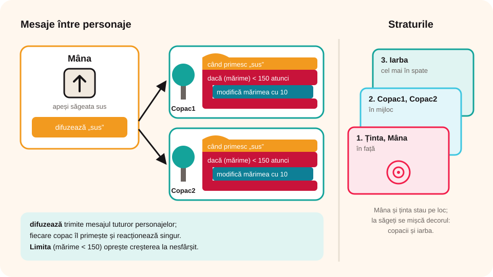

## Ce vei învăța azi

- să controlezi personajele din **taste**;
- să așezi personajele pe **straturi** (în față, în spate);
- să trimiți **mesaje** între personaje cu **„difuzează”**;
- de ce și cum **limitezi** mișcarea și mărimea personajelor;
- să verifici **mai multe condiții deodată** într-o buclă **la infinit**.

## Să ne amintim

În Paint 3D ai desenat, pe pânză transparentă, un **copac**, o **mână**, o **țintă** și **iarbă**, salvate ca `.png`. Azi le folosești într-un joc Scratch. Mai știi blocurile **„dacă… atunci”**, **„la infinit”** și **„atinge ( )?”**.

## Lecția pe scurt

### Jocul

Personajele: **Mâna**, **Copac1**, **Copac2**, **Ținta** și **Iarba**. Mâna (din colțul din dreapta jos) trebuie să **teleporteze** cei doi copaci într-o altă lume: se apropie destul de mult de un copac, pune **ținta** pe el și apasă **Spațiu**.

| Tasta | Ce se întâmplă |
|---|---|
| **săgeată stânga** | copacii se mută la dreapta (pare că mâna merge la stânga) |
| **săgeată dreapta** | copacii se mută la stânga |
| **săgeată sus** | copacii se măresc (pare că te apropii) |
| **săgeată jos** | copacii se micșorează (pare că te depărtezi) |
| **S** | copacii și iarba coboară (pare că sari) |
| **J** | copacii și iarba urcă (pare că te lași în jos) |
| **Spațiu** | teleportează copacul țintit |

**Truc:** mâna și ținta **stau pe loc**. Mișcarea e doar o **iluzie**: se mișcă decorul (copacii și iarba).

### Așezarea pe scenă și pe straturi

- **Iarba** și **Ținta** stau la **(0, 0)**, mijlocul scenei; **Mâna** în colțul din dreapta jos.
- Pentru copaci: bifezi în **Mișcare** „poziția x” și „poziția y”, iar în **Aspect** „mărimea”. Așezi copacii cu mouse-ul și treci valorile afișate în program, ca **poziții inițiale**.

**Straturile** (din **Aspect**, „du-te în stratul din față”, „du-te înapoi … straturi”):

1. în față: **Ținta** și **Mâna**;
2. sub ele: **Copac1** și **Copac2**;
3. cel mai în spate: **Iarba**.

### Mesaje între personaje



Scriptul de taste stă la **Mâna**. La fiecare tastă, ea **difuzează** un mesaj tuturor personajelor:

```
când tasta săgeată sus este apăsată
difuzează „sus”
```

Fiecare copac are un script care **primește** mesajul și reacționează:

```
când primesc „sus”
dacă (mărime) < 150 atunci
   modifică mărimea cu 10
```

### Limitele

Fără limite, copacii ar ieși de pe ecran sau ar crește la nesfârșit. De aceea:

- la **stânga/dreapta**: mutarea se face doar dacă x nu a trecut de o valoare maximă (o afli mutând copacul cu mouse-ul până la margine și citind x);
- la **mărire/micșorare**: doar dacă mărimea e între o valoare minimă și una maximă;
- la **sus/jos**: iarba nu urcă mai sus de **y = 0**, ca să nu se vadă cerul jos.

Pentru o mișcare mai naturală se adaugă un mic **„recul”**: personajul se mișcă puțin sus-jos înainte să se oprească (două blocuri **„repetă (10)”**).

### Teleportarea

La fiecare copac, o buclă **„la infinit”** verifică **trei condiții deodată**:

1. copacul este **destul de aproape**: mărimea lui e mai mare decât o valoare;
2. ținta **atinge** copacul: **„atinge (Ținta)?”**;
3. tasta **Spațiu** este apăsată: **„tasta (spațiu) apăsată?”**.

Dacă toate sunt adevărate (legate cu **și**), copacul primește efectul **fantomă**, adică dispare treptat:

```
la infinit
   dacă < (mărime > 120) și (atinge Ținta?) și (tasta spațiu apăsată?) > atunci
      repetă (10)
         modifică efectul fantomă cu 10
```

## Exemplu rezolvat: limita la dreapta

**Problema:** dacă ții apăsată săgeata stânga, copacii fug spre dreapta și ies de pe ecran.

1. Muți Copac1 cu mouse-ul cât de departe la dreapta vrei să ajungă. Citești x: de exemplu, **200**.
2. În scriptul care primește mesajul „stânga” pui o decizie:

```
când primesc „stânga”
dacă (poziția x) < 200 atunci
   modifică x cu 10
```

3. Testezi: copacul se oprește la marginea stabilită.

## Aplicații interactive

```categorii
# În ce categorie este blocul?
Evenimente: difuzează mesaj, când primesc mesaj, când tasta este apăsată
Detectare: atinge Ținta?, tasta spațiu apăsată?
Aspect: modifică efectul fantomă, du-te în stratul din față, modifică mărimea
```

```quiz
# Alege răspunsul corect.
La ce folosește blocul „difuzează”?
* trimite un mesaj tuturor personajelor, ca să reacționeze
- șterge un personaj
- redă un sunet

De ce punem limite la mișcarea personajelor?
- ca jocul să fie mai lent
* ca personajele să nu iasă de pe ecran sau să nu crească la nesfârșit
- ca să economisim memorie

Ce condiții trebuie îndeplinite ca un copac să fie teleportat?
* copacul e destul de mare, ținta îl atinge și se apasă Spațiu
- doar să se apese Spațiu
- copacul atinge marginea scenei

Ce personaj stă pe stratul cel mai din spate?
- Ținta
- Copac1
* Iarba
```

```ordonare
# Ce se întâmplă când apeși săgeata sus? Pune în ordine.
Mâna detectează tasta săgeată sus
Mâna difuzează mesajul „sus”
Copacii primesc mesajul
Fiecare copac verifică dacă nu a depășit mărimea maximă
Copacii se măresc
```

```adevarat-fals
A: În acest joc, mâna și ținta nu se mișcă; mișcarea este o iluzie creată de decor.
F: Fără limite, copacii s-ar opri singuri la marginea ecranului. | Fără limite, ar ieși de pe ecran.
A: Efectul fantomă face un personaj să devină transparent treptat.
A: Pozițiile inițiale se pot afla bifând „poziția x” și „poziția y”.
```

## Exersează

1. Mărește cu 100 limita la dreapta. Ce se întâmplă cu copacii când ajungi la noua limită?
2. Elimină limita ierbii (y = 0) la mișcarea în sus. Ce se vede dacă apeși de mai multe ori tasta **J**?
3. Schimbă efectul de la teleportare din **fantomă** în **culoare** sau **vârtej**.
4. Desenează în Paint 3D un obiect nou (o casă, o tufă) și adaugă-l în joc, cu același comportament ca un copac.
5. Dă două exemple de jocuri în care e nevoie de limitarea mișcării.
6. **Portofoliu:** fă o animație cu personaje 3D desenate de tine, controlate din **tastatură**. Pregătește și o scurtă prezentare a ei pentru colegi.

## Verifică-te

- De ce trimitem mesaje în loc să punem toate scripturile la Mâna?
- Cum afli valoarea limitei pentru mișcarea la dreapta?

## Pe scurt

Într-un joc, personajele se controlează din **taste**, iar un personaj poate **difuza** mesaje la care celelalte reacționează. Personajele stau pe **straturi**. **Limitele** (cu **„dacă… atunci”**) împiedică ieșirea de pe ecran sau creșterea la nesfârșit. O buclă **„la infinit”** poate verifica mai multe condiții deodată, legate cu **și**.
