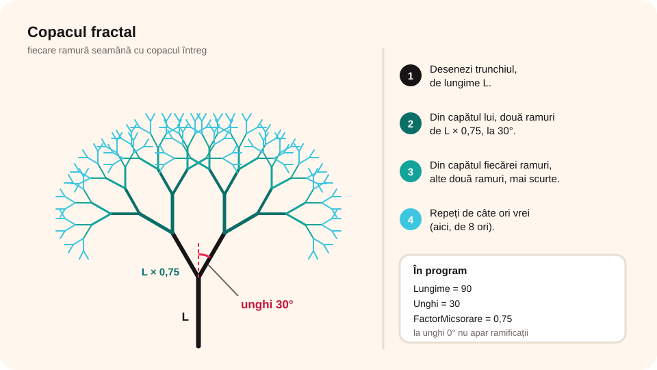

## Ce vei învăța azi

- să faci în Scratch o **prezentare** cu butoane **Înainte** și **Înapoi**;
- de ce **ascunzi** butoanele care nu se pot folosi;
- ce este un **fractal** și cum desenezi un copac fractal;
- să faci o **simulare** din cadre succesive.

## Să ne amintim

În Scratch, **decorurile** pot fi cadrele unei prezentări, iar **„difuzează”** trimite mesaje între personaje. O animație este o succesiune de **cadre**.

## Lecția pe scurt

### A. Album foto: Ansamblul Brâncuși din Târgu Jiu

O prezentare în Scratch poate fi folosită la **orice materie**, ca alternativă la PowerPoint, dar și pentru reclame.

**Conținutul:** 8 cadre (decoruri), numerotate de la **0** la **7** și numite `img0` … `img7`. Fiecare are un comentariu:

- **0**: Ansamblul monumental din Târgu Jiu;
- **1**: **Masa Tăcerii**, cu 12 scaune în formă de clepsidră, care amintesc de trecerea timpului;
- **2**: **Masa mică**, prima încercare a sculptorului pentru Masa Tăcerii;
- **3**: **Poarta Sărutului**, din travertin, simbol al trecerii spre o altă viață;
- **4**: motivul sărutului de pe stâlpii porții;
- **5**: **Coloana fără Sfârșit**, o axă care susține cerul;
- **6**: Coloana are **15 module** romboidale întregi, din fontă, și două jumătăți de modul la capete;
- **7**: **Grădina de piatră** din curtea casei Gănescu.

**Personaje:** **Minizaurus** (spune comentariile), butonul **Înainte** și butonul **Înapoi**.

**Cum funcționează:**

- La **steagul verde** se afișează cadrul **0**.
- **Înainte**: „decorul următor”. **Înapoi**: „decorul anterior”.
- Minizaurus are câte un script pentru fiecare cadru: **„când decorul devine img3”** → spune comentariul.

**O eroare și repararea ei:** dacă la un cadru Minizaurus are de spus **două** texte și treci repede la alt cadru, se amestecă textele: apare textul noului cadru, urmat de al doilea text de la cadrul vechi. **Soluția:** la începutul fiecărui script pui **„oprește (alte scripturi ale personajului)”**, ca să oprești tot ce era pornit înainte.

**Jocul butoanelor:**

- pe cadrul **0** nu ai unde merge înapoi, deci **ascunzi** butonul **Înapoi**;
- când ajungi la cadrul **1**, îl faci **vizibil** din nou, difuzând mesajul `afisezbutinapoi`;
- la fel, ascunzi **Înainte** pe **ultimul** cadru și îl arăți când revii la penultimul.

**De reținut:** butoanele care nu fac nimic într-un moment dat trebuie **ascunse** sau **dezactivate**. Altfel utilizatorul apasă, nu se întâmplă nimic și crede că programul nu merge.

### B. Fractali



**Fractalii** sunt forme care se pot împărți în părți mai mici, **asemănătoare** cu întregul. Termenul a fost introdus în **1975** de matematicianul **Benoit Mandelbrot**. În natură: **munții**, **ramurile copacilor**, **fulgii de zăpadă**, **frunza de ferigă**.

**Copacul fractal:**

1. Desenezi o linie (**trunchiul**) de lungime **L**.
2. Din capătul ei desenezi **două linii-copii**, mai scurte: **L1 = L × 0,75** (0,75 este **factorul de micșorare**), la un **unghi** (de exemplu, **30°**) față de linia-mamă.
3. Din capătul fiecărei linii-copil desenezi alte două linii, iar mai scurte.
4. Repeți de câte ori vrei (de exemplu, de 8 ori).

În program: Lungime = **90**, Unghi = **30**, FactorMicsorare = **0,75**. Schimbând lungimea, unghiul, culoarea sau factorul, obții copaci diferiți. Dacă unghiul e **0°**, nu se mai formează ramificații.

### C. Simulare: florile se închid noaptea

Se poate folosi la **Științe** sau la **Biologie**. **6 cadre** arată flori care se închid tot mai mult pe măsură ce se întunecă. La steagul verde se afișează cadrele **1, 2, …, 6**, cu o pauză între ele și un sunet de fundal. După cadrul 6, o nouă zi începe de la cadrul 1.

```
când se dă clic pe steagul verde
schimbă decorul la cadrul 1
pornește sunetul „natura”
repetă (12)
   așteaptă 1 secunde
   decorul următor
```

## Exemplu rezolvat: butonul Înapoi

**Scriptul butonului Înapoi:**

```
când se dă clic pe acest personaj
decorul anterior
dacă (numărul decorului) = 1 atunci
   ascunde
```

Atenție: Scratch numerotează decorurile de la **1**, deci cadrul `img0` are numărul **1**. Când ajungi la primul cadru, butonul se ascunde.

**Scriptul care îl face din nou vizibil:**

```
când primesc „afisezbutinapoi”
arată
```

## Aplicații interactive

```quiz
# Alege răspunsul corect.
De ce ascundem butonul Înapoi pe primul cadru?
* nu ai unde merge înapoi, iar un buton care nu face nimic îl încurcă pe utilizator
- ca prezentarea să meargă mai repede
- butoanele nu pot fi afișate pe primul cadru

Ce bloc rezolvă amestecarea textelor când treci repede la alt cadru?
- așteaptă 1 secunde
* oprește (alte scripturi ale personajului)
- la infinit

Ce este un fractal?
* o formă alcătuită din părți mai mici, asemănătoare cu întregul
- un tip de virus
- un decor din Scratch

Cât este lungimea liniilor-copii dacă linia-mamă are 80 și factorul de micșorare este 0,75?
- 75
* 60
- 40
```

```categorii
# Este un exemplu de fractal în natură?
Fractal: ramurile unui copac, un fulg de zăpadă, frunza de ferigă, un lanț muntos
Nu este fractal: o minge, o cutie de carton, o riglă
```

```adevarat-fals
A: O prezentare în Scratch poate fi folosită la orice materie.
F: La copacul fractal, liniile-copii sunt mai lungi decât linia-mamă. | Sunt mai scurte, înmulțite cu factorul de micșorare.
A: Termenul „fractal” a fost introdus de Benoit Mandelbrot în 1975.
F: Dacă unghiul de ramificare este 0°, copacul fractal are cele mai multe ramuri. | La 0° liniile se suprapun și nu se formează ramificații.
```

```ordonare
# Copacul fractal: pune pașii în ordine.
Desenezi trunchiul de lungime L
Din capătul lui desenezi două ramuri mai scurte, la un unghi
Din capătul fiecărei ramuri desenezi alte două ramuri
Repeți de câte ori vrei
```

## Exersează

1. Ce avantaj are o prezentare în Scratch față de una în PowerPoint?
2. Păstrează la butoanele Înainte/Înapoi doar „decorul următor” și „decorul anterior”. Ce se întâmplă la capete?
3. La copacul fractal, alege **culoarea** stiloului **aleator** la fiecare ramură. Încearcă unghiurile 0°, 45° și 90°.
4. Modifică simularea florilor astfel încât cadrele să se schimbe la apăsarea **săgeții jos**.
5. Fă un program care simulează **floarea-soarelui** care se întoarce după soare.
6. Dă trei exemple de fractali din natură.
7. **Portofoliu:** fă în Scratch un **test grilă** cu 10 întrebări, fiecare cu trei variante. Utilizatorul scrie răspunsul și primește imediat „Bravo, ai reușit!” sau „Este incorect!”. Între întrebări te muți cu săgețile.

## Verifică-te

- Cum faci ca butonul Înainte să dispară pe ultimul cadru?
- Ce trei valori schimbi ca să obții alt copac fractal?

## Pe scurt

Scratch poate face **prezentări** (cadre = decoruri, butoane **Înainte/Înapoi**), **desene matematice** (copacul **fractal**, din ramuri tot mai scurte) și **simulări** (cadre succesive cu pauze). Butoanele care nu se pot folosi trebuie **ascunse**, iar **„oprește alte scripturi”** împiedică amestecarea acțiunilor.
