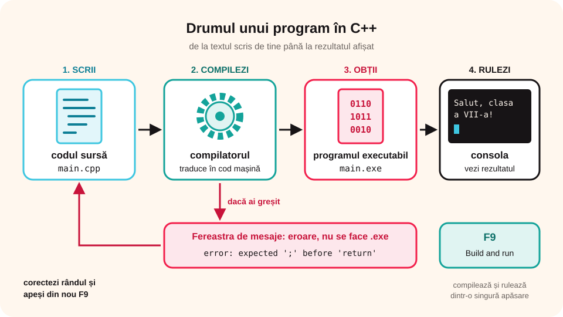

> **Competențe specifice (Anexa 15):** CS 1.4

## Ce vei învăța azi

- ce este un **limbaj de programare** și ce face un **compilator**;
- ce este un **mediu de dezvoltare** (IDE);
- să creezi, să **compilezi** și să **rulezi** un program în **Code::Blocks**;
- să citești **mesajele de eroare** și să deosebești erorile de compilare de cele de logică;
- să folosești și alte facilități ale mediului: completare automată, formatare, comentarii, **depanatorul**.

## Să ne amintim

Un **algoritm** este o succesiune finită de pași care rezolvă o problemă. În clasele a V-a și a VI-a ai scris algoritmi în **pseudocod** și i-ai construit din blocuri în **Scratch**. Acum îi vei scrie într-un limbaj „adevărat”, folosit de programatori: **C++**.

## Lecția pe scurt

### De la algoritm la program

Un **program** este un algoritm scris într-un **limbaj de programare**, pe care calculatorul îl poate executa. Exemple de limbaje: **C++**, **Python**, **Java**, **JavaScript**, **Pascal**.

Calculatorul înțelege doar **cod mașină** (0 și 1). De aceea, un program special, **compilatorul**, traduce **codul sursă** scris de tine (fișierul `.cpp`) într-un **program executabil** (`.exe`).

```text
cod sursă (.cpp)  →  compilator  →  program executabil (.exe)  →  rulare
```

Dacă ai greșit regulile limbajului, compilatorul **nu** face executabilul și îți arată **erorile**.



### Mediul de dezvoltare Code::Blocks

Un **mediu de dezvoltare integrat** (IDE) adună la un loc tot ce îți trebuie: **editorul** în care scrii, **compilatorul** și **depanatorul**. **Code::Blocks** este gratuit; la instalare alegi varianta care conține și compilatorul (**mingw-setup**).

Fereastra Code::Blocks:

1. **Bara de meniuri** și **bara de instrumente** (cu butoanele **Build**, **Run**, **Build and run**);
2. **Managementul** (*Management*, stânga): proiectele și fișierele;
3. **Editorul** (centru): scrii codul; cuvintele limbajului apar **colorate**, iar liniile sunt **numerotate**;
4. **Fereastra de mesaje** (*Logs & others*, jos): aici apar **erorile** și avertismentele;
5. **Consola** (fereastra neagră): apare când rulezi programul; aici **introduci** datele și vezi **rezultatele**.

### Un program nou

1. **File → New → Project → Console application → Go**.
2. Alegi limbajul **C++**, dai un **nume** proiectului (fără spații, de exemplu `Salut`) și un **folder**.
3. Apeși **Finish**. În **Sources** găsești fișierul `main.cpp`, cu un program gata scris.
4. Apeși **Build and run** (**F9**). Se deschide consola cu mesajul programului.

> Poți lucra și fără proiect: **File → New → Empty file**, apoi îl salvezi cu extensia `.cpp`.

### Primul program

```cpp
#include <iostream>
using namespace std;

int main()
{
    cout << "Salut, clasa a VII-a!";
    return 0;
}
```

Deocamdată reține: programul începe la **main**, instrucțiunile stau între **acolade** și fiecare se termină cu **punct și virgulă**. Lecția următoare explică fiecare rând.

### Erorile

Dacă uiți un **;**, o ghilimea sau o acoladă, apare în fereastra de mesaje o linie **roșie**, cu **numărul rândului** și o explicație, de exemplu: `error: expected ';' before 'return'`. Mergi la acel rând (sau la cel **de dinainte**), corectezi și apeși din nou **F9**.

### Erori de compilare și erori de logică

- **Eroarea de compilare** (de sintaxă): ai încălcat regulile limbajului. Programul **nu** pornește, iar mesajul roșu îți arată rândul.
- **Avertismentul** (*warning*, de obicei galben/portocaliu): programul se compilează, dar compilatorul bănuiește o problemă (de exemplu, o variabilă folosită fără valoare). Citește-l!
- **Eroarea de logică**: programul pornește, dar dă **rezultate greșite** (de exemplu, ai scris `a - b` în loc de `a + b`). Compilatorul nu o poate găsi; o descoperi doar **testând** programul cu date pentru care știi rezultatul.

### Alte facilități ale mediului de dezvoltare

| Facilitate | Unde / taste | La ce folosește |
|---|---|---|
| **Build** (compilare) | **Ctrl + F9** | doar compilează și arată erorile |
| **Run** (rulare) | **Ctrl + F10** | rulează ultimul executabil obținut |
| **Build and run** | **F9** | compilează și, dacă nu sunt erori, rulează |
| **Rebuild** | **Ctrl + F11** | compilează totul de la zero |
| **Colorarea sintaxei** și **numerotarea liniilor** | automat | vezi repede cuvintele limbajului, textele, comentariile și rândul unei erori |
| **Completarea automată** | apare singură când scrii (sau **Ctrl + Spațiu**) | propune nume de variabile și instrucțiuni |
| **Indentarea automată** | **Plugins → Source code formatter (AStyle)** | aliniază codul, ca să se vadă clar blocurile |
| **Comentarea unor rânduri** | **Edit → Comment** (**Ctrl + Shift + C**), **Uncomment** (**Ctrl + Shift + X**) | „oprești” temporar niște instrucțiuni, fără să le ștergi |
| **Găsire / Înlocuire** | **Ctrl + F** / **Ctrl + R** | cauți sau redenumești o variabilă |
| **Depanatorul** (*debugger*) | punct de oprire: **F5**; pornire: **F8**; rândul următor: **F7**; fereastra **Watches** | execuți programul **pas cu pas** și urmărești cum se schimbă valorile variabilelor |

> Depanatorul funcționează pentru programele create ca **proiect** (Console application), salvate într-un folder **fără spații și fără diacritice** în nume.

## Exemplu rezolvat: programul „Carte de vizită”

1. Creezi proiectul `Vizita` (Console application, C++).
2. În `main.cpp` scrii:

```cpp
#include <iostream>
using namespace std;

int main()
{
    cout << "Nume: Popescu Ana" << endl;
    cout << "Clasa: a VII-a B" << endl;
    cout << "Hobby: robotica";
    return 0;
}
```

3. Apeși **F9**. Consola afișează trei rânduri (`endl` trece la rând nou).
4. Ștergi intenționat un `;` și apeși F9: citești eroarea, apoi o corectezi.

## Aplicații interactive

```ordonare
# Drumul unui program
Scrii algoritmul
Scrii codul sursă în editor
Compilatorul îl traduce în cod mașină
Se obține programul executabil
Rulezi programul și vezi rezultatul în consolă
```

```categorii
# Ce parte a mediului Code::Blocks este?
Editorul: aici scrii codul sursă
Fereastra de mesaje: aici apar erorile
Consola: introduci date și vezi rezultatele
Managementul: lista proiectelor și a fișierelor
```

```quiz
# Alege răspunsul corect.
Ce face compilatorul?
* traduce codul sursă în cod mașină și semnalează erorile
- desenează schema logică
- trimite programul pe e-mail

Ce tastă compilează și rulează programul în Code::Blocks?
- F1
* F9
- Esc

Ce extensie are fișierul cu codul sursă C++?
- .exe
- .docx
* .cpp
```

```adevarat-fals
A: Code::Blocks este un mediu de dezvoltare gratuit.
F: Calculatorul înțelege direct textul scris în C++. | Codul trebuie tradus de compilator în cod mașină.
A: Instrucțiunile `cout` și `return 0` se termină cu punct și virgulă.
F: Dacă programul are erori, compilatorul face oricum executabilul. | Întâi trebuie corectate erorile.
```

```categorii
# Ce tip de greșeală este?
Eroare de compilare: lipsește ; după cout, ai scris Cout în loc de cout, lipsește o acoladă
Eroare de logică: programul afișează aria în loc de perimetru, ai scris a - b în loc de a + b
```

```categorii
# Ce facilitate a mediului folosești?
Build and run (F9): vrei să compilezi și să rulezi programul
Depanatorul: vrei să vezi pas cu pas cum se schimbă valoarea unei variabile
Comentarea rândurilor: vrei să oprești temporar două instrucțiuni fără să le ștergi
Găsire și înlocuire: vrei să redenumești variabila x în suma peste tot
```

```quiz
# Facilitățile mediului.
Programul pornește, dar pentru 2 și 3 afișează 6 în loc de 5. Ce fel de greșeală este?
- eroare de compilare
* eroare de logică
- nu e nicio greșeală
Explicație: Programul se compilează și rulează, dar rezultatul e greșit: e o eroare de logică, găsită prin testare.

Ce face un punct de oprire (breakpoint) pus cu F5?
* oprește programul la acel rând când rulează cu depanatorul, ca să vezi valorile variabilelor
- șterge rândul
- compilează doar acel rând
```

```completare
# Completează.
Programul care traduce codul sursă în cod mașină se numește [compilator]. Un mediu care conține editorul și compilatorul se numește [IDE|mediu de dezvoltare]. Rezultatele programului apar în [consolă|consola].
```

## Exersează

1. Deschide Code::Blocks și găsește toate elementele ferestrei.
2. Creează proiectul `Salut` și rulează programul care afișează „Hello world!”.
3. Modifică mesajul astfel încât să afișeze numele tău.
4. Șterge pe rând un `;`, o ghilimea și o acoladă. Notează în caiet ce eroare apare de fiecare dată.
5. Scrie un program care calculează suma a două numere, pune un punct de oprire (**F5**) pe rândul cu suma, pornește depanatorul (**F8**) și urmărește variabilele în fereastra **Watches**.
6. Formatează automat un program scris „strâmb” cu **Source code formatter (AStyle)**.
7. **Portofoliu:** programul „Carte de vizită”, cu cel puțin cinci rânduri despre tine, salvat în folderul `Portofoliu_Info_7`.

## Verifică-te

- Care e diferența dintre codul sursă și programul executabil?
- Unde cauți când programul nu se compilează?
- Cum descoperi o eroare de logică?

## Pe scurt

Un **program** este un algoritm scris într-un **limbaj de programare**. **Compilatorul** traduce **codul sursă** (`.cpp`) în **program executabil**. **Code::Blocks** este un **IDE**: are **editor**, **compilator** și **fereastră de mesaje**. **F9** (Build and run) compilează și rulează, iar rezultatele apar în **consolă**. Erorile de **compilare** le arată compilatorul; erorile de **logică** le găsești prin **testare** și cu **depanatorul**.
