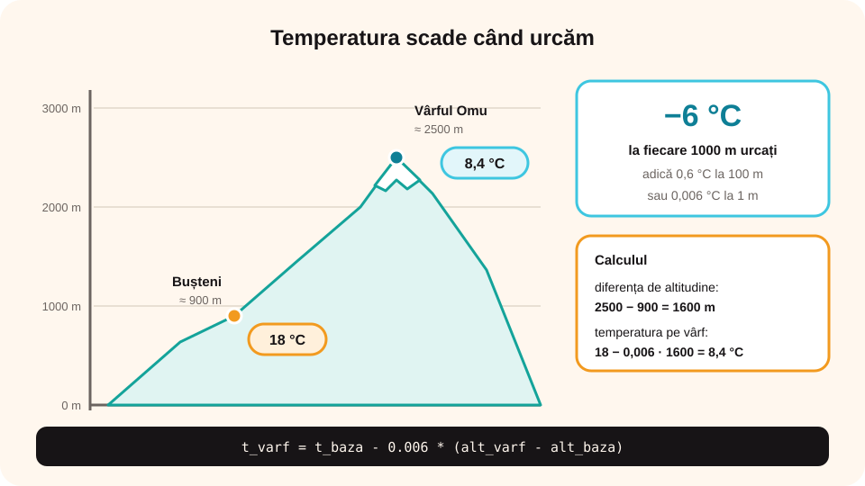

## Ce vei învăța azi

- să folosești C++ la probleme de **geografie**;
- să calculezi cu **scara hărții** și **densitatea populației**;
- să prelucrezi **temperaturi** (medie, maximă, minimă, amplitudine);
- să simulezi **creșterea** unei populații în timp.

## Să ne amintim

La geografie ai învățat despre **scara hărții**, **altitudine**, **clima** și **populație**. La informatică știi să calculezi **media**, **maximul** și **minimul** a n numere cu for.

## Lecția pe scurt

### Scara hărții

Scara **1 : 100 000** înseamnă că 1 cm pe hartă reprezintă 100 000 cm = **1 km** în realitate.

`distanta_reala_km = distanta_harta_cm * scara / 100000`

### Densitatea populației

`densitate = populatie / suprafata` (locuitori pe km²). De exemplu, România: aproximativ 19 000 000 de locuitori pe 238 000 km² înseamnă circa **80 loc./km²**.

### Temperatura și altitudinea

În medie, temperatura aerului **scade cu circa 6 °C la fiecare 1000 m** urcați (0,6 °C la 100 m).

`t_varf = t_baza - 0.006 * (alt_varf - alt_baza)`



### Amplitudinea termică

**Amplitudinea** este diferența dintre temperatura **maximă** și cea **minimă**: `amplitudine = maxim - minim`.

## Exemplu rezolvat: temperaturile unei săptămâni

Se citesc temperaturile din 7 zile. Afișează media, maxima, minima și amplitudinea.

```cpp
#include <iostream>
#include <iomanip>
using namespace std;

int main()
{
    double t, s = 0, maxim, minim;
    cin >> t;
    s = t;
    maxim = minim = t;
    for (int zi = 2; zi <= 7; zi++)
    {
        cin >> t;
        s = s + t;
        if (t > maxim) maxim = t;
        if (t < minim) minim = t;
    }
    cout << fixed << setprecision(1);
    cout << "Media: " << s / 7 << endl;
    cout << "Maxima: " << maxim << endl;
    cout << "Minima: " << minim << endl;
    cout << "Amplitudinea: " << maxim - minim;
    return 0;
}
```

Pentru 12 15 9 18 20 14 10: media **14.0**, maxima **20.0**, minima **9.0**, amplitudinea **11.0**.

### Al doilea exemplu: temperatura pe vârf

```cpp
double tb, ab, av;
cin >> tb >> ab >> av;   // temperatura și altitudinea la bază, altitudinea vârfului
cout << tb - 0.006 * (av - ab);
```

La Bușteni (≈ 900 m) sunt 18 °C. Pe Vârful Omu (≈ 2500 m): 18 - 0,006 · 1600 = **8,4 °C**.

### Al treilea exemplu: creșterea populației (while)

Un oraș are 50 000 de locuitori și crește cu 2% pe an. După câți ani depășește 60 000?

```cpp
double p = 50000;
int ani = 0;
while (p <= 60000)
{
    p = p * 1.02;
    ani++;
}
cout << ani << " ani";
```

Afișează **10 ani**.

## Aplicații interactive

```quiz
# Alege răspunsul corect.
Pe o hartă la scara 1 : 50 000, două sate sunt la 6 cm. Ce distanță e în realitate?
- 6 km
* 3 km
- 30 km

Un județ are 600 000 de locuitori și 5 000 km pătrați. Care e densitatea?
* 120 loc. pe km pătrat
- 1200 loc. pe km pătrat
- 12 loc. pe km pătrat

Ce afișează programul de amplitudine pentru maxima 25 și minima -5?
- 20
* 30
- -30
```

```categorii
# Ce calculezi?
populatie / suprafata: densitatea populației
maxim - minim: amplitudinea termică
s / 7: media temperaturilor dintr-o săptămână
p * 1.02: populația după un an de creștere cu 2%
```

```ordonare
# Ordonează programul care află temperatura pe vârf
double tb, ab, av;
cin >> tb >> ab >> av;
double tv = tb - 0.006 * (av - ab);
cout << tv;
```

```adevarat-fals
A: Scara 1 : 100 000 înseamnă că 1 cm pe hartă reprezintă 1 km în realitate.
F: Temperatura aerului crește odată cu altitudinea. | Scade, în medie cu 6 grade la 1000 m.
A: Amplitudinea termică este diferența dintre temperatura maximă și cea minimă.
```

```completare
# Completează.
La scara 1 : 200 000, 5 cm pe hartă înseamnă [10] km. Dacă la bază sunt 20 de grade, la 1000 m mai sus sunt aproximativ [14] grade.
```

## Exersează

1. Citește distanța de pe hartă (cm) și scara; afișează distanța reală în km.
2. Citește populația și suprafața a trei județe; afișează județul cu **densitatea cea mai mare**.
3. Citește cantitatea de precipitații din fiecare lună a anului; afișează **totalul**, **luna cea mai ploioasă** și câte luni au avut sub 30 mm.
4. **Fusul orar:** Bucureștiul e cu 7 ore înaintea New York-ului. Citește ora din București (0–23) și afișează ora din New York (atenție la ore ca 3, care devin 20 în ziua dinainte).
5. O pădure de 1200 ha pierde 3% pe an prin defrișare. După câți ani rămâne sub 1000 ha?
6. **Portofoliu:** alege un oraș din România, caută temperaturile medii lunare și fă un program care afișează media anuală, luna cea mai caldă, cea mai rece și amplitudinea.

## Verifică-te

- Cum transformi o distanță de pe hartă în distanță reală?
- Ce structură folosești pentru „după câți ani…” și de ce?

## Pe scurt

Problemele de geografie folosesc **scara hărții**, **densitatea populației**, **scăderea temperaturii cu altitudinea** și **amplitudinea termică**. Cu **for** prelucrăm datele pe zile sau luni (medie, maxim, minim), iar cu **while** aflăm **după cât timp** o mărime depășește o valoare.
