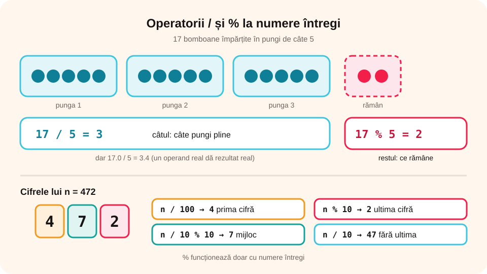

## Ce vei învăța azi

- să explici fiecare rând al unui **program C++**;
- să **declari** variabile de tipurile **int**, **double**, **char**, **bool**;
- să folosești **operatorii** aritmetici, relaționali și logici;
- să calculezi **expresii**, inclusiv cu **/** și **%**.

## Să ne amintim

În pseudocod ai lucrat cu **variabile** (o „cutie” cu nume, în care se pune o valoare), cu **constante** și cu **expresii**: `a ← 5`, `s ← a + b`. Ai folosit **div** (câtul) și **mod** (restul).

## Lecția pe scurt

### Structura unui program

```cpp
#include <iostream>      // biblioteca pentru citire și afișare
using namespace std;     // ca să scriem cout în loc de std::cout

int main()               // aici începe programul
{
    // instrucțiunile programului
    return 0;            // programul s-a încheiat fără probleme
}
```

- `#include <iostream>` aduce instrucțiunile **cin** (citire) și **cout** (afișare);
- **main** este **funcția principală**; execuția începe cu prima ei instrucțiune;
- textul de după `//` este un **comentariu**: compilatorul îl ignoră, dar pe tine te ajută să înțelegi codul;
- C++ face diferența între **litere mari și mici**: `Main` nu este `main`.

### Identificatori

Numele variabilelor se numesc **identificatori**. Reguli: conțin **litere**, **cifre** și **_**, **nu încep cu o cifră**, nu au spații sau diacritice și nu sunt cuvinte rezervate (`int`, `return`…). Corecte: `suma`, `nr_elevi`, `x1`. Greșite: `1x`, `nr elevi`, `int`.

### Tipuri de date

| Tip | Ce păstrează | Exemple |
|---|---|---|
| `int` | numere întregi | 7, -150, 2024 |
| `double` | numere reale (cu virgulă) | 3.14, -0.5 |
| `char` | un singur caracter | 'A', '7', '?' |
| `bool` | adevărat sau fals | true, false |

În C++ virgula zecimală se scrie cu **punct**: `3.14`.

### Declararea variabilelor și a constantelor

```cpp
int a, b;              // două variabile întregi
double medie = 9.50;   // declarare cu valoare inițială
char litera = 'M';
const double PI = 3.14159;   // constantă: nu se mai poate schimba
```

**Atribuirea** se scrie cu `=` (în pseudocod era `←`): `a = 5;` înseamnă „pune 5 în a”.

### Operatori aritmetici

`+` adunare, `-` scădere, `*` înmulțire, `/` împărțire, `%` restul împărțirii.

- dacă ambii operanzi sunt **int**, `/` dă **câtul întreg**: `17 / 5` este `3`;
- `17 % 5` este `2` (restul); `%` merge doar cu **întregi**;
- dacă măcar un operand e real, rezultatul e real: `17.0 / 5` este `3.4`.

Ordinea: întâi `*`, `/`, `%`, apoi `+`, `-`; parantezele schimbă ordinea.

### Operatori relaționali și logici

- relaționali: `<`, `<=`, `>`, `>=`, `==` (egal), `!=` (diferit). Atenție: `==` compară, `=` atribuie!
- logici: `&&` (**și**), `||` (**sau**), `!` (**negație**).

Exemplu: `x >= 1 && x <= 10` este adevărat dacă x e între 1 și 10.

### Trucuri cu / și %

Pentru un număr `n` de trei cifre, de exemplu 472:

- ultima cifră: `n % 10` → 2;
- fără ultima cifră: `n / 10` → 47;
- prima cifră: `n / 100` → 4;
- cifra din mijloc: `n / 10 % 10` → 7;
- `n` este par dacă `n % 2 == 0`.



## Exemplu rezolvat: calculează expresiile

Fie `int a = 23, b = 4;`

| Expresie | Valoare | De ce |
|---|---|---|
| `a / b` | 5 | câtul întreg |
| `a % b` | 3 | 23 = 4 · 5 + 3 |
| `a + b * 2` | 31 | întâi înmulțirea |
| `(a + b) * 2` | 54 | întâi paranteza |
| `a % 2 == 1` | true | 23 este impar |
| `a > 20 && b > 5` | false | b > 5 este fals |

## Aplicații interactive

```categorii
# Ce tip de date folosești?
int: numărul de elevi, anul nașterii
double: media generală, temperatura de 21.5 grade
char: inițiala numelui
bool: dacă un număr e par sau nu
```

```quiz
# Alege răspunsul corect.
Cât este 29 / 4, dacă ambele numere sunt int?
- 7.25
* 7
- 1

Cât este 29 % 4?
* 1
- 7
- 4

Care identificator este corect?
- 2nota
- nota finala
* nota_finala
```

```categorii
# Corect sau greșit ca identificator?
Corect: suma, x1, nr_elevi, Medie
Greșit: 1x, nr elevi, int, mărime
```

```adevarat-fals
A: Textul de după // este un comentariu, ignorat de compilator.
F: În C++ scriem numerele reale cu virgulă, de exemplu 3,14. | Se scriu cu punct: 3.14.
A: Operatorul == compară două valori, iar = atribuie o valoare.
F: Variabilele Suma și suma sunt aceeași variabilă. | C++ face diferența între literele mari și mici.
```

```completare
# Completează.
Pentru n = 538, ultima cifră se obține cu n % 10, adică [8]. Prima cifră se obține cu n / 100, adică [5]. Cifra din mijloc este n / 10 % 10, adică [3].
```

## Exersează

1. Calculează pentru `int x = 47, y = 6;`: `x / y`, `x % y`, `x - y * 3`, `(x - y) % 10`, `x % 2 == 0`.
2. Scrie declarațiile pentru: vârsta ta, înălțimea în metri, prima literă a orașului, dacă ai frați.
3. Scrie expresia C++ care e adevărată dacă `n` este număr de două cifre.
4. Scrie expresia care e adevărată dacă `n` se divide cu 3 **sau** cu 5.
5. **Portofoliu:** în caiet, un tabel cu 10 expresii C++ inventate de tine și valorile lor, verificate apoi cu un coleg.

## Verifică-te

- Care e diferența dintre `17 / 5` și `17.0 / 5`?
- Ce face operatorul `%` și când îl folosești?

## Pe scurt

Un program C++ are **#include**, **using namespace std;** și funcția **main**. Variabilele se **declară** cu un **tip** (`int`, `double`, `char`, `bool`) și un **identificator** corect. Operatorii aritmetici sunt `+ - * / %`; între întregi, `/` dă **câtul**, iar `%` dă **restul**. Comparăm cu `== != < <= > >=` și legăm condiții cu `&&`, `||`, `!`.
