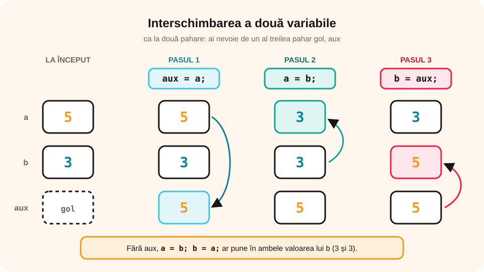

> **Competențe specifice (Anexa 15):** CS 1.4, CS 2.1, CS 2.2, CS 3.3

## Ce vei învăța azi

- să **citești** date cu `cin` și să **afișezi** cu `cout`;
- să folosești **atribuirea**;
- să scrii programe în care instrucțiunile se execută **una după alta**;
- să **interschimbi** valorile a două variabile;
- să clasifici datele unei probleme în date de **intrare**, de **ieșire** și de **manevră**.

## Să ne amintim

**Structura liniară** (secvențială) execută pașii **în ordine**, fiecare o singură dată. În pseudocod: `citește a, b`, `s ← a + b`, `scrie s`.

## Lecția pe scurt

### Citirea: cin

```cpp
int a, b;
cin >> a >> b;     // citește două numere de la tastatură
```

Săgețile `>>` arată spre variabilă: valoarea **intră** în ea. Când rulezi, scrii numerele în consolă, separate prin spațiu sau Enter.

### Afișarea: cout

```cpp
cout << "Suma este " << a + b << endl;
```

- textul între **ghilimele** se afișează exact cum e scris;
- o **expresie** fără ghilimele se calculează și se afișează valoarea ei;
- `endl` (sau `"\n"`) trece la **rând nou**;
- săgețile `<<` arată spre `cout`: valorile **ies** spre ecran.

Pune un mesaj înainte de citire, ca utilizatorul să știe ce să scrie: `cout << "Dati latura: ";`.

### Atribuirea

`variabila = expresie;` calculează întâi expresia din dreapta, apoi pune rezultatul în variabila din stânga. `x = x + 1;` înseamnă „mărește x cu 1” (se poate scrie și `x++;`). Alte scurtături: `s += 5;` înseamnă `s = s + 5;`.

### Pseudocod și C++

| Pseudocod | C++ |
|---|---|
| `citește a` | `cin >> a;` |
| `scrie a` | `cout << a;` |
| `a ← b + 1` | `a = b + 1;` |
| `a div b` | `a / b` (întregi) |
| `a mod b` | `a % b` |

### Analiza enunțului: date de intrare, de ieșire și de manevră

Înainte să scrii programul, citește enunțul și împarte datele în trei categorii:

| Categorie | Ce sunt | Cum le recunoști în program |
|---|---|---|
| **date de intrare** | datele **cunoscute**, pe care le primește programul („se dă”, „se citește”) | apar în `cin >>` |
| **date de ieșire** | **rezultatele** cerute („afișează”, „calculează”, „aflați”) | apar în `cout <<` |
| **date de manevră** (auxiliare, intermediare) | variabile **ajutătoare**, de care ai nevoie doar **în timpul** calculului; nu se citesc și nu se cer în enunț | nu apar nici în `cin`, nici în `cout` ca rezultat cerut |

Exemple de **date de manevră**: variabila `aux` de la interschimbare, un **contor** `i` care numără pașii, o **cifră** `c` scoasă dintr-un număr, un rezultat parțial păstrat ca să nu-l calculezi de două ori.

Pentru fiecare dată stabilești și **tipul** variabilei: `int` pentru numere întregi (vârstă, număr de elevi), `double` pentru numere reale (medie, temperatură), `char` pentru un caracter (o literă, un semn), `bool` pentru răspunsuri da/nu.

**Exemplu.** *„Se citesc prețul unui caiet (lei, cu bani) și numărul de caiete cumpărate. Afișează suma de plată și restul primit dintr-o bancnotă de 100 de lei.”*

| Dată | Categorie | Tip | De ce |
|---|---|---|---|
| `pret` | intrare | `double` | se citește; are zecimale (3.50 lei) |
| `nr` | intrare | `int` | se citește; numărul de caiete e întreg |
| `total` | ieșire, dar folosită și la calculul restului | `double` | se afișează |
| `rest` | ieșire | `double` | se afișează |

> **Atenție:** aceeași dată poate fi și de ieșire, și folosită apoi în alt calcul (ca `total`). Contează ce cere enunțul: dacă `total` nu ar fi cerut și l-ai folosi doar ca să afli restul, ar fi o **dată de manevră**.

### Interschimbarea a două variabile

Ca să schimbi conținutul a două pahare, ai nevoie de un **al treilea pahar gol**. La fel, folosim o variabilă auxiliară `aux` (o **dată de manevră**):

```cpp
aux = a;
a = b;
b = aux;
```

Dacă ai scrie doar `a = b; b = a;`, ambele ar ajunge să aibă valoarea lui b!



## Exemplu rezolvat: dreptunghiul

Se citesc lungimea și lățimea unui dreptunghi (numere naturale). Afișează perimetrul și aria.

```cpp
#include <iostream>
using namespace std;

int main()
{
    int L, l, P, A;
    cout << "Lungimea: ";
    cin >> L;
    cout << "Latimea: ";
    cin >> l;
    P = 2 * (L + l);
    A = L * l;
    cout << "Perimetrul = " << P << endl;
    cout << "Aria = " << A << endl;
    return 0;
}
```

Pentru L = 8 și l = 5: **Perimetrul = 26**, **Aria = 40**.

### Al doilea exemplu: suma cifrelor unui număr de trei cifre

```cpp
int n, s;
cin >> n;
s = n / 100 + n / 10 % 10 + n % 10;
cout << s;
```

Pentru 472: 4 + 7 + 2 = **13**.

## Aplicații interactive

```ordonare
# Ordonează instrucțiunile programului care afișează media a două note
int main()
{
double n1, n2, m;
cin >> n1 >> n2;
m = (n1 + n2) / 2;
cout << m;
return 0;
}
```

```quiz
# Alege răspunsul corect.
Ce afișează: a = 5; b = 3; a = a + b; b = a - b; cout << a << " " << b;
* 8 5
- 5 3
- 8 3

Ce afișează: cout << "3 + 4" << " = " << 3 + 4;
- 7 = 7
* 3 + 4 = 7
- 3 + 4 = 3 + 4

Ce instrucțiuni interschimbă corect valorile lui a și b?
- a = b; b = a;
* aux = a; a = b; b = aux;
- aux = a; b = aux; a = b;
```

```adevarat-fals
A: Instrucțiunea cin >> x; pune în x valoarea scrisă la tastatură.
F: Instrucțiunea x = x + 1; este o greșeală, pentru că x nu poate fi egal cu x + 1. | E o atribuire: x primește valoarea veche plus 1.
A: Textul scris între ghilimele se afișează exact cum este scris.
F: endl citește un număr nou. | endl trece la rând nou la afișare.
```

```categorii
# Citire, atribuire sau afișare?
Citire: cin >> a;
Atribuire: s = a + b;
Afișare: cout << s;
```

```completare
# Completează programul care afișează dublul unui număr.
int x; cin [>>] x; cout [<<] 2 * x;
```

```categorii
# Problema: „Se citesc lungimea L și lățimea l ale unui dreptunghi. Afișează perimetrul P.” Programul calculează întâi semiperimetrul sp = L + l, apoi P = 2 * sp. Clasifică datele.
Date de intrare: lungimea L, lățimea l
Date de ieșire: perimetrul P
Date de manevră: semiperimetrul sp
```

```categorii
# Problema: „Se citește un număr de trei cifre n. Afișează suma cifrelor lui.” Programul folosește variabilele n, c1, c2, c3 (cifrele) și s. Clasifică.
Date de intrare: n
Date de ieșire: s
Date de manevră: c1, c2, c3
```

```quiz
# Date și tipuri.
„Se citesc notele a doi elevi (de exemplu 9.50 și 8.25). Afișează media lor.” Ce tip au datele de intrare?
- int
* double
- char
Explicație: Notele au zecimale, deci folosim double; cu int s-ar pierde partea zecimală.

Care dintre următoarele este o dată de manevră?
- numărul citit de la tastatură
- rezultatul cerut în enunț
* variabila aux folosită la interschimbare
Explicație: Datele de manevră sunt variabile ajutătoare: nu se citesc și nu sunt cerute ca rezultat.

„Se citește o literă. Afișează dacă este vocală.” Ce tip are data de intrare?
* char
- bool
- double
Explicație: O literă este un singur caracter, deci char. Răspunsul „da/nu” ar putea fi păstrat într-o variabilă bool.
```

```eseu
# Nivel avansat: justifică alegerea datelor.
Problema: „Se citește un număr de minute m. Afișează câte ore întregi și câte minute rămase reprezintă (de exemplu, 135 → 2 ore și 15 minute).” Precizează datele de intrare, de ieșire și (dacă folosești) de manevră, tipul fiecărei variabile și justifică de ce ai ales acel tip și acea categorie.
Cuvinte: 30-120
Barem: intrare: m, de tip int (minutele sunt un număr întreg); ieșire: ore = m / 60 și min = m % 60, ambele int (împărțirea întreagă dă câtul, % dă restul); nu e nevoie de date de manevră, dar e acceptată o variabilă auxiliară dacă rolul ei e explicat; justificarea tipului int: nu există zecimale, iar / și % funcționează corect doar cu întregi.
```

## Exersează

1. Citește latura unui pătrat și afișează perimetrul și aria.
2. Citește vârsta ta și afișează în ce an vei împlini 18 ani (folosește anul curent).
3. Citește un număr de minute și afișează câte ore și câte minute sunt (de exemplu, 135 → 2 ore și 15 minute).
4. Citește un număr de trei cifre și afișează numărul **răsturnat** (472 → 274).
5. Citește două numere, interschimbă-le și afișează-le.
6. **Portofoliu:** un program care citește prețul unui produs și cantitatea, apoi afișează totul ca pe un **bon**: produs, cantitate, preț, total.

## Verifică-te

- Ce face `cin`? Dar `cout`?
- De ce ai nevoie de `aux` la interschimbare?
- Ce sunt datele de manevră? Dă două exemple.

## Pe scurt

În **structura liniară**, instrucțiunile se execută **în ordine**. Citim cu `cin >>`, afișăm cu `cout <<` (iar `endl` trece la rând nou) și calculăm cu **atribuirea** `variabila = expresie;`. Pentru **interschimbare** folosim o variabilă **auxiliară**. Datele unei probleme sunt de **intrare** (se citesc), de **ieșire** (se afișează) și de **manevră** (variabile ajutătoare), fiecare cu **tipul** potrivit.
