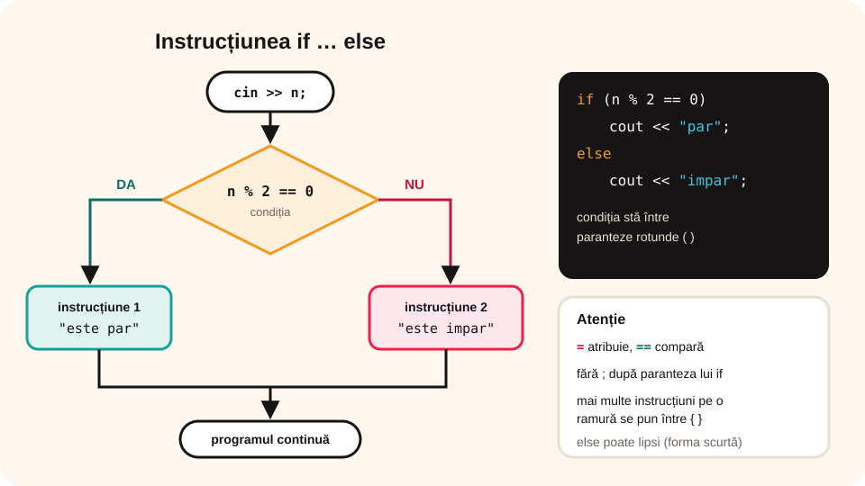

## Ce vei învăța azi

- să scrii **instrucțiunea if**, cu și fără **else**;
- să folosești **condiții** simple și **compuse**;
- când pui **acolade**;
- să rezolvi probleme de **decizie** în C++.

## Să ne amintim

**Structura alternativă** (de decizie) alege între două drumuri, după o **condiție**:

```text
dacă condiție atunci
    instrucțiuni 1
altfel
    instrucțiuni 2
```

## Lecția pe scurt

### Forma completă: if … else

```cpp
if (conditie)
    instructiune1;
else
    instructiune2;
```

Dacă **condiția** este **adevărată**, se execută `instructiune1`; altfel, `instructiune2`. Condiția stă **obligatoriu între paranteze rotunde**.



### Forma scurtă: if fără else

```cpp
if (conditie)
    instructiune;
```

Dacă condiția e falsă, nu se întâmplă nimic și programul merge mai departe.

### Mai multe instrucțiuni: acoladele

Pe o ramură se execută **o singură instrucțiune**. Dacă vrei mai multe, le pui într-un **bloc**, între **acolade**:

```cpp
if (a > b)
{
    aux = a;
    a = b;
    b = aux;
}
```

Fără acolade, doar prima instrucțiune ar depinde de condiție!

### Condiții

- simple: `n % 2 == 0`, `nota >= 5`, `a != b`;
- compuse: `x >= 10 && x <= 99` (x are două cifre), `zi == 6 || zi == 7` (weekend).

**Greșeli frecvente**:

- `if (a = 5)` atribuie în loc să compare; corect: `if (a == 5)`;
- `if (n > 0);` cu **;** după paranteză: if-ul nu mai controlează nimic;
- `1 <= x <= 10` nu funcționează ca la matematică; scrii `x >= 1 && x <= 10`.

## Exemplu rezolvat: par sau impar

```cpp
#include <iostream>
using namespace std;

int main()
{
    int n;
    cout << "n = ";
    cin >> n;
    if (n % 2 == 0)
        cout << n << " este par";
    else
        cout << n << " este impar";
    return 0;
}
```

### Al doilea exemplu: maximul a două numere

```cpp
int a, b, maxim;
cin >> a >> b;
if (a > b)
    maxim = a;
else
    maxim = b;
cout << "Maximul este " << maxim;
```

Pentru 12 și 31 afișează **Maximul este 31**.

## Aplicații interactive

```quiz
# Alege răspunsul corect.
Ce afișează pentru x = 7? if (x > 5) cout << "mare"; else cout << "mic";
* mare
- mic
- mare mic

Care condiție e adevărată doar pentru numerele de două cifre?
- x > 10 || x < 99
* x >= 10 && x <= 99
- 10 <= x <= 99

Ce greșeală are if (n = 0)?
* atribuie 0 lui n în loc să compare; trebuia ==
- lipsesc acoladele
- nu are nicio greșeală
```

```categorii
# Ce condiție C++ se potrivește?
n % 2 == 0: n este par
n % 5 == 0: n se divide cu 5
nota >= 5: elevul a promovat
a == b: numerele sunt egale
```

```ordonare
# Ordonează programul: admis sau respins (media cel puțin 5)
double m;
cin >> m;
if (m >= 5)
cout << "Admis";
else
cout << "Respins";
```

```adevarat-fals
A: Condiția unui if se scrie între paranteze rotunde.
F: Ramura else este obligatorie. | Forma scurtă a lui if nu are else.
A: Pentru mai multe instrucțiuni pe o ramură se folosesc acolade.
F: Expresia 1 <= x <= 10 verifică în C++ dacă x este între 1 și 10. | Se scrie x >= 1 && x <= 10.
```

```completare
# Completează programul care afișează valoarea absolută a lui x.
if (x [<] 0) x = -x; cout << x;
```

## Exersează

1. Citește un număr și afișează dacă este **pozitiv**, **negativ** sau **zero** (folosește două if-uri).
2. Citește vârsta unei persoane și afișează „Poate vota” sau „Nu poate vota încă”.
3. Citește două numere și afișează-le în ordine **crescătoare**.
4. Citește un an și afișează dacă e **bisect**: se divide cu 4 și nu cu 100, sau se divide cu 400.
5. Citește un număr de trei cifre și verifică dacă e **palindrom** (prima cifră egală cu ultima: 474, 101).
6. **Portofoliu:** programul „Ghicește numărul”: numărul secret e 17; utilizatorul introduce un număr, iar programul afișează „Ai ghicit!”, „Prea mic” sau „Prea mare”.

## Verifică-te

- Când lipsește `else`, ce se întâmplă dacă condiția e falsă?
- De ce `if (a = 5)` este o greșeală?

## Pe scurt

Instrucțiunea **if** execută o instrucțiune dacă **condiția** e adevărată, iar **else** o execută pe cealaltă dacă e falsă. Condiția stă între **paranteze**; mai multe instrucțiuni se pun între **acolade**. Condițiile compuse folosesc `&&` și `||`. Atenție la `==` față de `=`!
