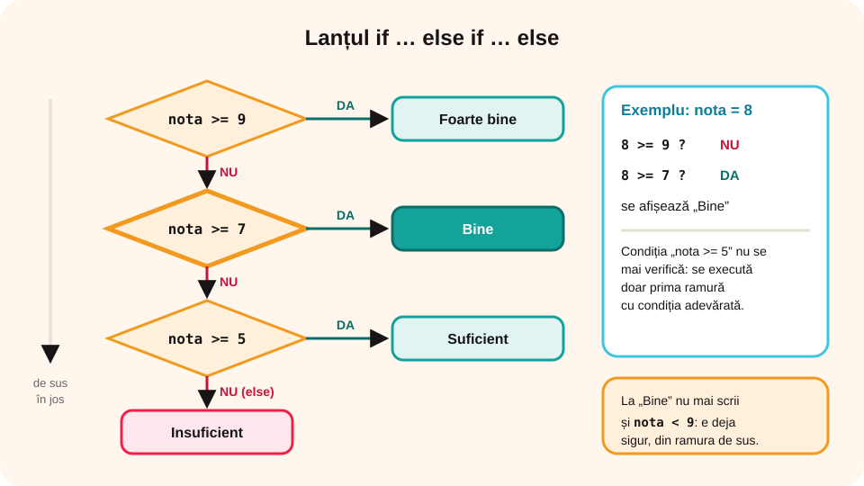

> **Competențe specifice (Anexa 15):** CS 2.2, CS 3.3

## Ce vei învăța azi

- să pui un **if în alt if** (decizii imbricate);
- să alegi între **mai multe** variante cu `if … else if … else`;
- să rezolvi probleme cu **trei sau mai multe** cazuri;
- ce face instrucțiunea **switch**.

## Să ne amintim

`if (conditie) A; else B;` alege între **două** drumuri. Condițiile compuse se scriu cu `&&` (și) și `||` (sau). Mai multe instrucțiuni pe o ramură se pun între **acolade**.

## Lecția pe scurt

### Decizii imbricate

O ramură a unui if poate conține alt if:

```cpp
if (n >= 0)
{
    if (n == 0)
        cout << "zero";
    else
        cout << "pozitiv";
}
else
    cout << "negativ";
```

Folosește **acolade** și **indentare** (aliniere cu spații), ca să se vadă clar ce if aparține de ce else.

### Lanțul if … else if … else

Când ai mai multe cazuri care se exclud, le scrii **unul după altul**:

```cpp
if (nota >= 9)
    cout << "Foarte bine";
else if (nota >= 7)
    cout << "Bine";
else if (nota >= 5)
    cout << "Suficient";
else
    cout << "Insuficient";
```

Condițiile se verifică **de sus în jos**; se execută **doar prima** ramură cu condiția adevărată. De aceea, la ramura „Bine” nu mai trebuie să scrii `nota < 9`.



### Maximul a trei numere

```cpp
maxim = a;
if (b > maxim) maxim = b;
if (c > maxim) maxim = c;
```

Ideea: presupui că primul e cel mai mare, apoi îl compari pe fiecare cu „campionul” de până acum. Funcționează pentru oricâte numere.

### Instrucțiunea switch

Când compari **aceeași variabilă** de tip **întreg** sau **char** cu mai multe **valori fixe**:

```cpp
switch (zi)
{
    case 1: cout << "Luni"; break;
    case 2: cout << "Marti"; break;
    case 3: cout << "Miercuri"; break;
    case 6:
    case 7: cout << "Weekend"; break;
    default: cout << "Alta zi";
}
```

`break` oprește switch-ul; fără el, s-ar executa și cazurile următoare. `default` prinde orice altă valoare.

## Exemplu rezolvat: ecuația a · x + b = 0

Se citesc a și b, numere reale. Afișează soluția.

```cpp
#include <iostream>
using namespace std;

int main()
{
    double a, b;
    cin >> a >> b;
    if (a != 0)
    {
        double x = -b / a;
        if (x == 0)
            x = 0;  // pentru b = 0, ca să nu afișeze „-0”
        cout << "x = " << x;
    }
    else if (b == 0)
        cout << "Orice numar este solutie";
    else
        cout << "Nu exista solutie";
    return 0;
}
```

| a | b | Afișează |
|---|---|---|
| 2 | -6 | x = 3 |
| 0 | 0 | Orice numar este solutie |
| 0 | 5 | Nu exista solutie |

## Aplicații interactive

```quiz
# Alege răspunsul corect.
Ce afișează lanțul de calificative pentru nota 8?
- Foarte bine
* Bine
- Suficient

Ce afișează pentru a = 4, b = 9, c = 2? maxim = a; if (b > maxim) maxim = b; if (c > maxim) maxim = c; cout << maxim;
- 4
* 9
- 2

Ce se întâmplă într-un switch dacă lipsește break?
* se execută și instrucțiunile cazurilor următoare
- programul nu se compilează
- se sare la default
```

```categorii
# Ce tip are triunghiul cu laturile a, b, c?
Echilateral (toate laturile egale): a == b && b == c
Cel puțin isoscel (măcar două laturi egale): a == b || b == c || a == c
Oarecare (nicio latură egală cu alta): a != b && b != c && a != c
```

```ordonare
# Ordonează lanțul pentru semnul lui n
if (n > 0)
cout << "pozitiv";
else if (n < 0)
cout << "negativ";
else
cout << "zero";
```

```adevarat-fals
A: Într-un lanț if … else if, se execută cel mult o ramură.
F: Instrucțiunea switch poate compara o variabilă cu intervale, de exemplu nota mai mare decât 7. | switch compară cu valori fixe.
A: Ramura default dintr-un switch prinde orice altă valoare.
A: Indentarea ajută la citirea if-urilor imbricate.
```

```completare
# Completează.
Pentru ecuația 2x - 8 = 0, adică a = 2 și b = -8, programul afișează x = [4]. Dacă a = 0 și b = 3, programul afișează că nu există [solutie|soluție].
```

## Exersează

1. Citește trei numere și afișează-l pe cel mai **mic**.
2. Citește trei numere și afișează-le în ordine **crescătoare**.
3. Citește trei lungimi și verifică dacă pot fi laturile unui **triunghi** (fiecare latură mai mică decât suma celorlalte); dacă da, afișează tipul: echilateral, isoscel sau oarecare.
4. Citește numărul lunii (1–12) și afișează **anotimpul**, cu switch.
5. Citește o temperatură (număr întreg) și afișează „Ger” (sub 0), „Frig” (0–10), „Plăcut” (11–25) sau „Cald” (peste 25).
6. **Portofoliu:** un **calculator**: citește două numere și un caracter (`+`, `-`, `*`, `/`) și afișează rezultatul; la împărțirea cu 0, un mesaj de eroare.

## Verifică-te

- De ce, în lanțul de calificative, nu mai scrii `nota < 9` la ramura „Bine”?
- Când folosești switch în loc de if?

## Pe scurt

Un **if** poate conține alt **if** (decizii imbricate). Lanțul **if … else if … else** alege dintre mai multe cazuri: se execută **prima** ramură cu condiția adevărată. **Maximul** se află comparând pe rând cu „campionul”. **switch** compară o variabilă cu valori fixe; nu uita de **break**.
