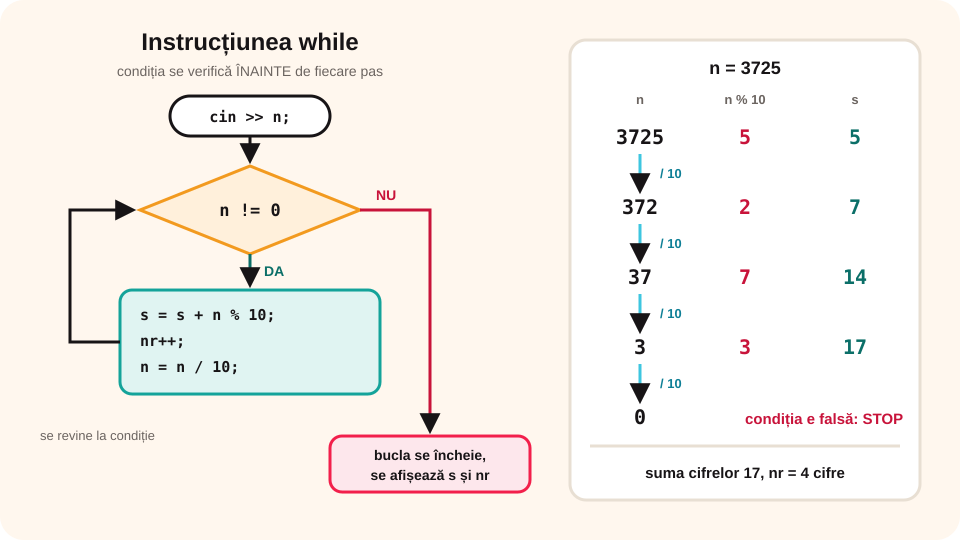

## Ce vei învăța azi

- să scrii instrucțiunea **while**;
- de ce condiția se verifică **înainte** de fiecare pas;
- cum eviți **bucla infinită**;
- să prelucrezi **cifrele** unui număr și să citești numere **până la 0**.

## Să ne amintim

În clasa a VI-a ai folosit structura **cât timp … execută**: pașii se repetă **cât timp** condiția e adevărată. Dacă la început condiția e falsă, pașii **nu se execută deloc**.

```text
cât timp condiție execută
    instrucțiuni
```

## Lecția pe scurt

### Instrucțiunea while

```cpp
while (conditie)
{
    instructiuni;
}
```

1. Se verifică **condiția**.
2. Dacă e **adevărată**, se execută instrucțiunile din buclă și se revine la pasul 1.
3. Dacă e **falsă**, bucla se încheie și programul continuă după ea.

Fiecare execuție a instrucțiunilor din buclă se numește **iterație** (pas).

### Bucla infinită

În buclă trebuie să se schimbe ceva care face, la un moment dat, condiția **falsă**. Altfel bucla nu se oprește niciodată:

```cpp
int i = 1;
while (i <= 5)
    cout << i;      // i nu se schimbă: buclă infinită!
```

Corect: `while (i <= 5) { cout << i; i++; }`. Dacă programul „îngheață”, închizi consola sau apeși **Ctrl + C**.

### Cifrele unui număr

Cu `% 10` iei **ultima cifră**, iar cu `/ 10` o **tai**. Repeți cât timp numărul nu a devenit 0:

```cpp
int n, s = 0, nr = 0;
cin >> n;
while (n != 0)
{
    s = s + n % 10;   // adun ultima cifră
    nr++;             // număr cifra
    n = n / 10;       // tai ultima cifră
}
cout << "Suma cifrelor: " << s << endl;
cout << "Numar de cifre: " << nr;
```

Pentru 3725: s = 5 + 2 + 7 + 3 = **17**, nr = **4**.

| Pas | n % 10 | s | nr | n după pas |
|---|---|---|---|---|
| 1 | 5 | 5 | 1 | 372 |
| 2 | 2 | 7 | 2 | 37 |
| 3 | 7 | 14 | 3 | 3 |
| 4 | 3 | 17 | 4 | 0 |



### Oglinditul unui număr

```cpp
int n, ogl = 0;
cin >> n;
while (n > 0)
{
    ogl = ogl * 10 + n % 10;
    n = n / 10;
}
cout << ogl;      // 3725 → 5273
```

### Citire până la 0

Când nu știi câte numere vor fi, citești **cât timp** nu apare 0:

```cpp
int x, s = 0;
cin >> x;
while (x != 0)
{
    s = s + x;
    cin >> x;
}
cout << s;
```

## Exemplu rezolvat: cel mai mare divizor comun (Euclid prin scăderi)

Cât timp numerele sunt diferite, scazi din cel mai mare pe cel mai mic. La final, numerele sunt egale cu **cmmdc**.

```cpp
#include <iostream>
using namespace std;

int main()
{
    int a, b;
    cin >> a >> b;
    while (a != b)
    {
        if (a > b)
            a = a - b;
        else
            b = b - a;
    }
    cout << "cmmdc = " << a;
    return 0;
}
```

Pentru 24 și 18: (24, 18) → (6, 18) → (6, 12) → (6, 6). **cmmdc = 6**. Programul presupune că a și b sunt nenule.

## Aplicații interactive

```quiz
# Alege răspunsul corect.
De câte ori se execută bucla? i = 1; while (i <= 4) { cout << i; i++; }
- de 3 ori
* de 4 ori
- de 5 ori

Ce afișează? i = 10; while (i < 5) { cout << i; i++; } cout << "gata";
* gata
- 10gata
- nimic, e buclă infinită

Ce valoare are s pentru n = 506, după bucla care adună cifrele?
- 56
* 11
- 3
```

```ordonare
# Ordonează programul care calculează suma cifrelor lui n
int n, s = 0;
cin >> n;
while (n != 0)
{
s = s + n % 10;
n = n / 10;
}
cout << s;
```

```adevarat-fals
A: La while, condiția se verifică înainte de fiecare iterație.
A: Dacă la început condiția e falsă, instrucțiunile din while nu se execută niciodată.
F: Pentru x = 3, bucla while (x > 0) cout << x; se oprește singură. | x nu se modifică, deci bucla este infinită.
F: Oglinditul lui 120 este 021. | Este 21; zerourile din față nu se scriu.
```

```categorii
# Ce face instrucțiunea în prelucrarea cifrelor?
n % 10: dă ultima cifră
n / 10: taie ultima cifră
ogl * 10 + n % 10: lipește cifra la oglindit
```

```completare
# Completează.
Pentru n = 4096, numărul de cifre este [4], suma cifrelor este [19], iar oglinditul este [6904].
```

## Exersează

1. Afișează numerele de la 1 la n, cu while.
2. Citește n și afișează **produsul** cifrelor lui (pentru 234 → 24).
3. Citește n și afișează câte cifre **pare** are.
4. Citește n și verifică dacă este **palindrom** (egal cu oglinditul lui).
5. Citește numere până la 0 și afișează câte au fost **pozitive** și câte **negative**.
6. **Portofoliu:** „Pușculița”: în fiecare zi pui cu 2 lei mai mult decât în ziua dinainte (prima zi 1 leu). Citește suma dorită și afișează după câte zile o strângi.

## Verifică-te

- Ce se întâmplă dacă uiți să modifici variabila din condiție?
- De ce se folosesc `% 10` și `/ 10` la prelucrarea cifrelor?

## Pe scurt

**while** repetă instrucțiunile **cât timp** condiția e adevărată; condiția se verifică **înainte** de fiecare iterație, deci bucla poate să nu se execute deloc. În buclă trebuie să se modifice ceva, altfel apare **bucla infinită**. Cu `% 10` și `/ 10` parcurgem **cifrele** unui număr.
