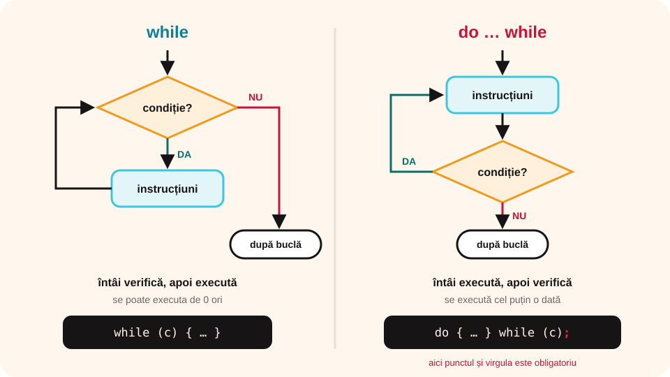

> **Competențe specifice (Anexa 15):** CS 2.2, CS 3.3

## Ce vei învăța azi

- să scrii instrucțiunea **do … while**;
- diferența dintre **while** și **do … while**;
- să **validezi** datele: ceri din nou un număr până e corect;
- să faci un **meniu** sau un **joc** care se repetă.

## Să ne amintim

În clasa a VI-a, structura **execută … cât timp** făcea pașii **întâi** și verifica condiția **după**. Așa, pașii se execută **cel puțin o dată**.

## Lecția pe scurt

### Instrucțiunea do … while

```cpp
do
{
    instructiuni;
} while (conditie);
```

1. Se execută instrucțiunile.
2. Se verifică **condiția**.
3. Dacă e **adevărată**, se reia de la pasul 1; dacă e **falsă**, bucla se încheie.

Atenție la **punctul și virgula** de după `while (conditie)`: aici este obligatoriu!

### while sau do … while?

| while | do … while |
|---|---|
| condiția se verifică **înainte** | condiția se verifică **după** |
| se poate executa de **0** ori | se execută **cel puțin o dată** |
| `while (c) { … }` | `do { … } while (c);` |

Exemplu: numărul de cifre al lui **0**. Cu while, `while (n != 0)` nu intră deloc în buclă și afișează 0 cifre. Cu do … while, răspunsul corect este **1**:

```cpp
int n, nr = 0;
cin >> n;
do
{
    nr++;
    n = n / 10;
} while (n != 0);
cout << nr;
```



### Validarea datelor

Programul cere un număr **până când** e corect:

```cpp
int nota;
do
{
    cout << "Nota (1-10): ";
    cin >> nota;
} while (nota < 1 || nota > 10);
```

Condiția descrie **când greșește** utilizatorul: cât timp nota e greșită, o cere din nou.

### Meniu care se repetă

```cpp
int opt;
do
{
    cout << "1. Salut  2. Gluma  0. Iesire" << endl;
    cin >> opt;
    if (opt == 1) cout << "Salut!" << endl;
    else if (opt == 2) cout << "Ce face un PC la plaja? Se descarca!" << endl;
} while (opt != 0);
```

## Exemplu rezolvat: jocul „Ghicește numărul”

Numărul secret este 37. Jucătorul încearcă până ghicește; programul îl ajută și numără încercările.

```cpp
#include <iostream>
using namespace std;

int main()
{
    int secret = 37, x, incercari = 0;
    do
    {
        cout << "Numarul tau: ";
        cin >> x;
        incercari++;
        if (x < secret) cout << "Prea mic" << endl;
        else if (x > secret) cout << "Prea mare" << endl;
    } while (x != secret);
    cout << "Ai ghicit din " << incercari << " incercari!";
    return 0;
}
```

Strategia cea mai bună (dacă știi că numărul este între 1 și 100): începi de la mijloc (50), apoi înjumătățești intervalul de fiecare dată.

## Aplicații interactive

```quiz
# Alege răspunsul corect.
De câte ori se execută? i = 10; do { cout << i; i++; } while (i < 5);
- niciodată
* o dată
- de 5 ori

Ce condiție validează un număr par citit?
* do { cin >> n; } while (n % 2 != 0);
- do { cin >> n; } while (n % 2 == 0);
- do { cin >> n; } while (n > 0);

Unde este obligatoriu punctul și virgula la do … while?
- după do
* după while (conditie)
- după acolada de deschidere
```

```categorii
# while sau do … while?
while: condiția se verifică înainte, poate executa de 0 ori
do … while: condiția se verifică după, execută cel puțin o dată
```

```ordonare
# Ordonează validarea unei vârste între 1 și 120
int v;
do
{
cin >> v;
} while (v < 1 || v > 120);
cout << "Varsta corecta";
```

```adevarat-fals
A: Instrucțiunile din do … while se execută cel puțin o dată.
F: La validare, condiția din while descrie valorile corecte. | Descrie valorile greșite: cât timp sunt greșite, se cere din nou.
A: Numărul de cifre al lui 0 se calculează corect cu do … while.
```

```completare
# Completează programul care citește numere până la un număr negativ și le adună.
s = 0; do { cin >> x; if (x >= 0) s = s + x; } [while] (x [>=] 0);
```

## Exersează

1. Citește un număr de **trei cifre**, cu validare (cere din nou dacă nu are trei cifre).
2. Afișează numerele pare de la 2 la 20, cu do … while.
3. Citește o parolă numerică până când este 2024; numără câte încercări greșite au fost.
4. Fă un meniu cu opțiunile: 1 – aria pătratului, 2 – aria dreptunghiului, 0 – ieșire.
5. Modifică jocul „Ghicește numărul” ca jucătorul să aibă doar **7 încercări**.
6. **Portofoliu:** un test de calcul mental: programul întreabă „7 × 8 = ?” până la răspunsul corect, apoi alte două întrebări, și afișează câte greșeli ai făcut.

## Verifică-te

- Când alegi do … while în loc de while?
- Ce condiție scrii la validarea unei note între 1 și 10?

## Pe scurt

**do … while** execută instrucțiunile **întâi** și verifică **apoi** condiția, deci bucla rulează **cel puțin o dată**. După `while (conditie)` urmează obligatoriu **;**. Este potrivită pentru **validarea datelor**, **meniuri** și **jocuri** care se repetă.
