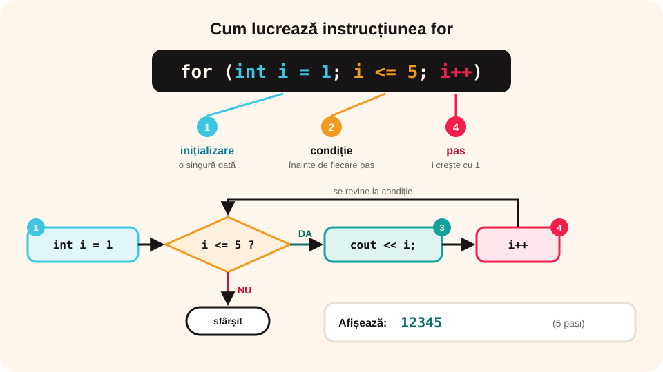

> **Competențe specifice (Anexa 15):** CS 2.2, CS 3.3

## Ce vei învăța azi

- să scrii instrucțiunea **for**;
- să numeri **crescător**, **descrescător** și cu **pași** diferiți;
- să calculezi **sume** și **produse** cu for;
- să citești și să prelucrezi **n numere**.

## Să ne amintim

Structura **pentru** repetă pașii de un **număr cunoscut** de ori, folosind un **contor**:

```text
pentru i ← 1, n execută
    instrucțiuni
```

## Lecția pe scurt

### Instrucțiunea for

```cpp
for (initializare; conditie; pas)
{
    instructiuni;
}
```

Exemplu: `for (int i = 1; i <= 5; i++) cout << i << " ";` afișează `1 2 3 4 5`.

1. **Inițializarea** (`int i = 1`) se face **o singură dată**, la început.
2. Se verifică **condiția** (`i <= 5`); dacă e falsă, bucla se încheie.
3. Se execută instrucțiunile.
4. Se face **pasul** (`i++`, adică i crește cu 1) și se revine la 2.

for este, de fapt, un while scris mai compact:

```cpp
int i = 1;
while (i <= 5)
{
    cout << i << " ";
    i++;
}
```



### Variante

| for | Afișează |
|---|---|
| `for (i = 1; i <= 10; i++)` | 1 2 3 … 10 |
| `for (i = 10; i >= 1; i--)` | 10 9 8 … 1 |
| `for (i = 2; i <= 20; i = i + 2)` | 2 4 6 … 20 |
| `for (i = 0; i <= 100; i = i + 25)` | 0 25 50 75 100 |

Bucla `for (i = 1; i <= n; i++)` face exact **n** pași.

### Suma și produsul

```cpp
int n, s = 0;
long long p = 1;
cin >> n;
for (int i = 1; i <= n; i++)
{
    s = s + i;     // suma 1 + 2 + … + n
    p = p * i;     // produsul 1 · 2 · … · n
}
```

- suma pornește de la **0**, produsul de la **1** (elementul neutru);
- produsul `1 · 2 · … · n` se numește **factorial**: n! (5! = 120);
- factorialul crește foarte repede; `long long` păstrează numere mai mari decât `int` (până la 20!).

### Citirea a n numere

```cpp
int n, x, s = 0;
cin >> n;
for (int i = 1; i <= n; i++)
{
    cin >> x;
    s = s + x;
}
cout << "Suma = " << s;
```

Contorul `i` doar numără citirile; valoarea citită e în `x`.

## Exemplu rezolvat: media notelor

Se citesc n și apoi n note. Afișează media, cu două zecimale.

```cpp
#include <iostream>
#include <iomanip>
using namespace std;

int main()
{
    int n;
    double nota, s = 0;
    cin >> n;
    for (int i = 1; i <= n; i++)
    {
        cin >> nota;
        s = s + nota;
    }
    cout << fixed << setprecision(2) << s / n;
    return 0;
}
```

Pentru n = 4 și notele 9 10 8 7, afișează **8.50**. `fixed << setprecision(2)` (din biblioteca `iomanip`) afișează două zecimale.

## Aplicații interactive

```quiz
# Alege răspunsul corect.
Ce afișează? for (int i = 3; i <= 7; i++) cout << i;
* 34567
- 3456
- 4567

De câte ori se execută? for (int i = 10; i >= 1; i = i - 3) cout << i << " ";
- de 3 ori
* de 4 ori
- de 10 ori

Cu ce valoare pornești un produs?
- 0
* 1
- n
```

```ordonare
# Ordonează etapele executării unui for
Se face inițializarea contorului
Se verifică condiția
Se execută instrucțiunile din buclă
Se face pasul
Se revine la verificarea condiției
```

```categorii
# Ce afișează bucla?
1 2 3 4 5: for (i = 1; i <= 5; i++)
5 4 3 2 1: for (i = 5; i >= 1; i--)
1 3 5 7 9: for (i = 1; i <= 9; i = i + 2)
```

```adevarat-fals
A: Inițializarea dintr-un for se face o singură dată.
F: Suma se inițializează cu 1. | Suma pornește de la 0; produsul de la 1.
A: Orice for se poate rescrie cu while.
A: 5! = 120.
```

```completare
# Completează.
Suma 1 + 2 + … + 10 este [55]. Produsul 1 · 2 · 3 · 4 este [24]. Bucla for (i = 1; i <= n; i++) face exact [n] pași.
```

## Exersează

1. Afișează tabla înmulțirii cu 7: `7 x 1 = 7` … `7 x 10 = 70`.
2. Afișează numerele **impare** mai mici decât n.
3. Citește n și calculează suma `1 + 3 + 5 + … ` a primelor n numere impare. Ce observi?
4. Citește n numere și afișează câte sunt **mai mari decât 10**.
5. Calculează 2 la puterea n cu for (înmulțești de n ori cu 2).
6. **Portofoliu:** „Clasamentul”: citește punctajele a n elevi și afișează punctajul **total**, **media** și câți au peste 80 de puncte.

## Verifică-te

- Ce trei părți are paranteza unui for?
- De ce suma pornește de la 0, iar produsul de la 1?

## Pe scurt

**for** repetă de un număr **cunoscut** de ori, cu un **contor**: `for (inițializare; condiție; pas)`. Contorul poate crește, scădea sau sări din 2 în 2. **Suma** pornește de la 0, **produsul** de la 1. Cu for citim și prelucrăm **n numere**.
