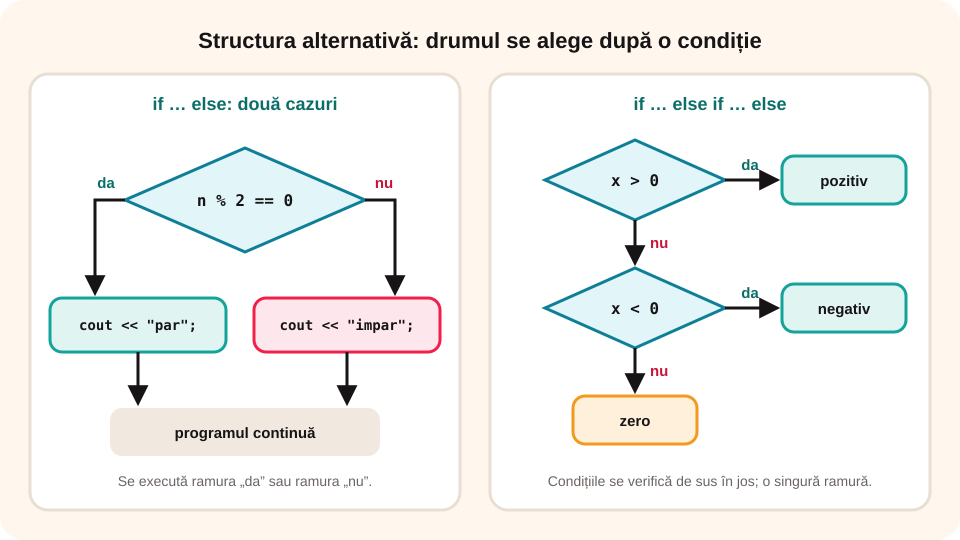

## Ce vei învăța azi

- să reamintești **structura alternativă** în pseudocod și în **C++**;
- să scrii **condiții compuse** corecte;
- să alegi între **if**, **if … else if** și **switch**;
- să rezolvi probleme tipice de **decizie**.

## Să ne amintim

În clasa a VII-a ai lucrat în **Code::Blocks**, în C++: citire cu `cin`, afișare cu `cout`, operatorii `/` și `%`, apoi structurile **alternativă** și **repetitive**.

## Lecția pe scurt

### Pseudocod și C++

| Pseudocod | C++ |
|---|---|
| `dacă c atunci A altfel B` | `if (c) A; else B;` |
| `dacă c atunci A` | `if (c) A;` |
| `și`, `not` | `&&`, `!` |
| `=`, `≠` (comparare) | `==`, `!=` |

### Condiții des folosite

| Condiție | Înțeles |
|---|---|
| `n % 2 == 0` | n este par |
| `n % k == 0` | n se divide cu k |
| `n >= 10 && n <= 99` | n are două cifre |
| `a == b && b == c` | toate trei sunt egale |
| `x >= 1 && x <= 9` | x este o cifră nenulă |
| `n % 10 == n / 100` | n (de trei cifre) are prima cifră egală cu ultima |

Operatorul **sau** se scrie cu două bare verticale: `x < 0 || x > 100` înseamnă „x este în afara intervalului 0–100”.

Negația lui `a && b` este `!a || !b`: „nu e (par **și** pozitiv)” înseamnă „e impar **sau** nu e pozitiv”.

### Trei forme de decizie

- **if … else**: două cazuri;
- **if … else if … else**: mai multe cazuri care se exclud, verificate de sus în jos;
- **switch**: o variabilă întreagă comparată cu valori fixe (`case`, `break`, `default`).



### Greșeli de evitat

- `if (a = b)` în loc de `if (a == b)`;
- `;` imediat după `if (…)`;
- lipsa acoladelor când o ramură are mai multe instrucțiuni;
- `1 <= x <= 10` în loc de `x >= 1 && x <= 10`.

## Exemplu rezolvat: trei numere în ordine crescătoare

```cpp
#include <iostream>
using namespace std;

int main()
{
    int a, b, c, aux;
    cin >> a >> b >> c;
    if (a > b) { aux = a; a = b; b = aux; }
    if (b > c) { aux = b; b = c; c = aux; }
    if (a > b) { aux = a; a = b; b = aux; }
    cout << a << " " << b << " " << c;
    return 0;
}
```

Pentru 9 4 6: după primul if → 4 9 6, după al doilea → 4 6 9, al treilea nu mai schimbă nimic. Afișează **4 6 9**.

### Al doilea exemplu: anul bisect

```cpp
if ((an % 4 == 0 && an % 100 != 0) || an % 400 == 0)
    cout << "bisect";
else
    cout << "nebisect";
```

2024 → bisect; 1900 → nebisect; 2000 → bisect.

## Aplicații interactive

```categorii
# Ce condiție C++ corespunde?
n % 2 == 1: n (natural) este impar
n % 3 == 0 && n % 5 == 0: n se divide cu 15
n >= 100 && n <= 999: n are trei cifre
x < 1 || x > 10: x nu este între 1 și 10
```

```quiz
# Alege răspunsul corect.
Ce afișează pentru a = 7, b = 7? if (a > b) cout << "A"; else if (a < b) cout << "B"; else cout << "egale";
- A
- B
* egale

Care este negația condiției x > 0 && x % 2 == 0?
- x <= 0 && x % 2 != 0
* x <= 0 || x % 2 != 0
- x < 0 || x % 2 == 0

Care an este bisect?
- 1900
* 2000
- 2023
```

```ordonare
# Ordonează programul care afișează maximul a două numere
int a, b;
cin >> a >> b;
if (a > b)
cout << a;
else
cout << b;
```

```adevarat-fals
A: Într-un lanț if … else if … else se execută o singură ramură.
F: Condiția n % 2 = 0 verifică dacă n e par. | Comparația se scrie cu ==.
A: switch se folosește pentru o variabilă comparată cu valori fixe.
A: Pentru 1900, condiția de an bisect este falsă.
```

```completare
# Completează.
Pentru n = 545, n % 10 este [5], iar n / 100 este [5], deci prima cifră este egală cu ultima. Pentru x = 15, condiția x % 3 == 0 && x % 5 == 0 este [adevărată|adevarata|true].
```

## Exersează

1. Citește un număr întreg și afișează dacă este pozitiv, negativ sau zero.
2. Citește trei numere și afișează câte dintre ele sunt pare.
3. Citește o notă de la 1 la 10 și afișează calificativul (FB, B, S, I) cu un lanț else if.
4. Citește numărul unei zile (1–7) și afișează numele ei cu switch.
5. Citește un număr de patru cifre și verifică dacă cifrele lui sunt în ordine strict crescătoare.
6. **Portofoliu:** „Biletul la film”: citește vârsta și ziua săptămânii; copiii sub 12 ani plătesc 15 lei, ceilalți 25 de lei, iar miercuri toți au 5 lei reducere. Afișează prețul.

## Verifică-te

- Când folosești switch în loc de if?
- Cum scrii negația condiției „a > 0 și b > 0”?

## Pe scurt

**Structura alternativă** alege un drum după o **condiție**: `if … else`, `if … else if … else` sau `switch`. Condițiile se compun cu `&&`, `||`, `!`, iar comparațiile se fac cu `==` și `!=`. Atenție la `=` față de `==`, la `;` după if și la acolade!
