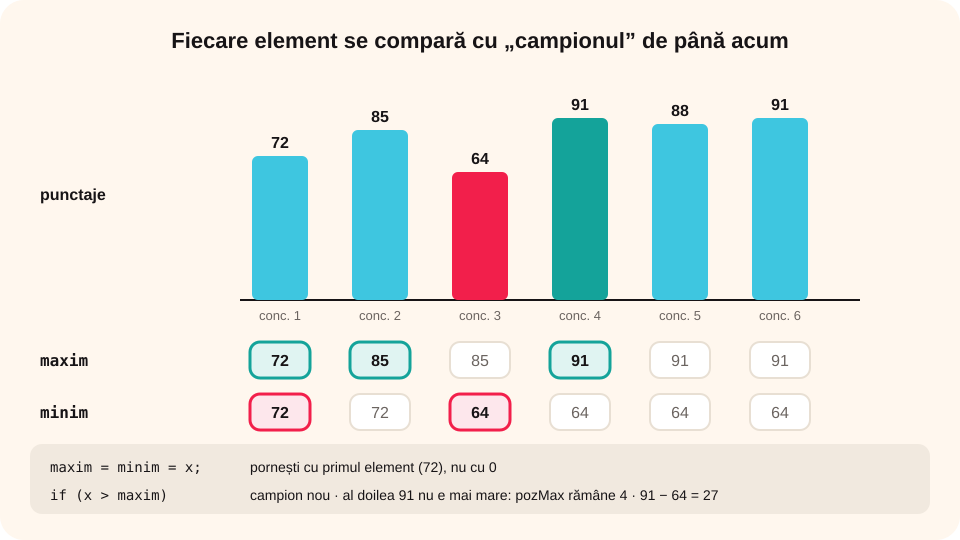

## Ce vei învăța azi

- să afli **maximul** și **minimul** dintr-un șir de valori;
- de ce inițializăm cu **primul element**;
- să afli **poziția** maximului și **de câte ori** apare;
- să afli maximul doar dintre elementele cu o **proprietate**.

## Să ne amintim

În clasa a VII-a ai aflat maximul a trei numere: presupui că primul e cel mai mare, apoi îl compari pe fiecare cu „campionul”. Același algoritm merge pentru oricâte numere.

## Lecția pe scurt

### Algoritmul maximului

```cpp
int n, x, maxim;
cin >> n >> x;            // primul element
maxim = x;                // campionul de până acum
for (int i = 2; i <= n; i++)
{
    cin >> x;
    if (x > maxim)
        maxim = x;        // avem un campion nou
}
cout << maxim;
```

Pentru **minim**, folosești `<` în loc de `>`.

### De ce primul element?

Dacă ai inițializa `maxim = 0` și toate numerele ar fi **negative** (de exemplu temperaturile de iarnă: -5, -2, -8), programul ar afișa 0, care nici nu e în șir! Inițializarea cu **primul element** funcționează mereu.

Altă variantă: inițializezi maximul cu o valoare **mai mică decât orice element posibil** (de exemplu, -1000000) și pornești for-ul de la 1.

### Poziția maximului

```cpp
if (x > maxim) { maxim = x; poz = i; }
```

Cu `>` reții **prima** poziție a maximului; cu `>=` reții **ultima** poziție.

### De câte ori apare maximul

Când găsești un maxim **nou**, contorul **începe de la 1**; când găsești o valoare **egală** cu maximul, crește:

```cpp
if (x > maxim) { maxim = x; k = 1; }
else if (x == maxim) k++;
```

### Maximul elementelor cu o proprietate

De exemplu, cel mai mare număr **par**. Nu poți porni de la primul element (poate e impar). Folosești un indicator: primul element par găsit devine maxim.

```cpp
int gasit = 0, maxPar;
for (int i = 1; i <= n; i++)
{
    cin >> x;
    if (x % 2 == 0)
    {
        if (gasit == 0 || x > maxPar) maxPar = x;
        gasit = 1;
    }
}
if (gasit) cout << maxPar; else cout << "Nu exista numere pare";
```

## Exemplu rezolvat: recordurile unui sportiv

Se citesc punctajele obținute de un sportiv în n concursuri. Afișează cel mai bun și cel mai slab punctaj, la al câtelea concurs a obținut cel mai bun punctaj și diferența dintre ele.

```cpp
#include <iostream>
using namespace std;

int main()
{
    int n, x, maxim, minim, pozMax = 1;
    cin >> n >> x;
    maxim = minim = x;
    for (int i = 2; i <= n; i++)
    {
        cin >> x;
        if (x > maxim) { maxim = x; pozMax = i; }
        if (x < minim) minim = x;
    }
    cout << "Cel mai bun: " << maxim << " (concursul " << pozMax << ")" << endl;
    cout << "Cel mai slab: " << minim << endl;
    cout << "Diferenta: " << maxim - minim;
    return 0;
}
```

Pentru `6` și `72 85 64 91 88 91`: cel mai bun **91 (concursul 4)**, cel mai slab **64**, diferența **27**.



## Aplicații interactive

```quiz
# Alege răspunsul corect.
De ce nu inițializăm maximul cu 0?
* dacă toate elementele sunt negative, rezultatul ar fi greșit
- pentru că 0 nu este număr
- e la fel de bine

Ce poziție reține if (x > maxim) { maxim = x; poz = i; } pentru șirul 4 9 2 9?
* 2
- 4
- 1

De câte ori apare maximul în șirul 7 3 7 1 7?
- 1
- 2
* 3
```

```categorii
# Ce operator folosești?
x > maxim: maximul și prima lui poziție
x >= maxim: maximul și ultima lui poziție
x < minim: minimul și prima lui poziție
```

```ordonare
# Ordonează programul care află minimul a n numere
int n, x, minim;
cin >> n >> x;
minim = x;
for (int i = 2; i <= n; i++)
{
cin >> x;
if (x < minim) minim = x;
}
cout << minim;
```

```adevarat-fals
A: Maximul se poate inițializa cu primul element al șirului.
F: Pentru maximul numerelor pare putem porni mereu de la primul element. | Primul element poate fi impar.
A: Diferența dintre maxim și minim se numește și amplitudinea valorilor.
A: Minimul și maximul se pot afla în aceeași parcurgere.
```

```completare
# Completează.
Pentru temperaturile -3 -7 2 -1, maximul este [2], minimul este [-7], iar diferența dintre ele este [9].
```

## Exersează

1. Citește n numere și afișează minimul și poziția lui.
2. Citește numere până la 0 și afișează cel mai mare număr citit.
3. Citește n numere și afișează cel mai mic număr **impar** sau un mesaj dacă nu există.
4. Citește n numere și afișează maximul și de câte ori apare.
5. Citește n numere și afișează elementul cu **cea mai mare sumă a cifrelor**.
6. **Portofoliu:** „Topul vânzărilor”: se citesc vânzările a n produse (cod și număr de bucăți). Afișează codul produsului cel mai vândut și al celui mai puțin vândut.

## Verifică-te

- Cum funcționează algoritmul maximului?
- Cum afli și de câte ori apare maximul?

## Pe scurt

**Maximul** se află presupunând că **primul element** e cel mai mare și comparându-l pe fiecare cu „campionul”; pentru **minim** se folosește `<`. Cu `>` reținem **prima** poziție, cu `>=` **ultima**. Numărul aparițiilor maximului se resetează la 1 la fiecare maxim nou. Pentru maximul elementelor cu o **proprietate**, folosim un **indicator**.
