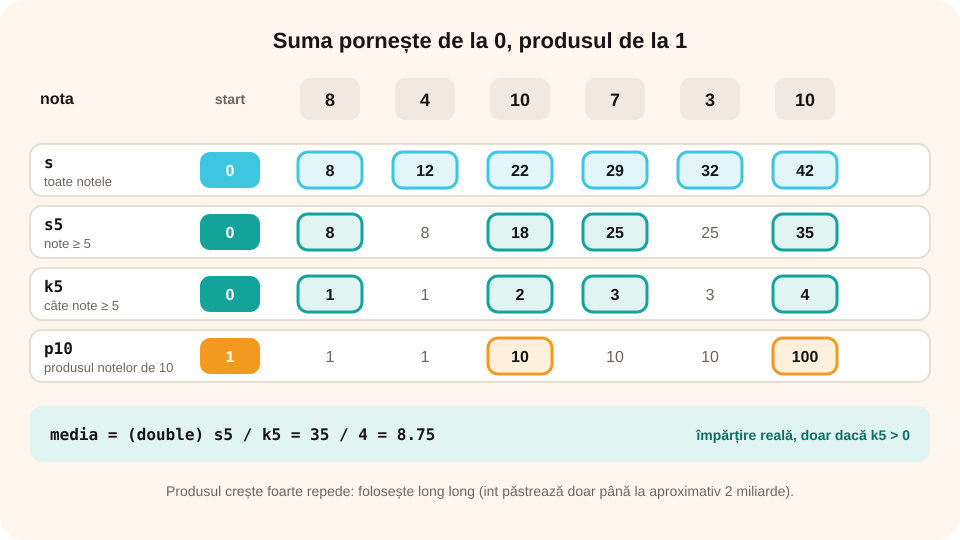

## Ce vei învăța azi

- să calculezi **suma** și **produsul** elementelor unui șir;
- să aduni doar elementele cu o **proprietate**;
- să calculezi **media aritmetică**;
- ce este **depășirea** și cum o eviți.

## Să ne amintim

Suma pornește de la **0**, produsul de la **1** (elementele neutre). Contorul numără elementele care respectă o condiție.

## Lecția pe scurt

### Suma

```cpp
int n, x, s = 0;
cin >> n;
for (int i = 1; i <= n; i++)
{
    cin >> x;
    s = s + x;            // sau s += x;
}
cout << s;
```

### Produsul

```cpp
long long p = 1;
for (int i = 1; i <= n; i++)
{
    cin >> x;
    p = p * x;
}
```

Produsul crește **foarte repede**. Tipul `int` păstrează numere doar până la aproximativ **2 miliarde**; peste această valoare apare **depășirea** (*overflow*) și rezultatul e greșit. De aceea folosim `long long` (până la circa 9 · 10¹⁸). Dacă un element e **0**, tot produsul devine 0.

### Suma elementelor cu o proprietate

```cpp
if (x % 2 == 0) s = s + x;       // suma elementelor pare
```

### Media aritmetică

Media = **suma** elementelor / **numărul** lor. Folosim împărțirea **reală**:

```cpp
double media = (double)s / n;      // sau s * 1.0 / n
```

Pentru **media elementelor cu o proprietate** ai nevoie și de un **contor** k: `media = (double)s / k`. Atenție: dacă **k == 0**, nu ai voie să împarți! Afișezi un mesaj.

### Suma alternantă

`x1 - x2 + x3 - x4 + …`: elementele de pe pozițiile **impare** se adună, cele de pe pozițiile **pare** se scad:

```cpp
if (i % 2 == 1) s = s + x;
else s = s - x;
```

## Exemplu rezolvat: media notelor de trecere

Se citesc n note. Afișează suma tuturor notelor, media notelor de cel puțin 5 (cu două zecimale) și produsul notelor de 10.

```cpp
#include <iostream>
#include <iomanip>
using namespace std;

int main()
{
    int n, nota, s = 0, s5 = 0, k5 = 0;
    long long p10 = 1;
    cin >> n;
    for (int i = 1; i <= n; i++)
    {
        cin >> nota;
        s = s + nota;
        if (nota >= 5) { s5 = s5 + nota; k5++; }
        if (nota == 10) p10 = p10 * nota;
    }
    cout << "Suma: " << s << endl;
    if (k5 > 0)
        cout << "Media notelor de trecere: " << fixed << setprecision(2) << (double)s5 / k5 << endl;
    else
        cout << "Nicio nota de trecere" << endl;
    cout << "Produsul notelor de 10: " << p10;
    return 0;
}
```

Pentru `6` și `8 4 10 7 3 10`: suma **42**, media notelor de trecere (8, 10, 7, 10) **8.75**, produsul notelor de 10 **100**.



## Aplicații interactive

```quiz
# Alege răspunsul corect.
Cât este suma elementelor impare din șirul 3 8 5 2 7?
- 25
* 15
- 10

Cât este produsul elementelor șirului 2 3 0 5?
* 0
- 30
- 10

Ce afișează cout << 7 / 2; și cout << 7 * 1.0 / 2;?
- 3.5 și 3.5
* 3 și 3.5
- 3 și 3
```

```categorii
# Cu ce valoare inițializezi?
0: suma, contorul
1: produsul
primul element: maximul, minimul
```

```ordonare
# Ordonează programul care calculează media numerelor citite până la 0
int x, s = 0, k = 0;
cin >> x;
while (x != 0)
{
s = s + x;
k++;
cin >> x;
}
if (k > 0) cout << (double)s / k;
```

```adevarat-fals
A: Dacă un element al șirului este 0, produsul tuturor elementelor este 0.
F: Tipul int poate păstra orice produs, oricât de mare. | Peste circa 2 miliarde apare depășirea; folosim long long.
A: Înainte de a calcula media elementelor cu o proprietate, verificăm că există astfel de elemente.
A: Suma alternantă a șirului 5 2 4 1 este 6.
```

```completare
# Completează.
Pentru șirul 4 6 5 5, suma este [20], media este [5], iar produsul este [600].
```

## Exersează

1. Citește n numere și afișează suma și media lor, cu două zecimale.
2. Citește numere până la 0 și afișează suma celor de două cifre.
3. Citește n numere și afișează produsul celor nenule.
4. Citește n numere și afișează suma elementelor de pe pozițiile pare și pe cea a elementelor de pe pozițiile impare.
5. Citește n numere și afișează media numerelor prime sau un mesaj dacă nu există numere prime.
6. **Portofoliu:** „Bugetul săptămânii”: se citesc cheltuielile din fiecare zi a săptămânii. Afișează totalul, media pe zi, ziua cu cele mai mari cheltuieli și câte zile au fost peste 50 de lei.

## Verifică-te

- De ce suma pornește de la 0, iar produsul de la 1?
- Ce verifici înainte de a împărți la contor?

## Pe scurt

**Suma** pornește de la 0 și adună fiecare element; **produsul** pornește de la 1 și înmulțește, cu `long long` ca să eviți **depășirea**. Pentru suma elementelor cu o **proprietate** adaugi un if. **Media** = suma / număr, cu împărțire **reală**; dacă numărul elementelor bune e 0, nu împarți. Suma **alternantă** adună elementele de pe poziții impare și le scade pe cele de pe poziții pare.
