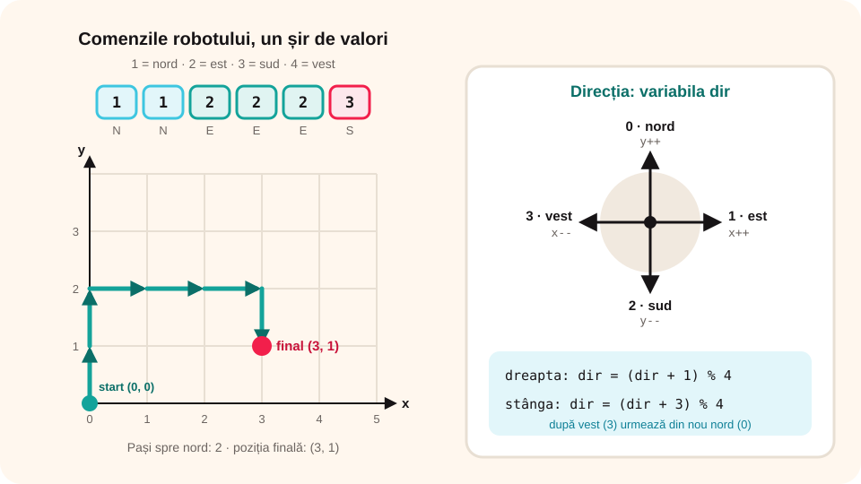

> **Competențe specifice (Anexa 15):** CS 2.2, CS 3.3

## Ce vei învăța azi

- să descrii în C++ **poziția** și **direcția** unui robot;
- să prelucrezi un **șir de comenzi** citite pe rând;
- să verifici **marginile** terenului și **bateria**;
- să vezi legătura dintre roboți și **șirurile de valori**.

## Să ne amintim

Robotul primește **comenzi** și le execută **una după alta**. În C++, citim valori cu `cin` într-o buclă și luăm decizii cu `if` sau `switch`.

## Lecția pe scurt

### Robotul pe grilă

Terenul este o **grilă** cu coordonate, ca la matematică: robotul are poziția **(x, y)**. Pornește din **(0, 0)**.

- **nord**: y crește cu 1;
- **sud**: y scade cu 1;
- **est**: x crește cu 1;
- **vest**: x scade cu 1.

### Comenzile, un șir de valori

Robotul primește **n comenzi**, codificate prin numere: **1 = nord**, **2 = est**, **3 = sud**, **4 = vest**. Comenzile formează un **șir de valori**, pe care îl citim și îl prelucrăm **element cu element**:

```cpp
cin >> n;
for (int i = 1; i <= n; i++)
{
    cin >> c;        // comanda i
    // execută comanda c
}
```

### Direcția robotului

Un robot real nu se mută „spre nord” direct, ci se **rotește** și merge **înainte**. Ținem minte direcția cu o variabilă `dir` (0 = nord, 1 = est, 2 = sud, 3 = vest):

- rotire la **dreapta**: `dir = (dir + 1) % 4;`
- rotire la **stânga**: `dir = (dir + 3) % 4;`

Operatorul `%` face ca după vest (3) să urmeze din nou nordul (0).



### Marginile și bateria

Terenul are o mărime, de exemplu de la 0 la 9 pe fiecare axă. Înainte de mutare verificăm că robotul **nu iese** de pe teren. Fiecare pas consumă **baterie**; când bateria se termină, robotul se oprește.

## Exemplu rezolvat: unde ajunge robotul?

Se citesc n și apoi n comenzi (1 = nord, 2 = est, 3 = sud, 4 = vest). Afișează poziția finală și câți pași a făcut spre nord.

```cpp
#include <iostream>
using namespace std;

int main()
{
    int n, c, x = 0, y = 0, nord = 0;
    cin >> n;
    for (int i = 1; i <= n; i++)
    {
        cin >> c;
        switch (c)
        {
            case 1: y++; nord++; break;
            case 2: x++; break;
            case 3: y--; break;
            case 4: x--; break;
        }
    }
    cout << "Pozitia finala: (" << x << ", " << y << ")" << endl;
    cout << "Pasi spre nord: " << nord;
    return 0;
}
```

Pentru `6` și comenzile `1 1 2 2 2 3`: poziția finală **(3, 1)**, pași spre nord **2**.

### Al doilea exemplu: robotul cu rotiri și margini

Comenzi: **0 = înainte**, **1 = rotire dreapta**, **2 = rotire stânga**. Terenul are coordonate de la 0 la 9. Dacă o mutare ar scoate robotul de pe teren, comanda este **ignorată** și se numără.

```cpp
int n, c, x = 0, y = 0, dir = 0, ignorate = 0;
cin >> n;
for (int i = 1; i <= n; i++)
{
    cin >> c;
    if (c == 1) dir = (dir + 1) % 4;
    else if (c == 2) dir = (dir + 3) % 4;
    else
    {
        int nx = x, ny = y;
        if (dir == 0) ny++;
        else if (dir == 1) nx++;
        else if (dir == 2) ny--;
        else nx--;
        if (nx >= 0 && nx <= 9 && ny >= 0 && ny <= 9) { x = nx; y = ny; }
        else ignorate++;
    }
}
cout << x << " " << y << " " << ignorate;
```

## Aplicații interactive

```quiz
# Alege răspunsul corect.
Robotul pornește din (0, 0) și primește comenzile 2 2 1 4 (1 = nord, 2 = est, 3 = sud, 4 = vest). Unde ajunge?
- (2, 1)
* (1, 1)
- (3, 1)

Robotul are dir = 3 (vest) și se rotește la dreapta: dir = (dir + 1) % 4. Cât devine dir?
* 0, adică nord
- 4
- 2, adică sud

De ce verificăm poziția înainte de mutare?
* ca robotul să nu iasă de pe teren
- ca să meargă mai repede
- nu e nevoie
```

```categorii
# Cum se schimbă poziția?
y++: un pas spre nord
x++: un pas spre est
y--: un pas spre sud
x--: un pas spre vest
```

```ordonare
# Ordonează prelucrarea unei comenzi
Citești comanda c
Calculezi noua poziție
Verifici dacă noua poziție e pe teren
Muți robotul sau ignori comanda
Treci la comanda următoare
```

```adevarat-fals
A: Comenzile primite de robot formează un șir de valori.
F: Pentru rotirea la stânga se scrie dir = dir - 1, fără nicio altă verificare. | De la nord (0) ar da -1; se scrie dir = (dir + 3) % 4.
A: Un switch este potrivit pentru a executa comanda după codul ei.
```

```completare
# Completează.
După comenzile 1 1 1 3 (1 = nord, 3 = sud), pornind din (0, 0), robotul ajunge în (0, [2]). Dacă dir = 1 (est) și robotul se rotește la stânga, dir devine [0].
```

## Exersează

1. Modifică primul program ca să afișeze și **distanța totală** parcursă (numărul de pași).
2. Afișează cât de departe a ajuns robotul spre est (cel mai mare x atins pe parcurs).
3. Robotul are baterie pentru 20 de pași; dacă primește mai multe comenzi, se oprește și afișează „Baterie descărcată” și poziția.
4. Afișează dacă robotul s-a întors la punctul de plecare.
5. **Portofoliu:** „Robotul curier”: se citesc coordonatele unei destinații și apoi comenzile; afișează dacă robotul a ajuns la destinație și după câte comenzi.

## Verifică-te

- Cum ții minte direcția robotului?
- De ce folosim `% 4` la rotire?

## Pe scurt

Un robot pe grilă are o **poziție** (x, y) și o **direcție**. **Comenzile** formează un **șir de valori**, citit și executat element cu element, cu `for` și `switch`. Rotirea se calculează cu `% 4`, iar înainte de fiecare pas verificăm **marginile** terenului. Același mod de lucru – citești o valoare, o prelucrezi, treci la următoarea – îl folosim pentru toate **șirurile de valori**.
