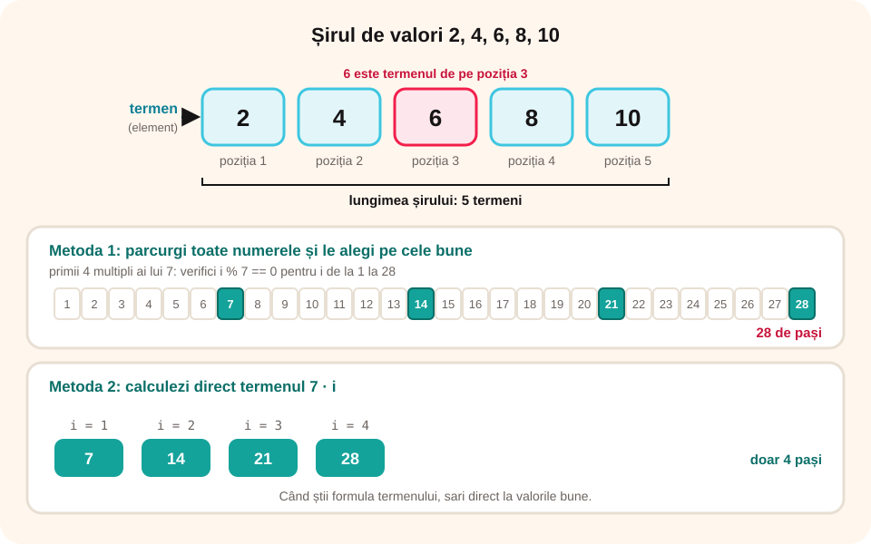

## Ce vei învăța azi

- ce este un **șir de valori**: **termeni**, **poziție**, **lungime**;
- unde întâlnești șiruri de valori;
- să **generezi** în C++ șiruri cu proprietăți simple: pare, impare, multipli, pătrate perfecte;
- două metode: **parcurgi toate numerele și alegi** sau **calculezi direct termenul**.

## Să ne amintim

Cu `for (int i = 1; i <= n; i++)` repeți de n ori. Cu `n % k == 0` verifici dacă n se divide cu k. Comenzile robotului din lecția trecută erau un **șir de valori**.

## Lecția pe scurt

### Ce este un șir de valori

Un **șir de valori** este o succesiune de valori **așezate într-o ordine**: 2, 4, 6, 8, 10.

- fiecare valoare este un **termen** (sau **element**);
- fiecare termen are o **poziție**: primul, al doilea…; 6 este pe poziția 3;
- numărul de termeni este **lungimea** șirului (aici 5);
- un șir poate fi **finit** sau **infinit** (toate numerele pare).

Exemple: notele tale la matematică, temperaturile din fiecare zi, punctajele unui joc, comenzile unui robot, valorile citite de un senzor la fiecare secundă.

### Metoda 1: parcurgi și alegi

Treci prin **toate** numerele dintr-un interval și le afișezi doar pe cele cu proprietatea cerută:

```cpp
for (int i = 1; i <= 50; i++)
    if (i % 7 == 0)
        cout << i << " ";       // 7 14 21 28 35 42 49
```

### Metoda 2: calculezi direct

Dacă știi **formula termenului**, sari direct la valorile bune:

| Șir | Termenul de pe poziția i | Cu for |
|---|---|---|
| 2 4 6 8 … | 2 · i | `for (i = 1; i <= n; i++) cout << 2 * i;` |
| 1 3 5 7 … | 2 · i - 1 | `for (i = 1; i <= n; i++) cout << 2 * i - 1;` |
| multiplii lui k | k · i | `for (i = 1; i <= n; i++) cout << k * i;` |
| 1 4 9 16 … | i · i | `for (i = 1; i <= n; i++) cout << i * i;` |
| din 5 în 5, de la 3 | 3, 8, 13 … | `for (x = 3; x <= 100; x = x + 5) cout << x;` |

Metoda 2 face **mai puțini pași**: pentru primii 10 multipli ai lui 7 sunt 10 pași, nu 70.



### Primii n termeni sau termenii până la o limită?

- „Afișează **primele n** numere pare”: număr cunoscut de termeni → `for` cu i de la 1 la n.
- „Afișează numerele pare **mai mici decât n**”: limita e valoarea → `for (x = 2; x < n; x = x + 2)` sau `while`.

## Exemplu rezolvat: numerele care se termină în 3

Afișează primele n numere naturale care au ultima cifră 3.

**Metoda 1** (parcurgi și numeri câte ai găsit):

```cpp
int n, gasite = 0, x = 1;
cin >> n;
while (gasite < n)
{
    if (x % 10 == 3)
    {
        cout << x << " ";
        gasite++;
    }
    x++;
}
```

**Metoda 2** (calculezi direct: 3, 13, 23… adică 10 · i + 3, cu i de la 0):

```cpp
for (int i = 0; i < n; i++)
    cout << 10 * i + 3 << " ";
```

Pentru n = 5, ambele afișează **3 13 23 33 43**.

## Aplicații interactive

```categorii
# Ce formulă are termenul de pe poziția i?
2 * i: 2 4 6 8 10
2 * i - 1: 1 3 5 7 9
i * i: 1 4 9 16 25
5 * i: 5 10 15 20 25
```

```quiz
# Alege răspunsul corect.
Care este al patrulea termen al șirului 3, 7, 11, 15, 19?
- 11
* 15
- 4

Ce afișează? for (int i = 1; i <= 4; i++) cout << i * i + 1 << " ";
* 2 5 10 17
- 1 4 9 16
- 2 4 6 8

Ce lungime are șirul numerelor de două cifre divizibile cu 10?
- 10
* 9
- 90
```

```ordonare
# Ordonează programul care afișează multiplii lui k mai mici sau egali cu 100
int k;
cin >> k;
for (int x = k; x <= 100; x = x + k)
cout << x << " ";
```

```adevarat-fals
A: Într-un șir de valori, fiecare termen are o poziție.
F: Pentru primii n multipli ai lui 7, metoda parcurgerii tuturor numerelor face mai puțini pași. | Calculul direct 7 · i face doar n pași.
A: Numerele 3, 13, 23 sunt de forma 10 · i + 3.
A: Șirul tuturor numerelor pare este infinit.
```

```completare
# Completează.
Al zecelea număr impar este [19]. Al șaselea pătrat perfect nenul este [36]. Primii trei multipli nenuli ai lui 9 sunt 9, 18 și [27].
```

## Exersează

1. Afișează primele n numere pare, cu ambele metode.
2. Afișează numerele de trei cifre divizibile cu 25.
3. Afișează pătratele perfecte mai mici decât n.
4. Afișează numerele de două cifre care au suma cifrelor 9.
5. Afișează primii n termeni ai șirului 4, 9, 14, 19, … și scrie formula termenului de pe poziția i.
6. **Portofoliu:** „Calendarul antrenamentelor”: un sportiv se antrenează din 3 în 3 zile, începând cu 2 septembrie. Afișează datele antrenamentelor din septembrie (2, 5, 8…) și câte antrenamente sunt.

## Verifică-te

- Ce sunt termenul, poziția și lungimea unui șir?
- Când e mai bună metoda calculului direct?

## Pe scurt

Un **șir de valori** e o succesiune ordonată de **termeni**, fiecare cu o **poziție**; numărul lor e **lungimea**. Generăm șiruri simple fie **parcurgând** toate numerele și **alegând** pe cele bune, fie **calculând direct** termenul (2 · i, 2 · i - 1, k · i, i · i). Al doilea mod face mai puțini pași.
