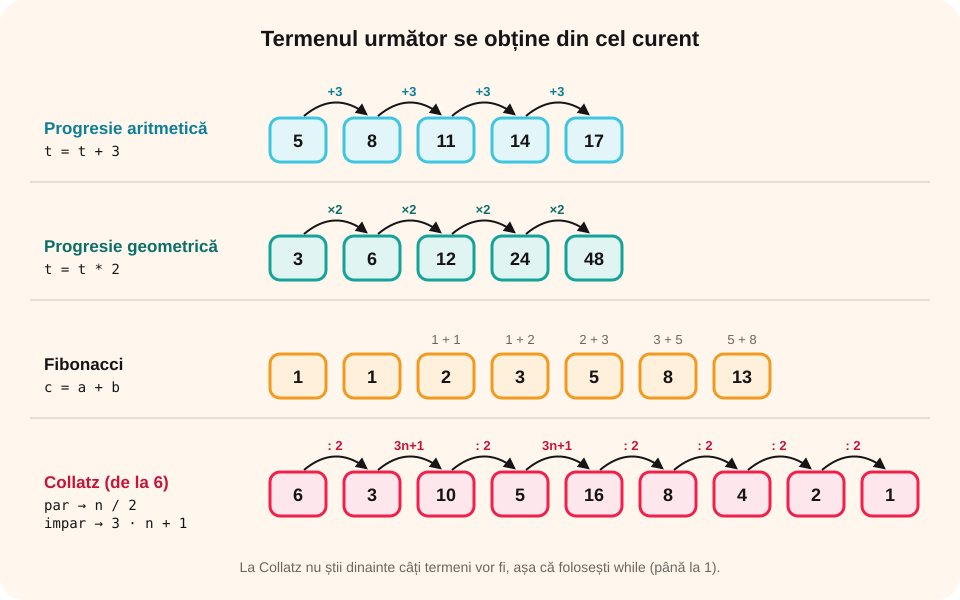

> **Competențe specifice (Anexa 15):** CS 2.1, CS 2.2, CS 3.3

## Ce vei învăța azi

- să generezi șiruri în care **fiecare termen se obține din cel dinainte**;
- ce sunt **progresiile aritmetice** și **geometrice**;
- să generezi **șirul lui Fibonacci** și **șirul lui Collatz**;
- să afli **termenul de pe poziția k**.

## Să ne amintim

În lecția trecută, termenul se calcula **direct** din poziție: 2 · i, i · i. Acum, termenul nou se calculează din **termenul anterior** (sau din cei anteriori), după o **regulă**.

## Lecția pe scurt

### Regula „termenul următor din cel curent”

Păstrezi termenul curent într-o variabilă `t` și, la fiecare pas, îl **transformi** în termenul următor:

```cpp
t = primul termen;
for (int i = 1; i <= n; i++)
{
    cout << t << " ";
    t = regula(t);      // de exemplu t = t + 3 sau t = t * 2
}
```

### Progresia aritmetică

Fiecare termen se obține **adunând** același număr **r** (rația): 5, 8, 11, 14… (primul 5, rația 3). Regula: `t = t + r;`

### Progresia geometrică

Fiecare termen se obține **înmulțind** cu același număr **q**: 3, 6, 12, 24… (primul 3, q = 2). Regula: `t = t * q;`. Termenii cresc foarte repede; folosește `long long` pentru valori mari.

### Șirul lui Fibonacci

Fiecare termen este **suma celor doi dinainte**: 1, 1, 2, 3, 5, 8, 13… Ai nevoie de **două** variabile pentru ultimii doi termeni (a și b) și de una pentru termenul nou (c):

```cpp
int a = 1, b = 1, c;
cout << a << " " << b << " ";
for (int i = 3; i <= n; i++)
{
    c = a + b;
    cout << c << " ";
    a = b;
    b = c;
}
```

### Șirul lui Collatz

Pornești de la un număr n. Dacă e **par**, îl **împarți la 2**; dacă e **impar**, îl faci **3 · n + 1**. Te oprești când ajungi la **1**. Pentru 6: 6, 3, 10, 5, 16, 8, 4, 2, 1. Nimeni nu a demonstrat încă dacă orice număr ajunge la 1 – e o problemă nerezolvată a matematicii!

```cpp
while (n != 1)
{
    cout << n << " ";
    if (n % 2 == 0) n = n / 2;
    else n = 3 * n + 1;
}
cout << 1;
```

Aici nu știi dinainte câți termeni vor fi, deci folosești `while`.



### Termenul de pe poziția k

Generezi termenii **fără să-i afișezi**, până ajungi la poziția k, apoi îl afișezi doar pe acela.

## Exemplu rezolvat: regula care alternează

Șirul 1, 2, 4, 5, 10, 11, 22, 23… pornește de la 1; alternativ, **aduni 1** și **înmulțești cu 2**. Afișează primii n termeni.

```cpp
#include <iostream>
using namespace std;

int main()
{
    int n, t = 1;
    cin >> n;
    for (int i = 1; i <= n; i++)
    {
        cout << t << " ";
        if (i % 2 == 1) t = t + 1;    // după pozițiile impare adunăm 1
        else t = t * 2;               // după cele pare înmulțim cu 2
    }
    return 0;
}
```

Pentru n = 8: **1 2 4 5 10 11 22 23**.

## Aplicații interactive

```categorii
# Ce fel de șir este?
Progresie aritmetică: 4 7 10 13
Progresie geometrică: 2 6 18 54
Fibonacci: 1 1 2 3 5 8
Collatz: 6 3 10 5 16 8 4 2 1
```

```quiz
# Alege răspunsul corect.
Care este termenul următor în progresia geometrică 5, 10, 20, 40?
- 50
* 80
- 60

Ce termen urmează după 13 și 21 în șirul lui Fibonacci?
* 34
- 29
- 42

De ce folosim while la șirul lui Collatz?
* nu știm dinainte câți termeni vor fi până la 1
- while e mai rapid decât for
- for nu poate folosi if
```

```ordonare
# Ordonează programul care afișează primii n termeni ai progresiei cu primul termen p și rația r
int n, p, r;
cin >> n >> p >> r;
int t = p;
for (int i = 1; i <= n; i++)
{
cout << t << " ";
t = t + r;
}
```

```adevarat-fals
A: Într-o progresie aritmetică, diferența dintre doi termeni vecini este mereu aceeași.
F: Pentru șirul lui Fibonacci ajunge o singură variabilă. | Ai nevoie de cei doi termeni anteriori.
A: Șirul lui Collatz pentru 8 este 8, 4, 2, 1.
A: Termenii unei progresii geometrice cu q = 2 cresc foarte repede.
```

```completare
# Completează.
Progresia aritmetică 7, 12, 17, … are rația [5], iar al cincilea termen este [27]. În șirul lui Collatz, după 7 urmează [22].
```

## Exersează

1. Citește primul termen și rația unei progresii aritmetice; afișează primii n termeni și suma lor.
2. Afișează puterile lui 2 mai mici decât 1 000 000.
3. Afișează termenii șirului lui Fibonacci mai mici decât n.
4. Citește n și afișează **câți pași** face șirul lui Collatz până la 1. Care număr sub 30 are cei mai mulți pași?
5. Afișează primii n termeni ai șirului 1, 3, 7, 15, 31… și descoperă regula.
6. **Portofoliu:** „Economiile”: pui 10 lei în prima săptămână și în fiecare săptămână cu 5 lei mai mult. Afișează, săptămână cu săptămână, cât ai pus și cât ai strâns, până strângi cel puțin 500 de lei.

## Verifică-te

- Care e diferența dintre o progresie aritmetică și una geometrică?
- De ce ai nevoie de trei variabile la Fibonacci?

## Pe scurt

Multe șiruri se generează pe baza unei **reguli** care calculează termenul următor din cel **curent**: **progresia aritmetică** (`t = t + r`), **progresia geometrică** (`t = t * q`), **șirul lui Collatz**. La **Fibonacci**, termenul nou e suma celor **doi** anteriori. Când nu știi numărul de termeni, folosești `while`.
