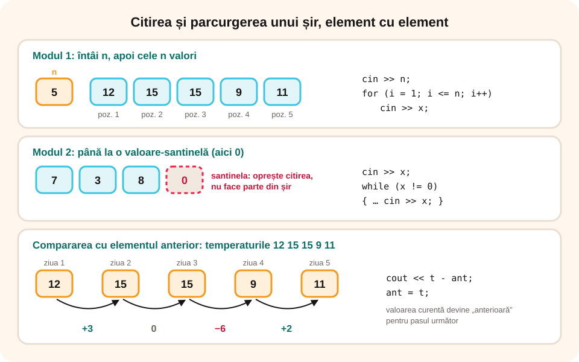

> **Competențe specifice (Anexa 15):** CS 2.1, CS 2.2, CS 3.3

## Ce vei învăța azi

- să **citești** un șir de valori când îi știi **lungimea** sau până la o **valoare de oprire**;
- să **parcurgi** șirul element cu element, cu **poziția** fiecăruia;
- să **prelucrezi** și să **afișezi** elementele;
- să compari fiecare element cu cel **anterior**.

## Să ne amintim

Un **șir de valori** are **termeni**, fiecare pe o **poziție**. Cu `cin >> x;` într-o buclă citești valorile una după alta.

## Lecția pe scurt

### Modul 1: lungimea e dată

Întâi se citește **n**, apoi cele n valori:

```cpp
int n, x;
cin >> n;
for (int i = 1; i <= n; i++)
{
    cin >> x;               // elementul de pe poziția i
    // prelucrezi x
}
```

### Modul 2: până la o valoare-santinelă

Valorile se termină cu o valoare specială (de exemplu **0**), care **nu face parte** din șir:

```cpp
int x;
cin >> x;
while (x != 0)
{
    // prelucrezi x
    cin >> x;
}
```

Citești **înainte** de buclă și la **sfârșitul** buclei, ca 0 să nu fie prelucrat.

### Parcurgerea

**Parcurgerea** înseamnă să treci prin **toate** elementele, de la primul la ultimul, și să faci ceva cu fiecare: îl afișezi, îl transformi, îl compari. Elementele se prelucrează **în momentul citirii**, unul câte unul; nu le păstrăm pe toate (asta vei învăța la liceu, cu **tablourile**).

### Afișarea, cu poziție și formatare

```cpp
for (int i = 1; i <= n; i++)
{
    cin >> x;
    cout << "Elementul " << i << ": " << x << endl;
}
```

Poți afișa elementele **separate prin spațiu**, câte unul pe rând sau **transformate** (dublul, ultima cifră etc.).

### Compararea cu elementul anterior

Ca să compari fiecare element cu cel **dinainte**, păstrezi elementul anterior într-o variabilă `ant`:

```cpp
cin >> n >> ant;                // primul element
for (int i = 2; i <= n; i++)
{
    cin >> x;
    if (x > ant) cout << "creste ";
    else if (x < ant) cout << "scade ";
    else cout << "egal ";
    ant = x;                    // elementul curent devine anterior
}
```

## Exemplu rezolvat: jurnalul temperaturilor

Se citesc n temperaturi zilnice. Afișează, pentru fiecare zi începând cu a doua, cu câte grade s-a schimbat temperatura față de ziua anterioară.

```cpp
#include <iostream>
using namespace std;

int main()
{
    int n, t, ant;
    cin >> n >> ant;
    for (int zi = 2; zi <= n; zi++)
    {
        cin >> t;
        cout << "Ziua " << zi << ": " << t - ant << endl;
        ant = t;
    }
    return 0;
}
```

Pentru `5` și `12 15 15 9 11`: Ziua 2: **3**, Ziua 3: **0**, Ziua 4: **-6**, Ziua 5: **2**.



## Aplicații interactive

```categorii
# Cum se dă șirul?
Lungimea dată: 5 urmat de 3 8 1 9 4
Valoare-santinelă: 3 8 1 9 4 0
```

```quiz
# Alege răspunsul corect.
Se citesc 4 7 2 9 0 până la 0. Câte elemente are șirul?
- 5
* 4
- 3

De ce citim o dată înainte de while, la șirurile terminate cu 0?
* ca bucla să verifice elementul înainte să-l prelucreze, iar 0 să nu fie prelucrat
- pentru că while nu poate citi
- ca programul să fie mai lung

Ce afișează programul cu ant pentru șirul 3 5 5 2?
- scade egal creste
* creste egal scade
- creste creste scade
```

```ordonare
# Ordonează programul care afișează dublul fiecărui element, până la 0
int x;
cin >> x;
while (x != 0)
{
cout << 2 * x << " ";
cin >> x;
}
```

```adevarat-fals
A: Parcurgerea unui șir înseamnă trecerea prin toate elementele lui.
F: Valoarea-santinelă 0 se prelucrează ca orice element. | Ea doar marchează sfârșitul șirului.
A: Pentru a compara cu elementul anterior îl păstrăm într-o variabilă.
A: În for (i = 1; i <= n; i++), i este poziția elementului citit.
```

```completare
# Completează.
Pentru șirul 6 9 4, diferențele față de elementul anterior sunt [3] și [-5]. Dacă șirul 2 4 6 0 se termină cu santinela 0, el are [3] elemente.
```

## Exersează

1. Citește n numere și afișează-le pe cele de pe **poziții pare**.
2. Citește numere până la 0 și afișează **ultima cifră** a fiecăruia.
3. Citește n numere și afișează fiecare număr împreună cu **poziția** lui, sub forma „poziția 3: 17”.
4. Citește n numere și afișează câte **perechi de elemente vecine egale** există.
5. Citește n numere și afișează „crescător” dacă fiecare e mai mare decât cel anterior.
6. **Portofoliu:** „Pașii de azi”: se citesc numerele de pași făcuți în fiecare oră, până la 0. Afișează, pentru fiecare oră, numărul de pași și o bară din steluțe (o steluță la 500 de pași).

## Verifică-te

- Care sunt cele două moduri de a citi un șir de valori?
- Cum compari un element cu cel anterior?

## Pe scurt

Un șir de valori se citește fie când îi știm **lungimea** (`for`), fie până la o **valoare-santinelă** (`while`, cu citire înainte și la sfârșitul buclei). **Parcurgerea** prelucrează fiecare element în momentul citirii, cu **poziția** lui. Pentru comparații cu elementul **anterior**, îl păstrăm într-o variabilă care se actualizează la fiecare pas.
