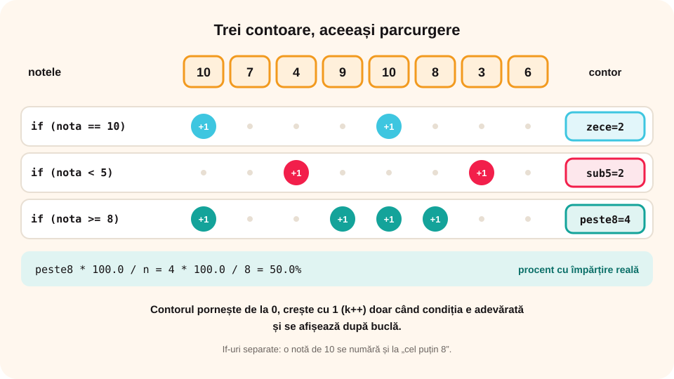

## Ce vei învăța azi

- să **numeri** elementele unui șir care respectă o **condiție**;
- să folosești **mai multe contoare** deodată;
- să calculezi **procente**;
- să numeri **perechi** de elemente vecine.

## Să ne amintim

Știi să verifici o **proprietate** pentru fiecare element al unui șir și să afișezi elementele care o respectă. Acum nu le afișăm, ci le **numărăm**.

## Lecția pe scurt

### Algoritmul de numărare

Un **contor** este o variabilă care **pornește de la 0** și **crește cu 1** de fiecare dată când găsim un element bun:

```cpp
int n, x, k = 0;          // k = contorul
cin >> n;
for (int i = 1; i <= n; i++)
{
    cin >> x;
    if (conditie)
        k++;
}
cout << k;
```

Trei reguli: contorul se **inițializează cu 0** înainte de buclă, **crește** în buclă (doar când condiția e adevărată) și se **afișează după** buclă.

### Mai multe contoare

Poți număra după mai multe condiții **în aceeași parcurgere**:

```cpp
int poz = 0, neg = 0, zero = 0;
for (int i = 1; i <= n; i++)
{
    cin >> x;
    if (x > 0) poz++;
    else if (x < 0) neg++;
    else zero++;
}
```

Aici poz + neg + zero == n.

### Procente

Procentul elementelor bune este `k * 100.0 / n`. Scriem **100.0**, ca împărțirea să fie **reală**: 3 din 8 înseamnă 37.5%, nu 37%.

### Numărarea perechilor vecine

Păstrezi elementul **anterior** și compari:

```cpp
cin >> n >> ant;
for (int i = 2; i <= n; i++)
{
    cin >> x;
    if (x == ant) k++;     // pereche de elemente vecine egale
    ant = x;
}
```

Un șir cu n elemente are **n - 1** perechi de vecini.

## Exemplu rezolvat: statistica unui test

Se citesc n note (de la 1 la 10). Afișează câte note sunt de 10, câte sunt sub 5 și ce procent din elevi au luat cel puțin 8.

```cpp
#include <iostream>
#include <iomanip>
using namespace std;

int main()
{
    int n, nota, zece = 0, sub5 = 0, peste8 = 0;
    cin >> n;
    for (int i = 1; i <= n; i++)
    {
        cin >> nota;
        if (nota == 10) zece++;
        if (nota < 5) sub5++;
        if (nota >= 8) peste8++;
    }
    cout << "Note de 10: " << zece << endl;
    cout << "Note sub 5: " << sub5 << endl;
    cout << fixed << setprecision(1);
    cout << "Cel putin 8: " << peste8 * 100.0 / n << "%";
    return 0;
}
```

Pentru `8` și `10 7 4 9 10 8 3 6`: note de 10: **2**, sub 5: **2**, cel puțin 8: **50.0%**.

Observă că aici contoarele sunt cu **if-uri separate**, nu cu else if: o notă de 10 se numără și la „cel puțin 8”.



## Aplicații interactive

```quiz
# Alege răspunsul corect.
Câte elemente pare are șirul 3 8 12 7 6 1?
- 2
* 3
- 4

Cu ce valoare se inițializează un contor?
* 0
- 1
- n

Câte perechi de vecini egali are șirul 5 5 2 2 2 7?
- 2
* 3
- 5
```

```ordonare
# Ordonează programul care numără elementele divizibile cu 5, până la 0
int x, k = 0;
cin >> x;
while (x != 0)
{
if (x % 5 == 0) k++;
cin >> x;
}
cout << k;
```

```categorii
# if-uri separate sau lanț else if?
if-uri separate: numărul notelor de 10 și al notelor de cel puțin 8
lanț else if: numărul elementelor pozitive și negative și al zerourilor
```

```adevarat-fals
A: Contorul se afișează după ce s-a terminat bucla.
F: Expresia 3 * 100 / 8 dă exact 37.5 în C++. | Între întregi dă 37; scriem 100.0.
A: Un șir cu 10 elemente are 9 perechi de elemente vecine.
A: Mai multe contoare pot fi actualizate în aceeași parcurgere a șirului.
```

```completare
# Completează.
În șirul 4 15 22 9 30 sunt [3] numere de două cifre și [2] numere impare. Procentul numerelor impare este [40]%.
```

## Exersează

1. Citește n numere și afișează câte au ultima cifră 0.
2. Citește numere până la 0 și afișează câte sunt prime.
3. Citește n numere și afișează câte sunt mai mari decât **primul** element.
4. Citește n temperaturi și afișează în câte zile a fost mai cald decât în ziua anterioară.
5. Citește n numere și afișează câte sunt pare, câte impare și procentul fiecărei categorii.
6. **Portofoliu:** „Sondajul clasei”: fiecare elev votează un sport (1 = fotbal, 2 = baschet, 3 = volei, 4 = înot); se citesc voturile până la 0. Afișează numărul de voturi și procentul pentru fiecare sport și sportul câștigător.

## Verifică-te

- Care sunt cele trei reguli ale unui contor?
- De ce scriem `100.0` la calculul procentului?

## Pe scurt

**Numărarea** folosește un **contor** inițializat cu **0**, care crește cu 1 când elementul respectă **condiția** și se afișează **după** buclă. Putem folosi **mai multe contoare** în aceeași parcurgere (cu if-uri separate sau cu else if, după caz). **Procentul** se calculează cu `k * 100.0 / n`. Perechile de vecini se numără cu ajutorul elementului **anterior**.
