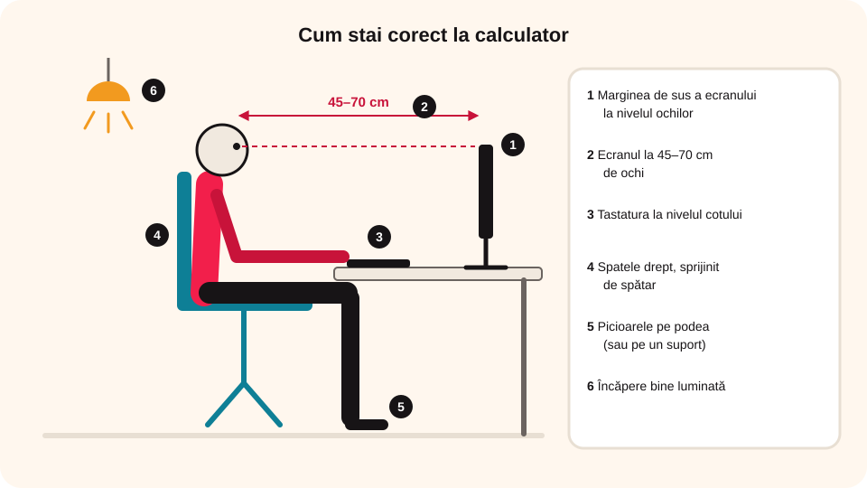

> **Competențe specifice (Anexa 15):** CS 1.1

## Ce vei învăța azi

- regulile de securitate și protecție a muncii din laboratorul de informatică;
- ce este **ergonomia** și cum stai corect la calculator, tabletă și telefon;
- ce probleme de sănătate apar când folosim greșit dispozitivele electronice.

## Să ne amintim

În clasa a V-a începi două lucruri noi: **TIC** (folosirea calculatorului) și **Informatică** (algoritmi și programe). Ca să lucrezi bine și în siguranță, trebuie să știi câteva reguli.

## Lecția pe scurt

### A. Regulile laboratorului de informatică

1. Intri și lucrezi în laborator **doar sub supravegherea profesorului**.
2. Faci **doar activitățile cerute** de profesor.
3. **Nu instalezi și nu copiezi programe** pe calculatoare fără acordul profesorului.
4. **Nu intri cu mâncare sau băuturi** în laborator.
5. **Nu conectezi și nu deconectezi** echipamentele de la priză și nu atingi cablurile electrice sau tabloul de siguranțe.
6. Nu folosești stickuri, CD-uri, DVD-uri sau hard-diskuri externe fără acordul profesorului.
7. **Nu desfaci și nu schimbi între ele** componentele (tastaturi, mouse-uri, imprimante).
8. Orice defecțiune o **anunți profesorului**.
9. Nu modifici setările calculatoarelor (de exemplu, rezoluția ecranului sau imprimanta implicită).
10. Ai grijă de echipamentul la care lucrezi și nu iei nimic din laborator.
11. La final, lași laboratorul **în ordine și curat**.

### B. Ergonomia

**Ergonomia** este știința care studiază legătura dintre oameni și obiectele pe care le folosesc, ca munca să fie sigură și sănătoasă.

**La calculator (pe scaun):**

- lucrezi într-o încăpere **bine luminată**;
- scaunul e stabil și confortabil; înălțimea scaunului și a mesei se reglează astfel încât **tastatura să fie la nivelul cotului**;
- ții **spatele drept, sprijinit de spătar**, și **picioarele pe podea** (sau pe un suport);
- monitorul stă la **45–70 cm** de ochi, cu **marginea de sus a ecranului la nivelul ochilor**.



**La tabletă și telefon:**

- schimbi din când în când felul în care ții dispozitivul, ca mâinile să nu obosească;
- ridici dispozitivul sau îl pui pe un suport, ca să **nu apleci capul înainte**;
- ții **capul drept** când privești ecranul.

### C. Ce se întâmplă când folosim greșit dispozitivele

- **Dureri de ceafă și de spate**: cu cât apleci capul mai mult, cu atât gâtul duce o greutate mai mare.
- **Probleme de vedere**: ochii obosesc când stau mult timp aproape de ecran și trec des între lumina ecranului și cea din cameră; așa poate apărea **miopia**.
- **Dependența**: jocurile și aplicațiile sunt făcute să te țină cât mai mult în fața ecranului (recompense, actualizări, concursuri). Mai există și riscul să întâlnești online un limbaj sau comportamente nepotrivite.

## Exemplu rezolvat

**Situație:** mouse-ul de la calculatorul tău nu mai funcționează în timpul orei. Ce faci?

- ✗ Iei mouse-ul colegului: încalci regula despre schimbarea componentelor între ele.
- ✗ Desfaci mouse-ul ca să vezi ce are: nu ai voie să desfaci echipamentele.
- ✓ **Anunți profesorul.** El decide ce e de făcut.

## Aplicații interactive

```adevarat-fals
# Regulile laboratorului: adevărat sau fals?
A: În laborator este interzisă instalarea programelor fără acordul profesorului.
F: Poți intra în laborator cu un suc, dacă ești atent. | Este interzis accesul cu produse alimentare sau lichide.
F: Dacă nu merge mouse-ul tău, îl poți lua pe al colegului. | Nu ai voie să schimbi componentele între ele; anunți profesorul.
F: Poți schimba rezoluția ecranului dacă nu îți place. | Este interzisă modificarea configurării calculatoarelor.
A: La finalul orei, laboratorul trebuie lăsat în ordine și curățenie.
```

```quiz
# Alege varianta corectă.
Când lucrezi la calculator, trebuie:
* să menții spatele drept, sprijinit de spătar
- să apleci capul înainte, aproape de ecran
- să lași scaunul mult pe spate, cât mai relaxat
Explicație: Spatele drept și sprijinit te ferește de dureri de spate și de ceafă.

La ce nivel trebuie să fie ochii față de ecran?
- la nivelul marginii de jos a ecranului
* la nivelul marginii de sus a ecranului
- la mijlocul ecranului
Explicație: Marginea de sus a ecranului stă la nivelul ochilor, ca să nu apleci capul.

La ce distanță se așază monitorul?
- 10–20 cm
* 45–70 cm
- peste 2 metri
```

```categorii
# Postură corectă sau incorectă?
Corect: spatele sprijinit de spătar, picioarele pe podea, tastatura la nivelul cotului, capul drept la telefon
Incorect: capul aplecat spre ecran, monitorul foarte aproape de ochi, telefonul ținut în poală cu capul în jos, scaunul lăsat mult pe spate
```

```completare
# Completează definiția.
[Ergonomia] este știința care studiază legătura dintre oameni și obiectele pe care le folosesc. Folosirea îndelungată a ecranelor de aproape poate duce la [miopie|miopia].
```

```cartonase
# Efectele folosirii greșite a dispozitivelor
Dureri de ceafă și de spate = Apar când ții mult timp capul aplecat înainte.
Probleme de vedere = Ochii obosesc stând mult aproape de ecran; poate apărea miopia.
Dependența = Petreci prea mult timp cu jocuri și aplicații făcute să te țină în fața ecranului.
```

## Exersează

1. Enumeră cinci reguli pe care le respecți în laboratorul de informatică.
2. Ce crezi că s-ar putea întâmpla dacă ai instala programe pe calculatoarele din laborator fără acordul profesorului? Dar dacă ai desface un calculator?
3. Joc de rol: ești în tren și vrei să folosești o tabletă. Ce poziție adopți? Ce greutăți în plus pot apărea?
4. Ce poți face ca să nu devii dependent de dispozitivele electronice?
5. **Portofoliu:** fă un afiș cu cele mai importante cinci reguli de folosire corectă a calculatorului, tabletei sau telefonului.

## Pe scurt

În laborator lucrezi doar sub supravegherea profesorului și respecți regulile. **Ergonomia** te ajută să stai corect: spatele drept, picioarele pe podea, ecranul la 45–70 cm și la nivelul ochilor, capul drept la telefon și tabletă.
