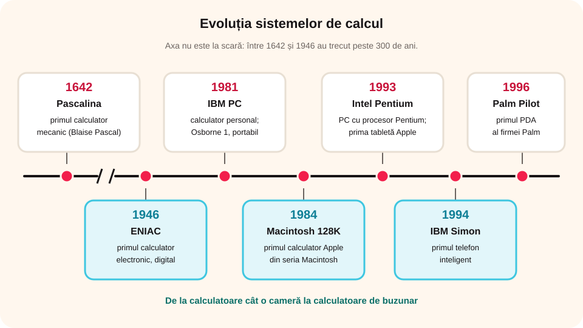

## Ce vei învăța azi

- ce este un **sistem de calcul** și ce este un **sistem de comunicații**;
- momentele importante din istoria calculatoarelor;
- care sunt sistemele de calcul folosite cel mai des astăzi.

## Să ne amintim

Folosim calculatorul, tableta și telefonul la teme, la calcule, ca să comunicăm, să căutăm informații, să vedem filme sau să ne jucăm. Toate au apărut din nevoia oamenilor de a face calcule rapid și de a comunica repede.

## Lecția pe scurt

### Două definiții importante

- Un **sistem de calcul** este format din **hardware** (partea fizică) și **software** (partea logică: sistemul de operare și programele). Cu el putem prelua, stoca, prelucra și transmite informații.
- Un **sistem de comunicații** este ansamblul de echipamente prin care informația este transmisă între două sau mai multe puncte.

### Evoluția sistemelor de calcul

| Anul | Ce a apărut |
|---|---|
| 1642 | **Pascalina**, primul calculator mecanic, construit de francezul **Blaise Pascal** |
| 1946 | **ENIAC**, primul calculator electronic de uz general, numeric (digital), creat pentru armata SUA |
| 1981 | **IBM PC**, primul calculator personal asemănător celor de azi; tot atunci apare **Osborne 1**, primul calculator portabil |
| 1984 | **Macintosh 128K**, primul calculator Apple din seria Macintosh |
| 1993 | primul calculator personal cu procesor **Intel Pentium**; **Newton MessagePad**, prima tabletă Apple |
| 1994 | **IBM Simon**, primul telefon inteligent |
| 1996 | **Palm Pilot**, primul PDA (asistent digital personal) al firmei Palm |



### Evoluția comunicațiilor

De la **focuri și semnale de fum**, oamenii au ajuns la **telegraf**, **telefon** (cu fir și fără fir), **radio** și **televiziune**, iar apoi la **internet**. Azi comunicăm prin e-mail, mesaje text și video și aplicații de mesagerie. Calculatoarele și comunicațiile au evoluat împreună și au devenit **un singur sistem**, folosit de toată lumea.

### Sistemele de calcul folosite azi

- **Calculatorul personal de birou (desktop)**: pentru acasă sau birou; are putere de calcul mare, se poate conecta la multe dispozitive și rulează multe aplicații.
- **Laptopul**: calculator personal **portabil**; e mic, fără cabluri și consumă puțină energie. Din aceeași familie fac parte notebookul, netbookul și ultrabookul.
- **Tableta**: și mai mică, are **ecran tactil** (touchscreen), dar se poate conecta mai greu prin fir la alte dispozitive.
- **Telefonul inteligent (smartphone)**: telefon mobil multifuncțional, cu aparat foto, calculator, calendar, GPS, agendă și multe altele.

Le folosim peste tot: în medicină (aparatură, evidența pacienților), în bănci (conturi, carduri) și în școli (evidența elevilor, materiale, lecții online).

## Exemplu rezolvat

**Întrebare:** În ce secol a apărut calculatorul personal?

**Rezolvare:** IBM PC a apărut în **1981**. Anii 1901–2000 formează **secolul al XX-lea**, deci răspunsul este **secolul XX**.

## Aplicații interactive

```ordonare
# Pune invențiile în ordine cronologică (de la cea mai veche).
Pascalina, primul calculator mecanic (1642)
ENIAC, primul calculator electronic de uz general (1946)
IBM PC, primul calculator personal ca cele de azi (1981)
Macintosh 128K (1984)
IBM Simon, primul telefon inteligent (1994)
```

```quiz
# Alege răspunsul corect.
Pascalina era un calculator:
- electronic
- multimedia
* mecanic
Explicație: Pascalina, construită de Blaise Pascal în 1642, făcea calcule cu ajutorul unor roți dințate.

Calculatorul personal a apărut în secolul:
* XX
- XIX
- XXI
Explicație: IBM PC a apărut în 1981, adică în secolul al XX-lea.

Care a fost primul calculator electronic de uz general?
- IBM PC
* ENIAC
- Osborne 1
```

```completare
# Alege forma corectă și scrie-o.
Laptopul este un calculator personal [portabil]. Tableta are un ecran [tactil]. Telefonul inteligent este un telefon [mobil].
```

```categorii
# Sistem de calcul sau mijloc de comunicare din istorie?
Sisteme de calcul: Pascalina, ENIAC, IBM PC, Macintosh 128K
Mijloace de comunicare: semnalele de fum, telegraful, radioul, televiziunea
```

```cartonase
# Sistemele de calcul de azi
Desktop = Calculator personal de birou, cu putere mare de calcul și multe aplicații.
Laptop = Calculator personal portabil, mic, fără cabluri, cu consum redus de energie.
Tabletă = Dispozitiv portabil cu ecran tactil, mai mic decât laptopul.
Smartphone = Telefon mobil multifuncțional: foto, GPS, calendar, aplicații.
```

## Exersează

1. Numește trei sisteme de calcul și dă pentru fiecare un exemplu de situație în care îl folosești.
2. Joc de rol: pleci în tabără. Ce echipamente iei ca să comunicați între voi și cum le folosiți?
3. Investigație: ce dispozitive folosesc tu și prietenii tăi, părinții voștri și bunicii voștri? Ce legătură observi între numărul de dispozitive și experiența fiecăruia cu ele?
4. Dezbatere: „Cea mai eficientă metodă de transmitere a mesajelor”.
5. **Portofoliu:** fă un poster „Sisteme de calcul și de comunicații actuale”, cu imagini și maximum 30 de cuvinte pentru fiecare echipament.

## Pe scurt

Primul calculator mecanic a fost **Pascalina** (1642), primul calculator electronic de uz general **ENIAC** (1946), iar primul calculator personal ca cele de azi **IBM PC** (1981). Astăzi folosim cel mai des desktopul, laptopul, tableta și telefonul inteligent, care sunt și sisteme de calcul, și mijloace de comunicare.
