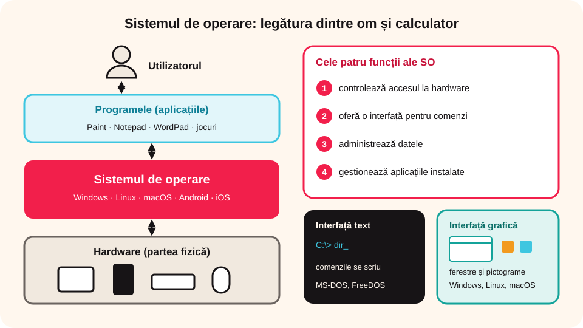
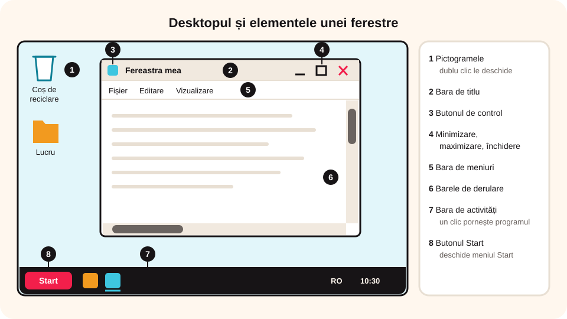

> **Competențe specifice (Anexa 15):** CS 1.2

## Ce vei învăța azi

- ce este **sistemul de operare** și care sunt cele patru funcții ale lui;
- care sunt elementele interfeței Windows: desktopul, pictogramele, bara de activități, butonul și meniul Start;
- cum lucrezi cu **ferestrele**: minimizare, maximizare, restaurare, închidere, redimensionare.

## Să ne amintim

Partea **software** a unui sistem de calcul este formată din **sistemul de operare** și din diferite **programe** (aplicații).

## Lecția pe scurt

### Ce este sistemul de operare

**Sistemul de operare (SO)** este un ansamblu de programe care face legătura dintre echipamentele fizice (hardware) și utilizator. El controlează funcțiile calculatorului și înțelege comenzile pe care i le dai. **Fără sistem de operare, un calculator nu poate fi folosit.**

**Programele (aplicațiile)** se instalează **după** sistemul de operare. Ele ne ajută în activitățile de zi cu zi: facturare, proiectare, grafică, animație, jocuri etc.

**Cele patru funcții ale sistemului de operare:**

1. controlează accesul la hardware (la componentele fizice);
2. oferă o **interfață** prin care dai comenzi și pornești aplicații;
3. administrează datele;
4. gestionează aplicațiile instalate.

**Tipuri de sisteme de operare, după interfață:**

- **cu interfață text** (comenzile se scriu): DOS, MS-DOS, FreeDOS;
- **cu interfață grafică** (lucrezi mai ușor, cu ferestre și pictograme): Windows, Linux, Unix, macOS, Android, iOS.



### Interfața Windows 10

1. **Suprafața de lucru (desktopul)**: ecranul principal al sistemului de operare.
2. **Pictogramele**: imagini mici de pe desktop; cu **dublu clic** deschizi programe sau date. Pictograma **Coșului de reciclare (Recycle Bin)** este o scurtătură către locul unde ajung temporar fișierele șterse.
3. **Bara de activități (taskbar)**: arată pictogramele programelor folosite des și ale celor deschise; le pornești cu **un clic**. În dreapta ei găsești data și ora, limba tastaturii (de exemplu, tastatura românească pentru diacritice), conexiunea la rețea, bateria și volumul.
4. **Butonul Start**: deschide meniul Start.
5. **Meniul Start**: de aici accesezi toate programele instalate, setările și butonul **Alimentare (Power)**, cu trei opțiuni:
   - **Închidere (Shut down)**: oprirea calculatorului;
   - **Repornire (Restart)**: repornirea sistemului de operare;
   - **Repaus (Sleep)**: consum redus de energie, când pleci pentru puțin timp.

Windows are și programe incluse, în grupul **Accesorii Windows**: **Paint** (desen), **Notepad** și **WordPad** (texte).

### Ferestrele

Fiecare program se deschide într-o **fereastră**, un dreptunghi pe ecran. De aici vine și numele **Windows** („ferestre”). Poți lucra cu mai multe programe deodată; ferestrele se suprapun ca niște coli de hârtie. **Fereastra activă** este cea care primește comenzile tale.

Elementele unei ferestre:

- **butonul de închidere** (✕): închide fereastra; la fel face combinația **Alt + F4**;
- **butonul de maximizare/restaurare** (□): fereastra ocupă tot ecranul sau revine la mărimea de dinainte;
- **butonul de minimizare** (–): fereastra devine o pictogramă pe bara de activități; un clic pe pictogramă o readuce;
- **bara de titlu**: arată numele ferestrei;
- **butonul de control**: deschide un **meniu**, adică o listă de comenzi pentru fereastră;
- **bara de meniuri** (sau **panglica / ribbon**, la unele aplicații);
- **barele de derulare** orizontală și verticală.



**Redimensionare:** dacă fereastra nu e minimizată sau maximizată, pui cursorul pe o margine și, când își schimbă forma, tragi ținând apăsat butonul stâng al mouse-ului. Dacă tragi de colț, se schimbă ambele dimensiuni.

## Exemplu rezolvat

**Care dintre acestea sunt sisteme de operare: Paint, Notepad, WordPad, Media Player, Windows, MS-DOS?**

Paint, Notepad, WordPad și Media Player sunt **programe (aplicații)**. **Sistemele de operare** sunt **Windows** și **MS-DOS**.

## Aplicații interactive

```categorii
# Sistem de operare sau aplicație?
Sistem de operare: Windows, MS-DOS, Linux, Android, iOS, macOS
Aplicație: Paint, Notepad, WordPad, Media Player
```

```cartonase
# Butoanele unei ferestre
Minimizare (–) = Reduce fereastra la o pictogramă pe bara de activități.
Maximizare (□) = Fereastra ocupă tot ecranul.
Restaurare = Readuce fereastra la mărimea de dinainte.
Închidere (✕) = Închide fereastra; la fel face Alt + F4.
```

```quiz
# Alege răspunsul corect.
Ce face sistemul de operare?
* face legătura dintre echipamentele fizice și utilizator
- este un program de desenat
- este o componentă hardware din unitatea centrală
Explicație: Fără sistem de operare, calculatorul nu poate fi folosit.

Ce opțiune alegi când pleci de la calculator pentru puțin timp?
- Închidere (Shut down)
- Repornire (Restart)
* Repaus (Sleep)
Explicație: În modul Repaus calculatorul consumă puțină energie și îți poți relua lucrul repede.

Care sisteme de operare au interfață grafică?
* Windows
* Android
- MS-DOS
* Linux
```

```completare
# Completează.
Programele se deschid cu [dublu clic] pe pictograma de pe desktop și cu [un clic|clic] pe pictograma din bara de activități. Fișierele șterse ajung în [Coșul de reciclare|Recycle Bin]. Fereastra care primește comenzile tale se numește fereastra [activă].
```

```adevarat-fals
A: Un calculator fără sistem de operare nu poate fi folosit.
F: Aplicațiile se instalează înainte de sistemul de operare. | Programele se instalează după instalarea sistemului de operare.
A: Ferestrele se pot suprapune, ca niște coli de hârtie.
F: Un meniu este o pictogramă de pe desktop. | Un meniu este o listă de comenzi din care alegi una.
```

## Exersează

1. Dă exemple de două funcții ale unui sistem de operare.
2. Ce este un meniu?
3. Pornește calculatorul și enumeră elementele de pe ecranul Windows. Apasă Start și vezi ce aplicații ai instalate.
4. Deschide Paint, Notepad și WordPad. Redimensionează-le astfel încât să fie toate pe ecran, fără să se suprapună, doar atingându-se la margini.
5. **Știai că?** Windows a apărut în noiembrie 1985, ca interfață grafică pentru MS-DOS. Primul sistem de operare Mac OS a apărut în 1984, pentru calculatoarele Apple Macintosh.
6. **Portofoliu:** fă un colaj „Desktopul meu”, cu cinci pictograme, două ferestre deschise ale aplicațiilor preferate și pictograma Coșului de reciclare.

## Pe scurt

**Sistemul de operare** face legătura dintre om și calculator. Windows are **desktop**, **pictograme**, **bara de activități** și **meniul Start**. Fiecare program se deschide într-o **fereastră**, pe care o poți minimiza, maximiza, restaura, închide sau redimensiona.
