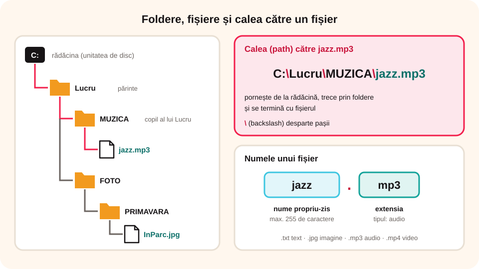

> **Competențe specifice (Anexa 15):** CS 1.2

## Ce vei învăța azi

- ce este un **fișier** și ce ne spune **extensia** lui;
- ce sunt **folderele** și **subfolderele** și de ce le folosim;
- ce este **structura arborescentă** și cum scrii **calea** către un fișier;
- ce **reguli** respecți ca să îți organizezi bine datele.

## Să ne amintim

Datele se păstrează pe dispozitive de stocare: HDD, SSD, stickuri, carduri, discuri optice.

## Lecția pe scurt

### Fișierul

Un **fișier** este un set de date memorate electronic pe un dispozitiv de stocare. Poate conține programe, texte, poze, desene, muzică sau filme. Când păstrezi un fișier pe un dispozitiv de stocare, faci operația de **salvare**.

Numele unui fișier are două părți, despărțite de **punct**:

```
nume propriu-zis . extensie
   tema_mea       .   txt
```

- **Numele propriu-zis** are cel mult **255 de caractere** și **nu poate conține** caracterele `\ / : * ? " < > |`.
- **Extensia** ne spune **ce tip** de fișier este:

| Tip | Extensii |
|---|---|
| text | .txt |
| imagine | .png, .jpg, .jpeg, .bmp, .gif |
| audio (sunet, muzică) | .mp3, .wav, .ogg, .m4a |
| video (filme) | .avi, .mp4, .ogv, .mov, .mpg |

### Folderele

Când ai foarte multe fișiere, e greu să găsești ce cauți. De aceea le grupăm în **foldere** (numite și **directoare**).

Un **folder** poate conține fișiere și/sau alte foldere. Un folder aflat în alt folder se numește **subfolder**. Numele unui folder respectă aceleași reguli: cel mult 255 de caractere, fără `\ / : * ? " < > |`.

**E ca într-o bibliotecă:** rafturile, bibliorafturile și dosarele sunt folderele, iar paginile sunt fișierele.

### Unitățile de disc

O **unitate de disc** este un loc unde se pot stoca date: tot hard-diskul sau SSD-ul, o parte din el (o **partiție**) sau un dispozitiv extern (stick, CD). Fiecare unitate are o **literă** urmată de două puncte: `C:`, `D:`, `E:`.

### Structura arborescentă și calea

Folderele și fișierele formează o **structură arborescentă**, ca un copac: din trunchi pornesc ramuri (folderele), iar pe ramuri cresc frunze (fișierele). Folderul care conține un subfolder se numește **părinte**, iar subfolderul este **copilul** lui.

Folderul care **nu are părinte** se numește **rădăcină**; de obicei este unitatea de disc, de exemplu `C:`.

**Calea (path)** arată drumul de la rădăcină până la un fișier. În Windows, pașii se despart cu `\` (**backslash**, bară oblică inversă).

Exemplu: fișierul `jazz.mp3` se află în folderul `MUZICA`, care e în folderul `Lucru`, pe unitatea `C:`. Calea este:

```
C:\Lucru\MUZICA\jazz.mp3
```



**Câte fișiere încap?** Depinde de mărimea fișierelor și de capacitatea dispozitivului.

### Reguli pentru structurarea datelor

Un calculator „ordonat” te ajută să găsești repede orice fișier. Respectă aceste reguli:

1. **Grupează după un criteriu clar**: pe discipline (`Matematica`, `TIC`, `Romana`), pe tipuri (`Poze`, `Muzica`) sau pe perioade (`2026-Septembrie`).
2. **Dă nume sugestive**, care spun ce conține fișierul: `Tema_TIC_hardware.txt`, nu `fisier1.txt` sau `asdf.txt`.
3. **Nu face prea multe niveluri** de subfoldere: 2–4 niveluri sunt de obicei suficiente.
4. **Păstrează aceeași regulă de denumire** peste tot. De exemplu, data scrisă **an-lună-zi** (`2026-10-15_excursie.jpg`): așa, fișierele se ordonează singure în ordinea zilelor.
5. **Nu ține fișiere „la grămadă”** pe desktop; mută-le în folderul potrivit.
6. **Șterge copiile inutile** și fă **copii de siguranță** (backup) pentru fișierele importante, pe alt dispozitiv de stocare.

**Exemplu de structură bună:**

```
C:\Scoala
   \TIC
      \Unitatea1
      \Unitatea2
   \Matematica
   \Proiecte
      \Mascota_clasei
```

## Exemplu rezolvat

Pe unitatea `C:` ai folderul `Lucru`, în el folderul `FOTO`, iar în `FOTO` creezi folderul `PRIMAVARA`, în care pui fișierul `InParc.jpg`.

**Calea este:** `C:\Lucru\FOTO\PRIMAVARA\InParc.jpg`. Din extensia `.jpg` știm că este o **imagine**.

## Aplicații interactive

```categorii
# Ce tip de fișier este?
Text: tema.txt
Imagine: poza.jpg, desen.png, logo.gif
Audio: melodie.mp3, sunet.wav
Video: film.mp4, clip.avi
```

```quiz
# Nume corecte
Care este un nume corect de fișier în Windows?
* `ExperimentBun!_1.txt`
- `ExperimentBun?_1.txt`
- `ExperimentBun->1.txt`
Explicație: Caracterele ? și > nu sunt permise în numele fișierelor.

Care este un nume corect de folder?
- `Imagini_partea<2>`
* `Imagini_partea2`
- `Imagini_partea2*`
Explicație: Caracterele < > și * nu sunt permise.

Ce indică extensia unui fișier?
- mărimea fișierului
* tipul fișierului
- data creării
```

```ordonare
# Construiește calea către fișierul jazz.mp3, de la rădăcină la fișier.
C:
Lucru
MUZICA
jazz.mp3
```

```adevarat-fals
F: Un fișier poate conține mai multe foldere. | Folderul conține fișiere, nu invers.
A: Un folder poate conține mai multe fișiere.
A: Folderul care nu are părinte se numește rădăcină.
F: În Windows, pașii dintr-o cale se despart cu „/”. | În Windows se folosește „\” (backslash).
```

```completare
# Completează textul.
Datele sunt memorate în format electronic în [fișiere]. Mai multe fișiere pot fi grupate în [foldere|directoare]. Fiecare fișier are o [extensie] care îi indică tipul. Un folder aflat în alt folder se numește [subfolder|subdirector].
```

```categorii
# Organizare bună sau organizare proastă?
Bună: numele Tema_TIC_hardware.txt, foldere separate pe discipline, data scrisă an-lună-zi în numele fișierelor, o copie de siguranță pe un stick
Proastă: zeci de fișiere puse la grămadă pe desktop, nume ca fisier1.txt sau asdf.txt, zece niveluri de subfoldere goale, trei copii identice ale aceluiași fișier în același folder
```

```quiz
# Alege varianta cea mai bună.
Ce nume este cel mai potrivit pentru o poză din excursia de pe 15 octombrie 2026?
- IMG_4587.jpg
- poza.jpg
* 2026-10-15_excursie_Sinaia.jpg
Explicație: Numele spune ce conține și, cu data scrisă an-lună-zi, pozele se ordonează singure.

Unde salvezi tema la TIC, ca s-o găsești ușor?
- direct pe desktop, cu celelalte fișiere
* în folderul `Scoala\TIC`
- în folderul Muzica
```

```eseu
Ai pe desktop 40 de fișiere amestecate: teme la mai multe discipline, poze din vacanță, melodii și desene făcute în Paint. Descrie structura de foldere pe care o creezi ca să le organizezi (scrie numele folderelor și subfolderelor), regula după care denumești fișierele și scrie calea completă către un fișier ales de tine.
Cuvinte: 40-150
Barem: structură arborescentă logică (de exemplu C:\Personal cu Scoala\TIC, Scoala\Matematica, Poze\Vacanta_2026, Muzica, Desene); criteriu de grupare explicat; nume de foldere și fișiere valide (fără \ / : * ? " < > |) și sugestive; o regulă de denumire aplicată consecvent; o cale corectă scrisă cu \, de exemplu C:\Personal\Poze\Vacanta_2026\2026-07-20_mare.jpg.
```

## Exersează

1. Ce este un folder? Dar un subfolder?
2. Desenează pe caiet o structură arborescentă: în folderul `FOTO` pune patru foldere, `VARA`, `TOAMNA`, `IARNA`, `PRIMAVARA`. Scrie calea către fișierul `InParc.jpg` din `PRIMAVARA`.
3. Investigație: desenează o structură în care rădăcina are două subfoldere, fiecare dintre ele alte două, și tot așa de cinci ori. În ultimele foldere pune câte două fișiere. Găsește o regulă pentru a calcula câte foldere și câte fișiere sunt.
4. **Portofoliu:** fă două desene, arborele tău genealogic și un arbore de foldere și fișiere din calculatorul tău. Ce asemănări observi?

## Pe scurt

Datele se păstrează în **fișiere**, cu **nume.extensie**; extensia arată tipul. Fișierele se grupează în **foldere** și **subfoldere**, care formează o **structură arborescentă** pornind de la **rădăcină**. **Calea**, de exemplu `C:\Lucru\MUZICA\jazz.mp3`, arată unde se află un fișier.
