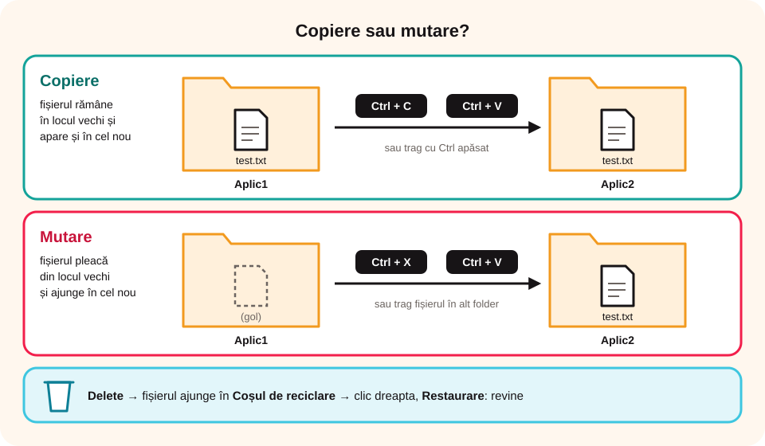

> **Competențe specifice (Anexa 15):** CS 1.1, CS 1.2

## Ce vei învăța azi

- să folosești **File Explorer** ca să navighezi printre foldere;
- să **creezi, deschizi, redenumești, copiezi, muți și ștergi** fișiere și foldere;
- să copiezi fișiere pe un **stick** și să îl scoți **în siguranță**;
- să **recuperezi** un fișier din Coșul de reciclare, să selectezi mai multe fișiere deodată și să **cauți** un fișier.

## Să ne amintim

Datele sunt păstrate în **structuri arborescente** de foldere și fișiere, care pornesc de la o rădăcină, de exemplu `C:`.

## Lecția pe scurt

### Programe pentru fișiere

Pentru lucrul cu fișiere și foldere, Windows are programul **File Explorer**. Îl pornești din meniul Start sau cu combinația **tasta Windows + E**. Există și alte programe asemănătoare: Total Commander și FreeCommander (Windows), Nautilus (Linux), Finder (macOS).

### Navigarea

- În **stânga** ferestrei vezi **structura arborescentă** de foldere. Un clic pe `>` (sau `+`) sau un dublu clic pe folder îi arată subfolderele; operația se numește **expandare**.
- Un clic pe un folder din stânga îi arată **conținutul în dreapta**.
- În dreapta, **dublu clic** pe un folder îl deschide, iar **un clic** pe un fișier îl **selectează**.
- Din meniul **Vizualizare (View)** alegi cum vezi fișierele: pictograme mari sau mici, listă, detalii.

### Proprietăți

Selectezi fișierul sau folderul → **clic dreapta** → **Proprietăți (Properties)**. Vezi detalii, inclusiv **dimensiunea (Size)**.

### Operațiile principale

| Operație | Cum o faci |
|---|---|
| **Creare folder** | clic dreapta → **Nou (New)** → **Folder** → scrii numele → **Enter** |
| **Creare fișier** | clic dreapta → **Nou** → alegi tipul (de exemplu, *Document text*) |
| **Deschidere** | **dublu clic** pe fișier; se deschide în aplicația cu care a fost creat |
| **Redenumire** | selectezi → clic pe nume → scrii numele nou → **Enter** |
| **Copiere** | **Ctrl + C**, apoi în folderul destinație **Ctrl + V**; sau tragi fișierul ținând apăsat **Ctrl**; sau clic dreapta → **Copiere** / **Lipire** |
| **Mutare** | **Ctrl + X**, apoi **Ctrl + V**; sau tragi fișierul în alt folder de pe aceeași unitate de disc (drag and drop); sau clic dreapta → **Decupare** / **Lipire** |
| **Ștergere** | tasta **Delete**, sau clic dreapta → **Ștergere (Delete)** |

> **Copiere** = fișierul rămâne și în locul vechi, și apare în cel nou. **Mutare** = fișierul pleacă din locul vechi.



### Lucrul cu un stick de memorie

1. Introduci stickul în **portul USB**. În File Explorer apare o unitate nouă, de exemplu `E:`.
2. **Copiezi** fișierele pe stick (Ctrl + C, deschizi `E:`, Ctrl + V). Atenție: dacă **tragi** un fișier pe **altă unitate de disc**, Windows îl **copiază**, nu îl mută.
3. Înainte să scoți stickul, dai clic pe pictograma **Eliminare în siguranță a hardware-ului** din bara de activități (sau clic dreapta pe unitate → **Scoatere**). Așa nu se strică fișierele care încă se scriu.

> Un fișier șters de pe stick **nu** ajunge în Coșul de reciclare: este șters definitiv. Verifică de două ori înainte să apeși Delete!

### Coșul de reciclare

Un fișier șters ajunge în **Coșul de reciclare (Recycle Bin)**, de unde îl poți **recupera**: deschizi Coșul de reciclare → clic dreapta pe fișier → **Restaurare (Restore)**. Dacă îl ștergi și din Coșul de reciclare, este **șters definitiv**.

### Selecția multiplă

- fișiere **unul după altul**: clic pe primul, ții apăsat **Shift**, clic pe ultimul;
- fișiere **răzlețe**: clic pe primul, ții apăsat **Ctrl**, clic pe fiecare dintre celelalte;
- **toate** fișierele din folder: **Ctrl + A**.

### Căutarea

Selectezi folderul în care cauți → scrii în caseta **Căutare (Search)** → **Enter** → clic dreapta pe rezultat → **Deschidere locație fișier**.

## Exemplu rezolvat

**Sarcină:** în folderul `Lucru` creează subfolderele `Aplic1` și `Aplic2`. În `Aplic1` creează `test1.txt`, fă o copie numită `test2.txt`, apoi mută `test2.txt` în `Aplic2`.

1. În `Lucru`: clic dreapta → Nou → Folder → `Aplic1` → Enter. La fel pentru `Aplic2`.
2. În `Aplic1`: clic dreapta → Nou → Document text → `test1.txt`.
3. Selectezi `test1.txt` → **Ctrl + C** → **Ctrl + V** → redenumești copia în `test2.txt`.
4. Selectezi `test2.txt` → **Ctrl + X** → deschizi `Aplic2` → **Ctrl + V**.

## Aplicații interactive

```cartonase
# Combinații de taste
Ctrl + C = Copiere
Ctrl + X = Tăiere (decupare), pentru mutare
Ctrl + V = Lipire
Ctrl + A = Selectarea tuturor fișierelor din folder
Tasta Windows + E = Pornește File Explorer
Alt + F4 = Închide fereastra
```

```ordonare
# Cum muți un fișier cu tastatura? Pune pașii în ordine.
Selectezi fișierul
Apeși Ctrl + X
Deschizi folderul destinație
Apeși Ctrl + V
```

```quiz
# Alege răspunsul corect.
Dacă dai clic dreapta pe un folder și alegi Proprietăți, vezi:
- toate fișierele din folder
* proprietățile folderului, inclusiv dimensiunea lui
- toate folderele din calculator

Un fișier șters mai poate fi recuperat?
* Da, din Coșul de reciclare, cu Restaurare
- Nu, niciodată
- Doar dacă repornești calculatorul
Explicație: Fișierul e șters definitiv doar dacă îl ștergi și din Coșul de reciclare.

Cum selectezi mai multe fișiere care NU sunt unul după altul?
- ții apăsat Shift și dai clic pe ultimul
* ții apăsat Ctrl și dai clic pe fiecare
- apeși Ctrl + V
```

```categorii
# Copiere sau mutare?
Copiere: Ctrl + C apoi Ctrl + V, tragi fișierul ținând Ctrl, fișierul rămâne și în locul vechi
Mutare: Ctrl + X apoi Ctrl + V, tragi fișierul fără Ctrl pe aceeași unitate de disc, fișierul pleacă din locul vechi
```

```adevarat-fals
A: File Explorer este programul din Windows pentru lucrul cu fișiere și foldere.
F: Un fișier se deschide cu un singur clic în partea dreaptă a File Explorer. | Un clic îl selectează; dublu clic îl deschide.
A: Ctrl + A selectează toate fișierele din folderul curent.
A: Dacă tragi un fișier de pe C: pe stickul E:, fișierul este copiat. | Între unități de disc diferite, tragerea face o copie.
F: Poți scoate stickul din calculator oricând, chiar în timp ce se copiază fișiere. | Folosești întâi Eliminare în siguranță, altfel fișierele se pot strica.
F: Un fișier șters de pe stick poate fi restaurat din Coșul de reciclare. | De pe stick, fișierele se șterg definitiv.
```

```eseu
Sarcină practică: pe calculator, creează în folderul `Portofoliu` structura `TIC\Unitatea2`, apoi mută acolo trei fișiere create de tine, redenumește-le cu nume sugestive, copiază folderul `Unitatea2` pe un stick și scoate stickul în siguranță. Descrie aici, în ordine, ce operații ai făcut și ce combinații de taste sau comenzi ai folosit.
Cuvinte: 40-150
Barem: crearea folderelor (clic dreapta → Nou → Folder); mutarea cu Ctrl + X / Ctrl + V; redenumirea; copierea pe stick (Ctrl + C / Ctrl + V sau tragere pe altă unitate); Eliminare în siguranță; pașii sunt în ordinea corectă și numele respectă regulile.
```

## Exersează

1. Fă pe calculator sarcina din exemplul rezolvat. Apoi șterge `test1.txt` și restaurează-l din Coșul de reciclare.
2. Exersează selecția multiplă pe cele două fișiere.
3. Alege trei foldere de pe calculator și scrie-le în ordinea crescătoare a dimensiunii (folosește Proprietăți).
4. Investigație: câștigi timp dacă folosești combinațiile de taste în loc de meniuri?
5. **Portofoliu:** creează folderul `Portofoliu`, iar în el un fișier text `PrimulMeuFisier.txt` și un folder `Documente`.

## Pe scurt

În **File Explorer** creezi, deschizi, redenumești, copiezi (**Ctrl + C / Ctrl + V**), muți (**Ctrl + X / Ctrl + V**) și ștergi (**Delete**) fișiere și foldere. Ce ștergi ajunge în **Coșul de reciclare**, de unde poți restaura. Cu **Ctrl** și **Shift** selectezi mai multe fișiere deodată.
