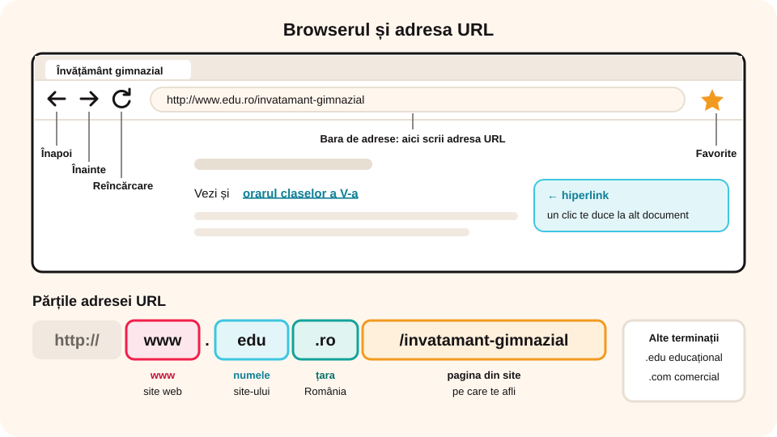
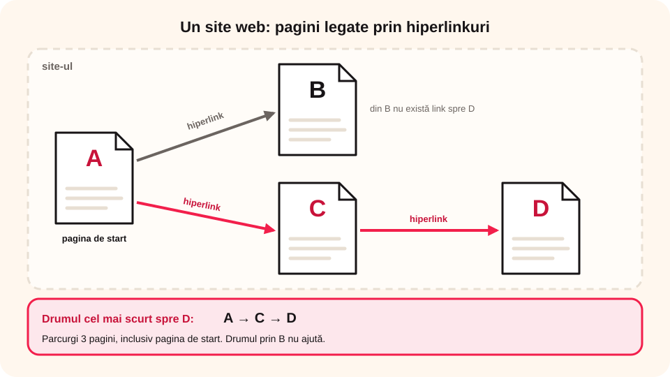

## Ce vei învăța azi

- ce sunt **hipertextul**, **hiperlinkul**, **pagina web** și **site-ul web**;
- din ce este formată o **adresă URL**;
- cum folosești un **browser** ca să navighezi;
- care sunt **pericolele de pe internet** și cum te protejezi.

## Să ne amintim

**WWW (World Wide Web)** este serviciul internetului în care documentele sunt legate între ele și pot fi accesate ușor.

## Lecția pe scurt

### Cum a apărut web-ul

**WWW** a fost inventat în **1989** de cercetătorul englez **Tim Berners-Lee**, la **CERN** (Organizația Europeană pentru Cercetare Nucleară), în Geneva, Elveția. Șeful lui a scris pe propunere: „Vag, dar interesant”.

### Hipertext și hiperlinkuri

**Hipertextul** este un text care conține **hiperlinkuri** (legături) către alte materiale. Când dai clic pe un hiperlink, ajungi direct la documentul legat.

### Adresa URL

Fiecare document de pe web are o adresă unică, numită **URL** (Uniform Resource Locator). Exemplu:

```
http://www.edu.ro/invatamant-gimnazial
```

- `www`: cei trei W, specifici site-urilor web;
- `edu`: numele site-ului;
- `.ro`: țara căreia i se adresează site-ul (`.ro` pentru România) sau tipul site-ului (`.edu` educațional, `.com` comercial);
- `/invatamant-gimnazial`: pagina din site pe care te afli.

### Pagini și site-uri

- Informația de pe web este organizată în **pagini web**, asemănătoare cu paginile unei cărți. Paginile web sunt scrise în **HTML** (HyperText Markup Language), un **limbaj de marcare**.
- Un **site web** este o colecție de pagini web, legate prin hiperlinkuri, care aparțin de obicei unei persoane sau organizații. Exemple: `www.cfr.ro`, `www.wikipedia.org`.
- **Navigarea** înseamnă parcurgerea paginilor web. Prima pagină a unui site se numește **pagina de start (home page)**.
- Paginile se deschid cu un **program de navigare (browser)**, scriind adresa URL: Google Chrome, Mozilla Firefox, Microsoft Edge, Safari, Opera.

> Curiozitate: în browser, clic dreapta pe o pagină → **Vezi sursa paginii** și vezi codul HTML al paginii.

### Butoanele browserului

- **Înapoi (←)**: revii la pagina deschisă anterior; dacă îl ții apăsat, vezi istoricul.
- **Înainte (→)**: mergi la pagina următoare, dacă ai fost deja pe ea.
- **Reîncărcare (⟳)**: încarci din nou pagina, dacă nu s-a încărcat complet sau ca să vezi actualizările.
- **Favorite (☆)**: adaugi pagina la paginile tale favorite.
- **Bara de adrese**: aici scrii sau vezi adresa URL.



### Siguranța pe internet

| Pericol | Ce este | Cum te protejezi |
|---|---|---|
| **Virușii informatici** | programe care se instalează fără permisiune și strică hardware-ul sau software-ul | instalezi un **antivirus**; nu deschizi linkuri nesigure sau fișiere de la necunoscuți |
| **Conținutul nepotrivit** | informații dăunătoare, chiar ilegale, care pot îndemna la violență sau la consum de alcool și droguri | folosești site-uri de încredere, potrivite vârstei; **verifici** informațiile înainte să le folosești |
| **Furtul de identitate** | infractorii copiază datele personale (nume, adresă, parole, date de card) și le folosesc ca să facă rău | **nu dai date personale**; parolele sunt **secrete** și **complexe** (litere, cifre, simboluri); te înregistrezi pe site-uri doar cu acordul părinților; folosești **firewall**, antivirus și antispyware |
| **Hărțuirea online (cyberbullying)** | intimidarea și abuzarea cuiva prin internet | alegi atent cu cine te împrietenești online; vorbești politicos; **nu răspunzi** la mesaje care te supără și **ceri ajutorul unui adult**; nu publici nimic care te poate pune în pericol |

## Exemplu rezolvat

**Care este cel mai mic număr de pagini?** Un site are pagina de start A. Din A ai link spre B și C, iar din C ai link spre D. Ca să ajungi la D: **A → C → D**. Parcurgi **3 pagini**, inclusiv cea de start. Drumul prin B nu ajută, pentru că din B nu ai link spre D.



## Aplicații interactive

```quiz
# Alege răspunsul corect.
Ce program folosim pentru a naviga pe internet?
- un program de editare de imagini
- un fișier text
* un browser

Ce înseamnă „.ro” într-o adresă URL?
* că site-ul se adresează României
- că site-ul este comercial
- numele paginii pe care te afli

Cine a inventat World Wide Web?
- Ray Tomlinson
* Tim Berners-Lee
- Blaise Pascal
```

```adevarat-fals
A: Un site web poate avea o singură pagină web.
F: Pentru realizarea unei pagini web se folosește programul Paint. | Paginile web se scriu în limbajul HTML.
A: Între paginile web pot exista mai multe hiperlinkuri.
F: Parola poate fi spusă colegului de bancă, dacă îi ești prieten. | Parolele sunt personale și nu se spun nimănui.
```

```categorii
# Ce faci? Sortează comportamentele.
Sigur: verific informațiile în mai multe surse, cer ajutorul unui adult dacă primesc un mesaj urât, folosesc o parolă complexă și greu de ghicit, folosesc site-uri potrivite vârstei mele
Periculos: îmi public adresa pe internet, deschid fișierul primit de la un necunoscut, răspund la mesajele jignitoare, accept orice cerere de prietenie
```

```cartonase
# Butoanele browserului
Înapoi (←) = Revii la pagina deschisă anterior.
Înainte (→) = Mergi la pagina următoare, dacă ai fost deja pe ea.
Reîncărcare (⟳) = Încarci din nou pagina.
Favorite (☆) = Salvezi pagina în lista de favorite.
```

```completare
# Completează.
Un text care conține legături către alte materiale se numește [hipertext]. Adresa unică a unei pagini web se numește [URL]. Prima pagină a unui site se numește pagina de [start]. Paginile web sunt scrise în limbajul [HTML].
```

## Exersează

1. Ce înseamnă adresă URL? Dă trei exemple de adrese ale unor site-uri.
2. Dă un exemplu de situație din viața reală în care navigarea pe internet te ajută să rezolvi o problemă.
3. Intră pe trei site-uri și navighează prin ele. Ordonează-le după cât de multe pagini crezi că au, apoi numără paginile și verifică. Complexitatea unui site depinde doar de numărul de pagini sau și de legăturile dintre ele?
4. Enumeră trei pericole ale internetului și cum te protejezi de fiecare.
5. **Portofoliu:** fă o fișă cu numele a trei browsere pe care le cunoști și adresele lor URL.

## Pe scurt

Pe **web**, paginile sunt legate prin **hiperlinkuri** și au o adresă **URL**. Un **site web** este o colecție de pagini, pe care le deschizi cu un **browser**. Pe internet ai grijă la **viruși**, **conținut nepotrivit**, **furt de identitate** și **hărțuire online**.
