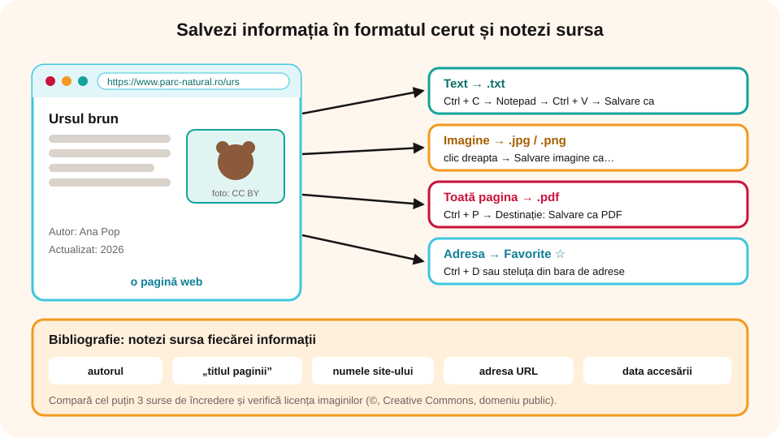

> **Competențe specifice (Anexa 15):** CS 1.2, CS 1.3

## Ce vei învăța azi

- să salvezi de pe internet un **text**, o **imagine**, o **pagină întreagă** sau o **adresă**, în **formatul cerut**;
- să te documentezi din **mai multe surse** și să verifici dacă o informație este de încredere;
- ce sunt **drepturile de autor**, **licențele** și **plagiatul**;
- cum **citezi** corect o sursă și cum scrii o **bibliografie**.

## Să ne amintim

Cu un **motor de căutare** găsești pagini după **cuvinte-cheie**. **Descărcarea (download)** înseamnă salvarea pe calculatorul tău a unui fișier de pe internet. Extensia unui fișier îi arată tipul: `.txt` (text), `.jpg`, `.png` (imagine), `.pdf` (document).

## Lecția pe scurt

### Salvarea informațiilor în formatul cerut

Profesorul îți poate cere informația într-un anumit **format** (tip de fișier). Iată cum salvezi fiecare lucru:

| Ce salvezi | Cum faci | Formatul obținut |
|---|---|---|
| **un text** | selectezi textul → **Ctrl + C** → deschizi **Notepad** sau **WordPad** → **Ctrl + V** → **Fișier → Salvare ca** | `.txt` (Notepad), `.rtf` (WordPad) |
| **o imagine** | **clic dreapta** pe imagine → **Salvare imagine ca…** → alegi folderul și numele → **Salvare** | de obicei `.jpg` sau `.png` |
| **o pagină întreagă** | **Ctrl + P** (Imprimare) → la *Destinație* alegi **Salvare ca PDF** → **Salvare** | `.pdf` |
| **o pagină, ca să o deschizi fără internet** | **Ctrl + S** → *Pagină web, completă* | `.html` (plus un folder cu imaginile) |
| **ce se vede pe ecran** | **Windows + Shift + S** (sau tasta **Print Screen**) → lipești în **Paint** → **Salvare ca** | `.png` sau `.jpg` |
| **adresa paginii** | **Ctrl + D** sau steluța **☆** (Favorite); sau copiezi adresa din bara de adrese | un link în lista de favorite |

**Sfaturi:**

- Salvează totul **într-un folder** făcut special pentru proiect, de exemplu `Documentare_Urs_brun`, cu **nume sugestive** pentru fișiere.
- Dacă se cere alt format pentru o imagine (de exemplu `.png` în loc de `.jpg`), o deschizi în **Paint** și folosești **Salvare ca → Imagine PNG**.
- Fișierele descărcate prin butoane de tip **Descarcă** ajung de obicei în folderul **Descărcări (Downloads)**.



### Documentarea din mai multe surse

Pe internet oricine poate publica orice, așa că nu tot ce citești este adevărat. Când te documentezi:

1. **Folosește cel puțin trei surse** și **compară** informațiile. Dacă surse de încredere spun același lucru, informația este probabil corectă.
2. **Verifică cine a scris**: o instituție (minister, muzeu, universitate), o enciclopedie, un autor cunoscut? Site-urile oficiale au adesea terminații ca `.gov.ro` sau `.edu.ro`.
3. **Verifică data**: informația este actuală?
4. **Fii atent la titluri senzaționale** („Nu o să-ți vină să crezi!”): de multe ori ascund **știri false (fake news)**.
5. **Notează sursa** fiecărei informații chiar în momentul în care o salvezi.

### Drepturile de autor

- Orice **operă** (text, poză, desen, melodie, film, program) este protejată de **drepturile de autor** din momentul în care a fost creată, chiar dacă nu scrie nicăieri **©**.
- Folosirea unei opere fără acordul autorului este **ilegală**. La școală, poți folosi **fragmente** din operele altora, dar doar dacă **menționezi sursa** și autorul.
- **Licența** spune ce ai voie să faci cu o operă:

| Licență | Ce înseamnă |
|---|---|
| **© Toate drepturile rezervate** | nu ai voie să o folosești fără acordul autorului (excepție: citatele scurte, cu sursa) |
| **Creative Commons (CC)** | autorul îți dă voie să o folosești, cu condiții: **BY** = menționezi autorul; **NC** = doar în scop necomercial; **ND** = fără modificări; **SA** = distribui mai departe cu aceeași licență |
| **Domeniul public** | o poți folosi liber; de exemplu, operele autorilor morți de peste **70 de ani** sau operele cu licența **CC0** |

- **Plagiatul** înseamnă să prezinți ca fiind al tău un text, o imagine sau o idee a altcuiva. Este necinstit, chiar dacă schimbi câteva cuvinte.
- Cum eviți plagiatul: **scrii cu cuvintele tale** ce ai înțeles; când copiezi exact, pui textul **între ghilimele** și scrii sursa; treci toate sursele la **Bibliografie**.

### Cum citezi o sursă

În **Bibliografie**, la finalul proiectului, scrii pentru fiecare sursă:

**Autorul** (dacă apare), **„Titlul paginii”**, **numele site-ului**, **adresa URL**, **data accesării**.

Exemplu:

> „Constantin Brâncuși”, Wikipedia, https://ro.wikipedia.org/wiki/Constantin_Brâncuși, accesat la 15.10.2026.

Pentru o imagine, scrii sub ea: *Imagine: numele autorului, licența, site-ul* (de exemplu: *Imagine: Ana Pop, CC BY, pixabay.com*).

## Exemplu rezolvat

**Cerința:** „Fă o fișă despre ursul brun din România. Salvează un text despre hrana lui în format `.txt` și o fotografie în format `.png`, în folderul `Urs_brun`. Scrie sursele.”

1. Creezi folderul `Urs_brun` în `Portofoliu`.
2. Cauți `urs brun România hrană` și deschizi **trei** site-uri de încredere (de exemplu, al unui parc național și al unei organizații de protecția naturii). Compari ce scriu.
3. Selectezi un paragraf → **Ctrl + C** → în **Notepad** **Ctrl + V** → la final scrii sursa → **Salvare ca** `Urs_hrana.txt` în `Urs_brun`.
4. Cauți o fotografie cu licență liberă (de exemplu, pe un site cu imagini Creative Commons) → **clic dreapta → Salvare imagine ca…** → o salvezi. Dacă este `.jpg`, o deschizi în **Paint** → **Salvare ca → Imagine PNG** → `Urs_brun.png`.
5. În fișierul text adaugi **Bibliografie**: titlul paginii, site-ul, adresa și data, plus autorul și licența fotografiei.

## Aplicații interactive

```categorii
# Ce format obții?
.txt: textul lipit în Notepad și salvat
.pdf: pagina imprimată cu Salvare ca PDF
.png sau .jpg: imaginea salvată cu clic dreapta → Salvare imagine ca, captura de ecran salvată din Paint
.html: pagina salvată cu Ctrl + S ca Pagină web completă
```

```ordonare
# Cum salvezi o imagine de pe internet? Pune pașii în ordine.
Găsești imaginea și verifici licența ei
Dai clic dreapta pe imagine
Alegi Salvare imagine ca…
Alegi folderul proiectului și scrii un nume sugestiv
Apeși Salvare
Notezi sursa și autorul imaginii
```

```quiz
# Alege răspunsul corect.
Profesorul cere pagina despre Delta Dunării ca fișier PDF. Ce faci?
- Ctrl + D
* Ctrl + P, apoi alegi Salvare ca PDF
- clic dreapta → Salvare imagine ca
Explicație: Din fereastra de imprimare poți „imprima” pagina într-un fișier .pdf.

O imagine are licența CC BY. Ce trebuie să faci dacă o folosești în proiect?
* să menționezi autorul ei
- să plătești autorul
- nimic, este a ta
Explicație: BY înseamnă că menționezi autorul (atribuire).

Care este o citare corectă în bibliografie?
- „am luat de pe Google”
- www.google.com
* „Ursul brun”, Wikipedia, https://ro.wikipedia.org/wiki/Urs_brun, accesat la 20.10.2026
Explicație: Google este doar motorul de căutare; sursa este pagina pe care ai găsit informația.

Ce surse sunt de obicei de încredere?
* site-ul oficial al unui muzeu
* site-ul unui minister (.gov.ro)
- o postare anonimă cu titlul „Nu o să-ți vină să crezi!”
* o enciclopedie cunoscută
```

```adevarat-fals
F: Dacă o imagine nu are semnul ©, o poți folosi oricum vrei. | Operele sunt protejate de la creare, chiar dacă nu scrie ©.
A: Plagiatul înseamnă să prezinți ca fiind al tău ce a creat altcineva.
A: Operele aflate în domeniul public pot fi folosite liber.
F: E suficient să citești o informație pe un singur site ca să fii sigur că e adevărată. | Compară cel puțin trei surse de încredere.
A: Când copiezi exact o frază, o pui între ghilimele și scrii sursa.
```

```completare
# Completează.
Textul copiat în Notepad se salvează cu extensia [.txt|txt]. O pagină „imprimată” cu Salvare ca PDF devine un fișier [.pdf|pdf]. Licența care îți cere să menționezi autorul se notează [BY|CC BY]. Să prezinți munca altcuiva ca fiind a ta se numește [plagiat]. Pentru o documentare corectă compari cel puțin [trei|3] surse.
```

```eseu
Proiect de documentare: alege un obiectiv turistic din România. Găsește informații în cel puțin trei surse diferite, salvează un text în format .txt și o imagine cu licență liberă în format .png într-un folder cu numele obiectivului. Aici scrie: ce surse ai folosit (bibliografia completă), de ce le consideri de încredere și cum ai respectat drepturile de autor pentru imagine.
Cuvinte: 60-200
Barem: cel puțin trei surse citate complet (titlu, site, adresă URL, data accesării); justificarea încrederii (site oficial, instituție, enciclopedie, informații care se confirmă între surse); formatele cerute (.txt și .png) și numele folderului; imaginea are licență liberă (Creative Commons sau domeniu public), cu autorul și licența menționate; textul nu este prezentat ca fiind al elevului.
```

## Exersează

1. Caută o poezie de Mihai Eminescu și salveaz-o ca fișier `.txt`. Scrie la final sursa. De ce poezia lui Eminescu se află în domeniul public?
2. Salvează aceeași pagină o dată ca `.pdf` și o dată ca `.html`. Deschide-le pe amândouă. Ce diferențe observi?
3. Fă o captură de ecran cu pagina de start a site-ului școlii tale și salveaz-o ca `.png`.
4. Caută o informație (de exemplu, înălțimea vârfului Moldoveanu) pe trei site-uri. Dau toate aceeași valoare? Pe care te bazezi și de ce?
5. **Portofoliu:** adaugă la proiectul tău de documentare o pagină **Bibliografie** scrisă corect.

## Pe scurt

Salvezi informațiile **în formatul cerut**: textul în Notepad (`.txt`), imaginile cu **Salvare imagine ca** (`.jpg`, `.png`), paginile cu **Salvare ca PDF** (`.pdf`), adresele la **Favorite**. Te documentezi din **cel puțin trei surse de încredere**. Respecți **drepturile de autor**: verifici **licența**, nu **plagiezi** și treci la **Bibliografie** autorul, titlul, site-ul, adresa și data accesării.
