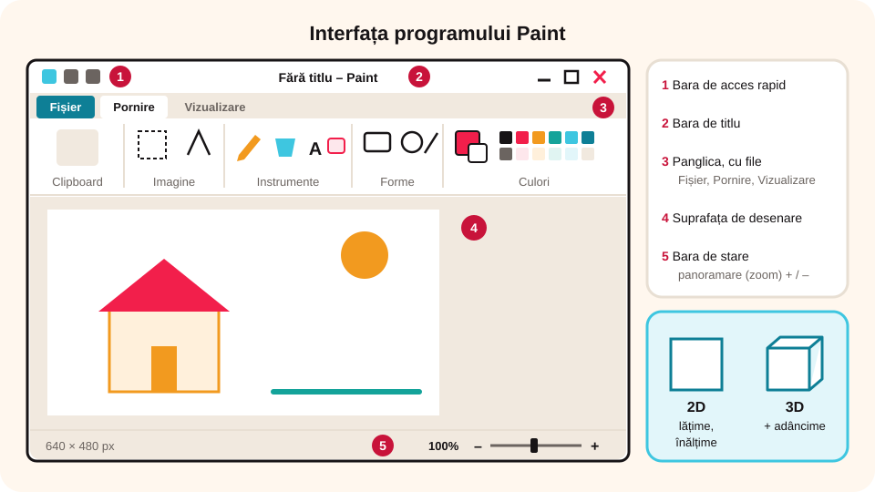

> **Competențe specifice (Anexa 15):** CS 3.1

## Ce vei învăța azi

- ce este un **editor grafic** și ce extensii au fișierele grafice;
- diferența dintre o imagine **2D** și una **3D**;
- care sunt elementele interfeței programului **Paint** și ce conțin filele lui.

## Să ne amintim

**Paint** este unul dintre programele incluse în Windows, în grupul **Accesorii Windows**. Fișierele imagine au extensii ca `.png`, `.jpg`, `.bmp`, `.gif`.

## Lecția pe scurt

### Editorul grafic

Un **editor grafic** este un program cu care **creezi, modifici și salvezi** imagini. Exemple: **Paint**, Paint.NET, **Inkscape**, **GIMP**, Adobe Photoshop, **Tux Paint**.

Imaginile se salvează în **fișiere grafice**. Din Paint poți salva cu extensiile `.png`, `.jpg`, `.bmp`, `.gif`, `.tiff`.

### 2D și 3D

- O imagine **2D** (în două dimensiuni) are **lățime** și **înălțime**, ca desenele pe hârtie.
- O imagine **3D** (în trei dimensiuni) mai are și **adâncime**.

> **Știai că?** În 1957, Ion Popescu-Gopo a câștigat premiul Palme d'Or la Festivalul de la Cannes cu filmul de animație „Scurtă istorie”. Personajul lui, un omuleț 2D desenat din linii simple, a devenit celebru ca „Omulețul lui Gopo”.

### Cum pornești Paint

- **Start** → **Accesorii Windows** → **Paint**;
- **Start** → scrii `Paint` → **Enter**;
- clic pe pictograma Paint din bara de activități, dacă este acolo.

### Interfața Paint

1. **Bara de acces rapid**: comenzi folosite des.
2. **Bara de titlu**: numele fișierului la care lucrezi și butoanele de minimizare, maximizare/restaurare și închidere.
3. **Panglica (Ribbon)**: comenzile, grupate în **file**. Dacă ții mouse-ul deasupra unui buton, vezi ce face și combinația de taste.
4. **Suprafața de desenare**: foaia pe care desenezi.
5. **Bara de stare**: are **panoramarea (zoom)**, cu care mărești sau micșorezi imaginea cu **+ / –**.



### Filele panglicii

**Fișier (File):** creezi un fișier nou, deschizi unul existent, **Salvezi**, **Salvezi ca** (în alt fișier), **Tipărești** și stabilești **Proprietățile** imaginii (dimensiuni, culori).

**Pornire (Home):** tot ce îți trebuie pentru desen:

- **Clipboard**: Lipire, Decupare (pentru mutare), Copiere;
- **Imagine**: **Selectare**, **Trunchiere**, **Redimensionare**, **Rotire**;
- **Instrumente**: **Creion**, **Umplere cu culoare**, **Text**, **Radieră**, **Selector de culoare (pipetă)**, **Lupă**;
- **Pensule**: urme de diferite tipuri;
- **Forme**: forma, conturul și umplerea ei;
- **Dimensiune**: grosimea liniei;
- **Culori**: **Culoarea 1** (prim-plan), **Culoarea 2** (fundal), **paleta de culori** și **Editare culori**.

**Vizualizare (View):** **mărire**, **micșorare**, **100%**, **rigle**, **liniatură cu pătrățele**, **bara de stare** și **ecran complet**.

## Exemplu rezolvat

**Sarcină:** vrei să vezi desenul la dimensiunea dublă.

**Rezolvare:** în fila **Vizualizare** apeși **Mărire** până ajungi la **200%**, sau tragi de controlul de panoramare din **bara de stare**. Ca să revii, apeși **100%**.

## Aplicații interactive

```quiz
# Alege răspunsul corect.
Un editor grafic folosește la:
- editarea sunetelor
- scrierea programelor
* editarea imaginilor

Care dintre acestea sunt editoare grafice?
* Paint
* GIMP
- Notepad
* Inkscape
- File Explorer
Explicație: Notepad editează texte, iar File Explorer gestionează fișiere.

Ce dimensiuni are o imagine 3D?
- lățime și înălțime
* lățime, înălțime și adâncime
- doar adâncime
```

```categorii
# În ce filă găsești comanda?
Fișier: Salvare ca, Tipărire, Proprietăți
Pornire: Radieră, Umplere cu culoare, Forme, Text
Vizualizare: Rigle, Liniatură cu pătrățele, Ecran complet
```

```completare
# Rebus: completează.
Imprimarea pe hârtie a unui desen se numește [tipărire]. Aplicația cu care faci un desen se numește editor [grafic]. Numele fișierului apare pe bara de [titlu]. [Panglica|Ribbon] conține comenzile din Paint grupate pe file. Culorile sunt aranjate într-o [paletă] de culori.
```

```cartonase
# Instrumentele din fila Pornire
Creion = Desenează liber, cu Culoarea 1.
Umplere cu culoare = Colorează dintr-odată o zonă închisă.
Radieră = Șterge; urma ei are culoarea de fundal (Culoarea 2).
Selector de culoare = Preia o culoare din desen, ca s-o folosești în altă parte.
Lupă = Mărește o zonă din desen.
Text = Scrie un text pe desen.
```

## Exersează

1. Deschide Paint și privește suprafața de lucru goală.
2. Panoramează la 50%, apoi la 100% și la 200%, o dată din bara de stare și o dată din fila Vizualizare.
3. Parcurge toate filele și uită-te la grupurile de comenzi.
4. Îngustează fereastra Paint. Ce se întâmplă cu grupurile de comenzi?
5. **Portofoliu:** caută pe internet cinci editoare grafice și extensiile fișierelor pe care le creează. Fă o fișă cu ele.

## Pe scurt

Cu un **editor grafic** (Paint, GIMP, Inkscape) creezi și modifici imagini, salvate ca `.png`, `.jpg`, `.bmp`, `.gif`. Imaginile **2D** au lățime și înălțime, iar cele **3D** au și adâncime. În Paint, comenzile sunt pe **panglică**, în filele **Fișier**, **Pornire** și **Vizualizare**.
