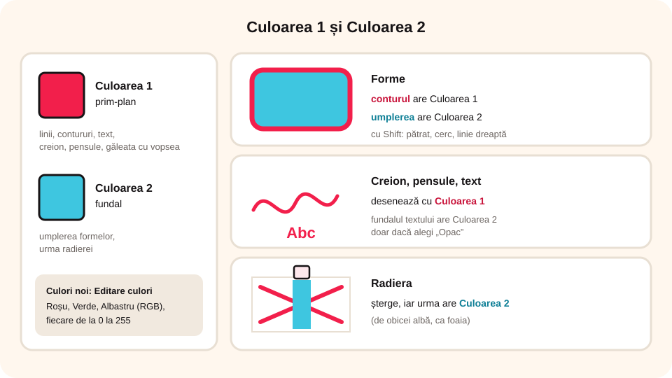
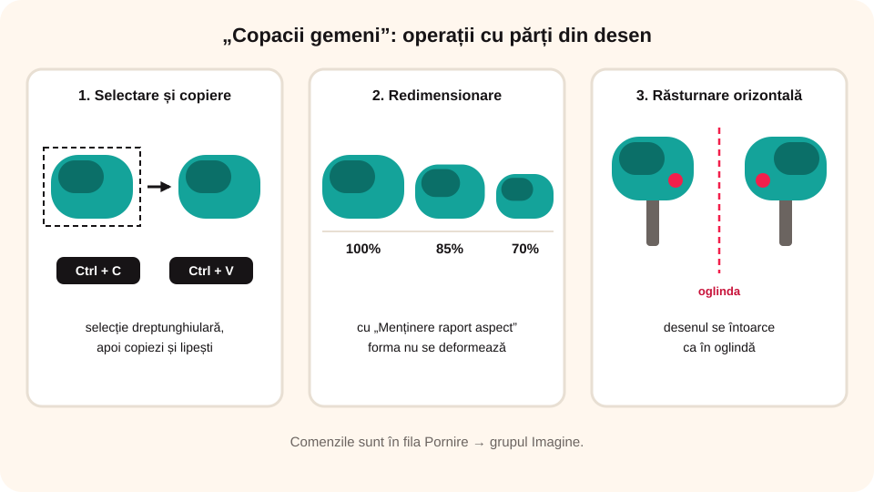

> **Competențe specifice (Anexa 15):** CS 3.1

## Ce vei învăța azi

- să creezi, să deschizi, să salvezi și să tipărești un **fișier grafic**;
- ce este modelul de culori **RGB** și cum creezi o culoare nouă;
- să desenezi **forme**, să **selectezi**, să **copiezi**, să **redimensionezi** și să **rotești** părți din desen;
- să adaugi **text** și să folosești celelalte instrumente din Paint;
- să **organizezi spațiul** desenului după o cerință dată.

## Să ne amintim

În Paint, comenzile pentru fișier sunt în fila **Fișier**, iar cele pentru desen în fila **Pornire**.

## Lecția pe scurt

### Fișierul grafic

| Operație | Comandă | Taste |
|---|---|---|
| fișier nou | **Fișier → Nou** | **Ctrl + N** |
| deschidere | **Fișier → Deschidere** | **Ctrl + O** |
| salvare în același fișier | **Fișier → Salvare** | **Ctrl + S** |
| salvare în alt fișier | **Fișier → Salvare ca** | |
| tipărire | **Fișier → Tipărire** | **Ctrl + P** |

La prima salvare alegi **numele** fișierului și **locul** unde îl păstrezi. **Salvare ca** creează un fișier nou și îl lasă neschimbat pe cel vechi.

Dimensiunea desenului se stabilește din **Fișier → Proprietăți** (de exemplu, 640 × 480 pixeli).

### Culorile

- **Culoarea 1**: culoarea de **prim-plan** (linii, contururi, text).
- **Culoarea 2**: culoarea de **fundal** (umplerea formelor, urma radierei).

Toate culorile se obțin din trei culori de bază: **Roșu (Red)**, **Verde (Green)** și **Albastru (Blue)**, fiecare în cantități de la **0 la 255**. Combinația se numește **RGB**. O culoare nouă o creezi din **Pornire → Culori → Editare culori**: scrii valorile R, G, B, apoi apeși **Adăugare la culori particularizate**.



### Formele

- Alegi forma din **Pornire → Forme**, apoi o desenezi ținând apăsat butonul stâng al mouse-ului.
- Cu **Shift** apăsat desenezi o **linie dreaptă**, un **pătrat** sau un **cerc**.
- **Conturul** se desenează cu Culoarea 1; îi alegi **grosimea** (**Dimensiune**) și stilul (**Contur**).
- **Umplerea** formelor închise se face cu Culoarea 2: fără umplere, culoare unică, creion cerat, acuarelă etc.
- Cât timp forma este încă selectată, îi poți schimba culorile și stilul; un clic în afara ei o fixează.

### Selecție și transformări

- **Selectare** (**Pornire → Imagine**): **dreptunghiulară**, **liberă**, **totală**, **inversată**, **transparentă** (fundalul alb devine transparent).
- **Copiere**: **Ctrl + C**, apoi **Ctrl + V**. **Mutare**: **Ctrl + X**, apoi **Ctrl + V**. **Ștergere**: tasta **Delete**.
- **Redimensionare**: în **procente** sau **pixeli**; cu **Menținere raport aspect** forma nu se deformează. Tot aici poți **înclina** imaginea.
- **Trunchiere**: selectezi ce vrei să **rămână**, apoi **Trunchiere**.
- **Rotire**: alegi direcția și unghiul. **Răsturnare orizontală** întoarce desenul ca **în oglindă**.



### Textul

Cu instrumentul **Text** dai clic pe desen și scrii. Apare fila **Instrumente text**, unde alegi **fontul**, **mărimea** (8–72 sau alta, scrisă de tine), **Aldin (Bold)**, **Cursiv (Italic)** și **Subliniat (Underline)**. Textul are Culoarea 1; fundalul lui are Culoarea 2 doar dacă alegi **Opac**.

### Alte instrumente

- **Creion**: linie liberă, cu Culoarea 1;
- **Umplere cu culoare**: colorează cu Culoarea 1 o zonă închisă, cu un singur clic;
- **Radieră**: șterge, iar urma ei are Culoarea 2;
- **Selector de culoare**: preia o culoare din desen;
- **Lupă**: clic stânga mărește, clic dreapta micșorează;
- **Pensule**: urme ca de pensulă, cu Culoarea 1.

### Imagini din alte fișiere

Poți aduce în desen o imagine salvată pe calculator: **Pornire → Lipire → Lipire din** și alegi fișierul. Imaginea apare **selectată**, așa că o poți muta, redimensiona sau roti imediat. Folosește doar imagini **ale tale** sau cu **licență liberă** și scrie sursa.

### Organizarea spațiului vizual

Un desen reușit nu înseamnă doar elemente frumoase, ci și **așezate bine** pe foaie. Când faci un afiș, o felicitare sau o ilustrație, respectă aceste reguli:

1. **Citește cerința**: ce dimensiune trebuie să aibă desenul (de exemplu, 800 × 600 px), ce elemente sunt obligatorii, ce text trebuie să apară.
2. **Elementul principal** este cel mai **mare** și stă în zona cea mai vizibilă (de obicei spre centru). Elementele secundare sunt mai mici.
3. **Prim-plan și fundal**: întâi desenezi **fundalul** (cerul, iarba), apoi elementele din față. Ce e mai departe se desenează **mai mic** și mai sus pe foaie.
4. **Echilibru**: nu aglomera o singură parte a foii; împarte elementele în stânga și în dreapta.
5. **Aliniere și spații egale**: elementele asemănătoare stau pe aceeași linie, la distanțe egale. Te ajută **Vizualizare → Rigle** și **Liniatură cu pătrățele**.
6. **Textul** (titlul) trebuie să se **citească ușor**: mărime potrivită, culoare care contrastează cu fundalul, fără să acopere elementele importante.
7. **Culori potrivite**: puține culori care se potrivesc între ele (2–4 culori principale).

## Exemplu rezolvat: „Copacii gemeni”

1. Stabilești dimensiunea desenului: **640 × 480 px**. Creezi trei nuanțe de verde (verde1, verde2, verde3) cu **Editare culori**.
2. **Trunchiul**: un dreptunghi cu colțuri rotunjite, maro, cu umplere **Culoare unică**.
3. **Coroana**: dreptunghiuri rotunjite verzi, în cele trei nuanțe, cu câteva frunze evidențiate.
4. Selectezi frunzișul (**selecție dreptunghiulară**), îl **copiezi** și îl **lipești** alături, apoi îl **redimensionezi la 85%**. Copia o mai copiezi o dată și o redimensionezi la **70%**.
5. Tragi frunzișurile peste trunchi și desenezi un cerc roșu pe cel mai mare. Primul copac e gata.
6. Selectezi copacul, îl copiezi, îl lipești la dreapta și îl întorci cu **Rotire → Răsturnare orizontală**.
7. Adaugi textul **„Copacii gemeni”**: Arial, 16, Aldin, negru.
8. Salvezi în folderul `Lucru`, cu numele `Copaci_gemeni.jpg`.

## Aplicații interactive

```ordonare
# Cum duplici un element dintr-un desen în Paint? Pune pașii în ordine.
Selectezi elementul cu Selectare
Apeși Ctrl + C (Copiere)
Apeși Ctrl + V (Lipire)
Tragi copia la locul dorit
```

```quiz
# Alege răspunsul corect.
Modelul RGB folosește culorile:
- roșu, galben, bleumarin
* roșu, verde, albastru
- alb, negru, albastru

Cu ce instrument colorezi dintr-odată o zonă închisă?
- Creion
* Umplere cu culoare
- Lupă

Ce faci ca să desenezi un cerc perfect?
- desenezi foarte încet
* ții apăsat Shift în timp ce desenezi elipsa
- folosești radiera
Explicație: Shift transformă elipsa în cerc, dreptunghiul în pătrat și linia oarecare în linie dreaptă.

Ce tip de rotire folosești ca să faci aripa a doua a unui fluture?
- rotire cu 90°
* răsturnare orizontală (în oglindă)
- rotire cu 180°
```

```categorii
# Culoarea 1 sau Culoarea 2?
Culoarea 1 (prim-plan): conturul formelor, textul, creionul, instrumentul Umplere cu culoare (clic stânga)
Culoarea 2 (fundal): interiorul formelor desenate, urma radierei
```

```cartonase
# Comenzi rapide în Paint
Ctrl + N = Fișier nou
Ctrl + O = Deschidere
Ctrl + S = Salvare
Ctrl + P = Tipărire
Ctrl + C / Ctrl + V = Copiere / Lipire
Ctrl + X = Decupare (pentru mutare)
```

```adevarat-fals
A: „Salvare ca” salvează desenul într-un fișier nou.
F: Dacă dai un clic cu radiera pe un cerc, se șterge tot cercul. | Radiera șterge doar ce atinge, nu toată forma.
A: Trunchierea păstrează doar zona selectată din imagine.
A: Cu „Menținere raport aspect”, imaginea nu se deformează la redimensionare.
A: Cu Lipire → Lipire din poți aduce în desen o imagine salvată pe calculator.
```

```quiz
# Organizarea spațiului vizual
Faci un afiș pentru concursul de șah. Unde pui elementul principal (o piesă mare de șah)?
* în zona centrală, mare, ca să se vadă primul
- într-un colț, foarte mic
- acoperit pe jumătate de titlu
Explicație: Elementul principal este cel mai mare și stă în zona cea mai vizibilă.

Ce desenezi primul într-un peisaj?
- copacul din față
* fundalul (cerul și iarba)
- textul
Explicație: Fundalul se desenează primul, apoi elementele din prim-plan, peste el.

Ce te ajută să așezi elementele aliniate și la distanțe egale?
* riglele și liniatura cu pătrățele din fila Vizualizare
- radiera
- selectorul de culoare
```

```categorii
# Afiș bine organizat sau prost organizat?
Bine organizat: titlul mare și ușor de citit, elementul principal în centru, elementele împărțite echilibrat, 3 culori care se potrivesc
Prost organizat: textul galben pe fundal alb, toate elementele înghesuite în stânga, titlul peste fața personajului, 15 culori diferite
```

```eseu
Sarcină practică: realizează în Paint un afiș de 800 × 600 px pentru „Ziua Pământului”. Cerințe: un fundal, cel puțin un element principal și două secundare desenate de tine (din forme), un element copiat și redimensionat, unul rotit sau răsturnat, o culoare creată cu Editare culori și titlul „Ziua Pământului”. Salvează-l ca ZiuaPamantului.png. Aici descrie cum ai organizat spațiul (unde ai pus fiecare element și de ce) și ce transformări ai folosit.
Cuvinte: 50-180
Barem: dimensiunea cerută (Fișier → Proprietăți); fundal desenat primul; element principal mare, în zona vizibilă; elemente secundare mai mici, așezate echilibrat; cel puțin o copiere cu redimensionare și o rotire sau răsturnare; culoare RGB creată; titlu lizibil, care contrastează cu fundalul; salvare în format .png cu numele cerut.
```

## Exersează

1. Deschide în Paint o imagine cu un animal care îți place și desenează pe ea o inimioară roșie.
2. Fă un desen cu două cercuri, patru dreptunghiuri și două triunghiuri.
3. Desenează un dreptunghi cu colțuri rotunjite și, în interiorul lui, trei steluțe în culori create de tine (nu din paletă).
4. Se poate face în Paint un desen de exact 5 × 5 cm? Caută în **Fișier → Proprietăți**.
5. **Portofoliu digital:** desenează un peisaj cu un copac și salvează-l ca `Peisaj.png` în folderul `Portofoliu`.

## Pe scurt

În Paint salvezi cu **Ctrl + S** sau **Salvare ca**, iar culorile se formează din **RGB**. Desenezi **forme** (cu **Shift** pentru pătrat și cerc), **selectezi**, **copiezi**, **redimensionezi**, **trunchiezi** și **rotești**. **Culoarea 1** este pentru prim-plan, **Culoarea 2** pentru fundal. Organizezi desenul după cerință: **elementul principal** mare și vizibil, **fundalul** desenat primul, elemente **echilibrate** și **aliniate**, text ușor de citit.
