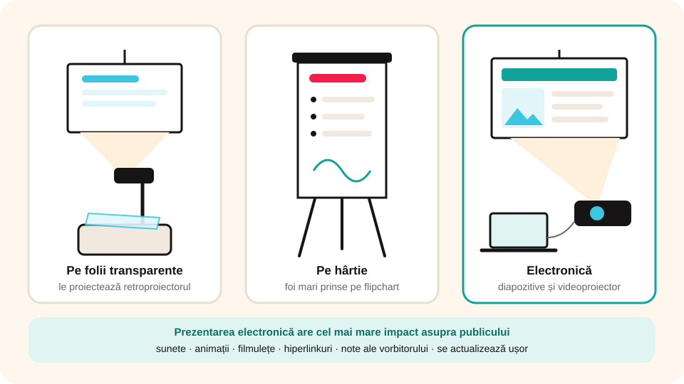

## Ce vei învăța azi

- ce este o **prezentare** și de ce o facem **vizuală**;
- care sunt **tipurile de prezentări**: pe folii, pe hârtie, electronice;
- ce **avantaje** are o prezentare electronică;
- ce este o **aplicație de prezentare** și câteva exemple.

## Să ne amintim

Anul trecut ai lucrat în Paint cu imagini și text. O prezentare bună le folosește pe amândouă ca să explice o idee.

## Lecția pe scurt

### Ce este o prezentare?

**Prezentarea** este o expunere scurtă a unor informații despre o temă, organizată după un **plan** stabilit dinainte. Ca publicul să înțeleagă și să rețină, informațiile se arată **vizual**: rezumate, ordonate, cu **imagini** și **text**.

### Tipuri de prezentări



| Tip | Pe ce se face | Cu ce se arată |
|---|---|---|
| pe **folii transparente** | foi transparente scrise | **retroproiectorul** le proiectează pe un ecran |
| pe **hârtie** | foi mari, tipărite sau scrise de mână | se prind pe un **flipchart** (șevalet rotafoliu) |
| **electronică** | o aplicație pe calculator, tabletă sau telefon | direct pe ecran sau cu **videoproiectorul** |

### Prezentarea electronică

Este o înșiruire de imagini numite **diapozitive** (în engleză, *slide-uri*). Un diapozitiv poate avea text, imagini, grafice, figuri. Informația apare **treptat**, diapozitiv cu diapozitiv.

**Avantaje:**

- diapozitivele pot avea, pe lângă text și imagini, **sunete**, **animații**, **filmulețe** și **hiperlinkuri** către pagini web sau documente;
- se **actualizează** ușor, oricând;
- poți adăuga **note ale vorbitorului** (*notes*), pe care le vezi doar tu, ca să te ajute în timpul expunerii;
- diapozitivele se pot **tipări** și împărți publicului (*handouts*) sau tipări pe folii.

Are cel mai mare **impact** asupra publicului dintre toate tipurile de prezentări.

O prezentare electronică are **două etape**:

1. **proiectarea și realizarea** ei, într-o aplicație de prezentare;
2. **susținerea** (expunerea) ei în fața publicului.

### Aplicația de prezentare

Este un program făcut pentru prezentări electronice. Are:

- un **editor**, în care creezi diapozitive cu text, imagini, sunete, animații;
- un sistem de **redare**, care arată diapozitivele în ordinea stabilită.

Exemple:

- **Microsoft PowerPoint** (Microsoft);
- **Keynote** (Apple);
- **Prezi** (Prezi Inc.);
- **LibreOffice Impress**: gratuit;
- **Google Slides**: gratuit, online, ușor de partajat.

### O prezentare făcută chiar pe edudigi

Mai jos este o prezentare electronică. Treci prin diapozitive cu săgețile, glisând sau cu un clic. Observă cele trei etape ale unei prezentări: **titlul**, **cuprinsul** și **încheierea**. Butonul **Note** îți arată notele vorbitorului, iar **Ecran complet** o arată ca la videoproiector.

```diapozitive
# Tipuri de prezentări
tema: albastru
## Tipuri de prezentări
Clasa a VI-a · Unitatea 1
Note: Pagina de titlu are titlul, autorul și data. Aici autorul este clasa.
---
## Pe folii transparente
- foi transparente, scrise sau tipărite
- le proiectează **retroproiectorul**
Note: Întreabă dacă a văzut cineva un retroproiector.
---
## Pe hârtie
- foi mari, tipărite sau scrise de mână
- se prind pe un **flipchart**
---
## Electronice
- **diapozitive** cu text, imagini, sunete, video
- se proiectează cu **videoproiectorul**
- au cel mai mare **impact**
Note: Aceasta este o prezentare electronică. Puteți vedea notele mele doar dacă apăsați Note.
---
## Mulțumesc!
Care tip de prezentare ți se pare cel mai potrivit pentru clasa ta?
```

## Exemplu rezolvat

**Sarcina:** trebuie să le explici colegilor de la clasa a V-a cum se folosește biblioteca școlii. Ce tip de prezentare alegi?

1. Ai la dispoziție un videoproiector în clasă, deci poți folosi o **prezentare electronică**.
2. Vrei să arăți fotografii cu rafturile și un filmuleț scurt: doar prezentarea electronică are **video**.
3. Pregătești diapozitivele într-o aplicație de prezentare (de exemplu, PowerPoint sau Google Slides).
4. Adaugi **note ale vorbitorului** cu ce vrei să spui la fiecare diapozitiv.
5. Tipărești câte o foaie cu regulile bibliotecii pentru fiecare coleg (**handout**).

## Aplicații interactive

```quiz
# Alege răspunsul corect.
Cum se numesc imaginile care formează o prezentare electronică?
- pagini
* diapozitive (slide-uri)
- ferestre

Cu ce aparat se proiectează o prezentare de pe calculator pe un ecran mare?
- retroproiector
* videoproiector
- flipchart

Care afirmație este adevărată?
- O prezentare pe hârtie poate conține animații.
* O prezentare electronică poate fi tipărită.
- O prezentare pe folii se proiectează cu videoproiectorul.
Explicație: Diapozitivele se pot tipări pe hârtie sau pe folii; foliile se pun la retroproiector.
```

```categorii
# Sortează după tipul de prezentare.
Pe folii transparente: retroproiector, foi transparente
Pe hârtie: flipchart, foi mari scrise de mână
Electronică: diapozitive, videoproiector, hiperlinkuri
```

```adevarat-fals
A: Notele vorbitorului nu sunt văzute de public.
F: Diapozitivele unei prezentări electronice nu mai pot fi modificate după ce au fost create. | Se actualizează ușor, oricând.
A: LibreOffice Impress este o aplicație de prezentare gratuită.
F: O prezentare electronică are o singură etapă: susținerea. | Are două etape: realizarea și susținerea.
```

```cartonase
# Termeni de reținut
Prezentare = expunere scurtă a unor informații despre o temă, după un plan
Diapozitiv (slide) = una dintre imaginile care formează prezentarea electronică
Note ale vorbitorului = text atașat diapozitivului, văzut doar de prezentator
Handout = diapozitive tipărite și împărțite publicului
Aplicație de prezentare = program pentru crearea și redarea prezentărilor electronice
```

## Exersează

1. Argumentează de ce e bine ca o prezentare să fie **vizuală**.
2. Care sunt deosebirile dintre o **aplicație de prezentare** și un **editor de texte**?
3. Caută pe internet informații despre două aplicații de prezentare din listă. Prin ce se aseamănă? Prin ce diferă?
4. Ce tip de prezentare ai alege pentru o excursie în natură, unde nu ai curent electric? De ce?
5. **Portofoliu:** scrie un text de cel mult 100 de cuvinte cu tema „Prezentarea electronică sau prezentarea pe hârtie? Cum aleg tipul potrivit”.

## Verifică-te

- Poți numi cele trei tipuri de prezentări?
- Poți da trei avantaje ale prezentării electronice?
- Poți numi trei aplicații de prezentare?

## Pe scurt

O **prezentare** arată vizual informații despre o temă. Poate fi pe **folii**, pe **hârtie** sau **electronică**. Prezentarea electronică e formată din **diapozitive** și poate avea sunete, video și hiperlinkuri. Se realizează într-o **aplicație de prezentare** (PowerPoint, Impress, Google Slides) și apoi se **susține** în fața publicului.
