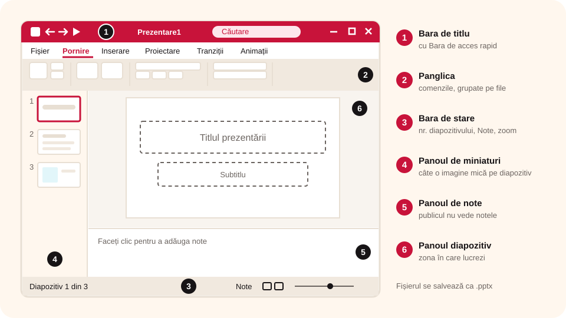

> **Competențe specifice (Anexa 15):** CS 1.1

## Ce vei învăța azi

- să **pornești** PowerPoint și să alegi tipul de prezentare din **ecranul de start**;
- să recunoști elementele **ferestrei**: bara de titlu, panglica, panourile, bara de stare;
- ce conține fiecare **filă** de pe panglică;
- cum se salvează o prezentare (**.pptx**).

## Să ne amintim

O **aplicație de prezentare** are un **editor** pentru diapozitive și un sistem de **redare**. PowerPoint este cea mai folosită.

## Lecția pe scurt

### Ce este PowerPoint?

**Microsoft PowerPoint** face parte din pachetul **Microsoft Office** și servește la realizarea și expunerea prezentărilor electronice. O prezentare se salvează într-un fișier cu extensia **.pptx** (sau mai vechea **.ppt**, ori **.pptm**).

Lecțiile folosesc PowerPoint din Office 2021, pe Windows 11. În alte versiuni (sau în LibreOffice Impress și Google Slides) butoanele sunt foarte asemănătoare.

### Pornirea aplicației

- **Start → Toate aplicațiile → PowerPoint**, sau
- apeși **Start**, scrii `PowerPoint` și apeși **Enter**.

**Ecranul de start** îți oferă trei variante:

1. **Prezentare necompletată** (*Blank Presentation*): o prezentare goală;
2. o prezentare dintr-un **șablon** (*template*) gata făcut;
3. **deschiderea** unei prezentări făcute anterior.

Dacă alegi prezentarea necompletată, se deschide **Prezentare1**, încă nesalvată, în modul **Vizualizare normală**.

### Fereastra PowerPoint



1. **Bara de titlu**: numele fișierului, caseta de căutare, contul Office și butoanele de minimizare, maximizare, închidere. În stânga are **Bara de acces rapid**: Salvare (**Ctrl + S**), Anulare (**Ctrl + Z**), Refacere (**Ctrl + Y**), Pornire de la început (**F5**).
2. **Panglica** (*Ribbon*): comenzile, grupate pe **file** (*tabs*).
3. **Bara de stare**: jos, cu numărul diapozitivului curent, limba, butonul **Note**, modurile de vizualizare și panoramarea (zoom).
4. **Panoul de miniaturi**: în stânga, câte o imagine mică pentru fiecare diapozitiv. Clic pe una și o editezi.
5. **Panoul de note**: notele tale pentru diapozitivul curent. **Publicul nu le vede.**
6. **Panoul diapozitiv**: zona mare din centru, unde lucrezi efectiv.

### Ce conține o filă

- **grupuri** de comenzi (unele au în colțul din dreapta jos o săgeată cu mai multe opțiuni);
- **butoane** individuale;
- **galerii** cu variante vizuale.

### Filele principale

| Filă | La ce folosește |
|---|---|
| **Fișier** | creare, deschidere, salvare, export, tipărire (vizualizarea **Backstage**) |
| **Pornire** | adăugarea și organizarea diapozitivelor, formatarea textului |
| **Inserare** | imagini, forme, tabele, text, video, hiperlinkuri |
| **Desenare** | desen cu degetul, creionul digital sau mouse-ul („cerneală digitală”) |
| **Proiectare** | teme, scheme de culori, dimensiunea diapozitivului |
| **Tranziții** | cum se trece de la un diapozitiv la altul |
| **Animații** | cum apar și se mișcă obiectele de pe diapozitiv |
| **Expunere diapozitive** | pornirea și setarea expunerii |
| **Înregistrare** | înregistrarea expunerii cu vocea ta (și camera), apoi exportul ca video |
| **Revizuire** | verificarea ortografiei, comentarii |
| **Vizualizare** | modurile de vizualizare: Normal, Sortare diapozitive, Citire |

**Știai că…?** Prima versiune de PowerPoint a apărut în **1987**, pentru calculatoarele Apple Macintosh, și era alb-negru.

## Exemplu rezolvat

**Sarcina:** vrei să vezi toate diapozitivele odată, ca să le schimbi ordinea.

1. Te uiți jos, pe **bara de stare**, la zona cu modurile de vizualizare.
2. Alegi **Sortare diapozitive** (*Slide Sorter*). Același mod îl găsești și în fila **Vizualizare**.
3. Toate diapozitivele apar ca miniaturi mari, unul lângă altul.
4. Ca să revii la editare, alegi din nou **Normal**.

## Aplicații interactive

```categorii
# În ce filă găsești comanda?
Fișier: salvare, tipărire, export
Inserare: imagine, tabel, hiperlink
Proiectare: temă, dimensiune diapozitiv
Tranziții: efect la trecerea între diapozitive
Revizuire: verificare ortografică, comentarii
```

```quiz
# Alege răspunsul corect.
Ce extensie are un fișier creat cu PowerPoint?
- .bmp
- .fla
* .pptx

Unde vezi miniaturile tuturor diapozitivelor?
* în panoul de miniaturi, în stânga
- pe panglică
- în panoul de note

Ce tastă pornește expunerea de la început?
- F1
* F5
- Esc
```

```adevarat-fals
A: Notele asociate unui diapozitiv nu sunt văzute de public în timpul expunerii.
F: Panglica PowerPoint are o filă numită Încărcare. | Nu există o astfel de filă; există Fișier, Pornire, Inserare etc.
A: Pe bara de stare apare numărul de diapozitive din prezentare.
A: Bara de acces rapid poate primi și alte comenzi, alese de tine.
```

```cartonase
# Combinații de taste în PowerPoint
Ctrl + S = Salvare
Ctrl + Z = Anularea ultimei acțiuni
Ctrl + Y = Refacerea acțiunii anulate
F5 = Pornirea expunerii de la început
Ctrl + M = Diapozitiv nou
```

## Exersează

1. Deschide PowerPoint și creează o prezentare necompletată. Închide-o, apoi creează una dintr-un **șablon**. Ce diferențe observi?
2. Parcurge toate filele și privește grupurile de comenzi.
3. Apasă butonul **Note** de pe bara de stare. Apasă-l încă o dată. Ce se întâmplă?
4. Modifică afișarea panglicii astfel încât să se vadă **doar filele**, fără comenzi.
5. Adaugă în **Bara de acces rapid** butonul **Imprimare rapidă**.
6. Micșorează fereastra PowerPoint. Cum se schimbă grupurile de comenzi de pe panglică?
7. **Portofoliu:** scrie o compunere de cel mult 100 de cuvinte, „Plimbare prin interfața PowerPoint”, cu cuvintele: *panglică, filă, galerie, diapozitiv, expunere, salvare, tipărire*.

## Verifică-te

- Poți numi cele șase elemente ale ferestrei PowerPoint?
- Știi în ce filă adaugi o imagine? Dar o tranziție?

## Pe scurt

PowerPoint salvează prezentările ca **.pptx**. Fereastra are **bara de titlu** (cu Bara de acces rapid), **panglica** cu file, **panoul de miniaturi**, **panoul diapozitiv**, **panoul de note** și **bara de stare**. Fiecare filă grupează comenzi pentru un tip de activitate: **Inserare** pentru conținut, **Proiectare** pentru aspect, **Tranziții** și **Animații** pentru efecte.
