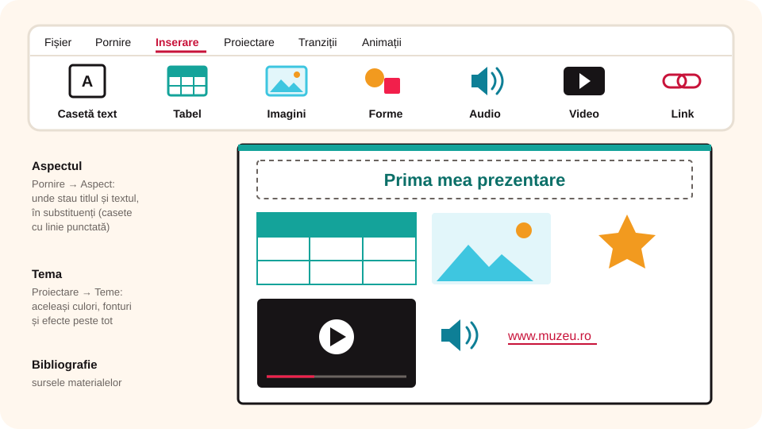

## Ce vei învăța azi

- să **creezi**, **deschizi**, **salvezi**, **închizi** și să **expui** o prezentare;
- să **adaugi, ștergi, copiezi, dublezi și muți** diapozitive;
- să inserezi **text, tabele, imagini, forme, sunete, video și hiperlinkuri**;
- să alegi o **temă** și un **aspect** pentru diapozitive;
- să respecți **drepturile de autor**.

## Să ne amintim

Comenzile pentru fișier sunt în fila **Fișier**, iar cele pentru conținut în fila **Inserare**.

## Lecția pe scurt

### A. Operații cu fișierul de prezentare

| Operație | Comandă | Taste |
|---|---|---|
| prezentare nouă | **Fișier → Nou** | **Ctrl + N** |
| deschidere | **Fișier → Deschidere** | **Ctrl + O** |
| salvare (același nume și loc) | **Fișier → Salvare** | **Ctrl + S** |
| salvare cu alt nume, format sau loc | **Fișier → Salvare ca** | **F12** |
| închidere | **Fișier → Închidere** | |

Cu **Salvare ca** poți alege și alt format: `.pptx`, `.ppt`, `.pdf`, chiar și video `.mp4`. O prezentare se poate salva și dacă nu are încă niciun diapozitiv.

**Expunerea:**

- pornire: **Expunere diapozitive → De la început** (**F5**) sau **De la diapozitivul curent**;
- parcurgere: **săgeți** înainte/înapoi, **Space** sau **Backspace**;
- ieșire: tasta **Esc** (la final, și cu un clic oriunde).

### B. Lucrul cu diapozitivele

Lucrezi în **panoul de miniaturi**, cu clic dreapta pe un diapozitiv:

- **diapozitiv nou**: **Inserare → Diapozitiv nou** (**Ctrl + M**);
- **ștergere**: **Ștergere diapozitiv**;
- **copiere**: **Copiere** (**Ctrl + C**), apoi **Lipire** (**Ctrl + V**);
- **dublare**: **Dublare diapozitiv** (face imediat o copie alături);
- **mutare**: **Decupare** (**Ctrl + X**), apoi **Lipire** (**Ctrl + V**), sau tragi miniatura cu mouse-ul.

### C. Obiectele de pe diapozitiv



Toate se adaugă din fila **Inserare**:

- **Casetă text**: clic pe diapozitiv și scrii. Fontul, mărimea, culoarea le schimbi din **Pornire → Font**, iar alinierea din **Pornire → Paragraf**;
- **Tabel**: alegi numărul de linii și coloane trecând cu mouse-ul peste grilă;
- **Imagini**: din calculator, din banca de imagini sau de pe internet;
- **Forme**: linii, dreptunghiuri, săgeți, stele, butoane de acțiune;
- **Audio**: un sunet salvat sau unul înregistrat cu microfonul;
- **Video**: un film salvat sau unul de pe internet;
- **Link**: un hiperlink către o pagină web sau un document.

### Teme și aspecte

- **Tema** (fila **Proiectare → Teme**) stabilește culorile, fonturile și efectele tuturor diapozitivelor, pentru un aspect unitar.
- Un **șablon** este o temă care are deja și conținut (de exemplu, pentru o diplomă sau o invitație).
- **Aspectul** unui diapozitiv (**Pornire → Aspect**) stabilește unde stau titlul, textul și imaginile, prin **substituenți** (casete cu linie punctată).

### D. Drepturile de autor

Poți folosi texte, imagini, sunete sau filme făcute de alții **doar dacă autorul permite**. Respectarea drepturilor de autor este o obligație legală și o formă de respect pentru munca altora.

Când folosești materiale de pe internet sau din cărți pentru un proiect școlar, le treci într-un diapozitiv **Bibliografie**: autorul, titlul, site-ul. Site-uri ca **pixabay.com** oferă imagini gratuite.

## Exemplu rezolvat: „Prima mea prezentare”

1. Creezi folderul `Lucru_clsVI`.
2. Deschizi PowerPoint → **Prezentare necompletată**.
3. Apeși **Salvare**: se deschide fereastra în care alegi locul (`Lucru_clsVI`) și numele (`Prezentarea mea`). Apeși **Salvare** din nou: de data asta nu mai apare nicio fereastră, pentru că fișierul are deja nume și loc.
4. Adaugi un diapozitiv nou cu **Ctrl + M**.
5. Pe primul diapozitiv scrii titlul **Prima mea prezentare**, plus un text scurt și o imagine cu Luna, de pe pixabay.com.
6. Pe al doilea diapozitiv pui un video și textul **Mulțumesc!**.
7. Salvezi cu **Ctrl + S** și pornești expunerea cu **F5**.

## Aplicații interactive

```ordonare
# Cum muți un diapozitiv în alt loc? Pune pașii în ordine.
Dai clic dreapta pe miniatura diapozitivului
Alegi Decupare (Ctrl + X)
Dai clic dreapta în locul nou din panoul de miniaturi
Alegi o opțiune de lipire (Ctrl + V)
```

```quiz
# Alege răspunsul corect.
Ce tastă încheie o expunere?
* Esc
- F1
- F5
- Delete

Cum inserezi o imagine pe un diapozitiv?
* fila Inserare → Imagini
- fila Revizuire → Traducere
- fila Vizualizare → Note

De ce prima apăsare pe Salvare deschide o fereastră, iar a doua nu?
- pentru că a doua oară salvarea nu funcționează
* pentru că la prima salvare alegi numele și locul fișierului, apoi doar se actualizează fișierul
- pentru că a doua oară se salvează automat ca .pdf

Ce combinație de taste adaugă un diapozitiv nou?
- Ctrl + N
* Ctrl + M
- Ctrl + D
```

```adevarat-fals
A: Un diapozitiv poate conține un sunet.
A: O prezentare poate fi salvată chiar dacă nu are niciun diapozitiv.
F: O prezentare necompletată are la creare două diapozitive. | Are un singur diapozitiv, cel de titlu.
F: Într-o prezentare, două diapozitive nu pot fi identice. | Poți dubla oricând un diapozitiv.
```

```completare
# Completează.
Tema stabilește [culorile], fonturile și efectele diapozitivelor. Aspectul stabilește unde stau titlul și textul, cu ajutorul [substituenților|substituentilor]. Sursele materialelor preluate se trec într-un diapozitiv numit [Bibliografie].
```

## Exersează

1. Dă trei exemple de operații cu diapozitivele.
2. Inserează pe un diapozitiv un tabel cu 3 linii și 2 coloane, cu orarul tău de luni.
3. Adaugă un hiperlink către pagina unui muzeu din orașul tău.
4. Câte dintre materiile tale de la școală te-ar ajuta să faci prezentări electronice?
5. **Portofoliu:** fă o prezentare de **6 diapozitive**, „Cinci lucruri care ne fac mândri că suntem români”, cu cel puțin **6 imagini**, un **video** și un **hiperlink** către un video. Nu uita diapozitivul **Bibliografie**.

## Verifică-te

- Care e diferența dintre **Salvare** și **Salvare ca**?
- Cum dublezi un diapozitiv?
- Ce faci înainte să folosești o imagine găsită pe internet?

## Pe scurt

Prezentarea se creează, se salvează (**Ctrl + S**, **F12**) și se expune (**F5**, ieșire cu **Esc**). Diapozitivele se adaugă (**Ctrl + M**), se copiază, se dublează și se mută din panoul de miniaturi. Din fila **Inserare** adaugi text, tabele, imagini, forme, sunete, video și linkuri. **Tema** dă aspectul unitar, iar sursele se trec la **Bibliografie**.
