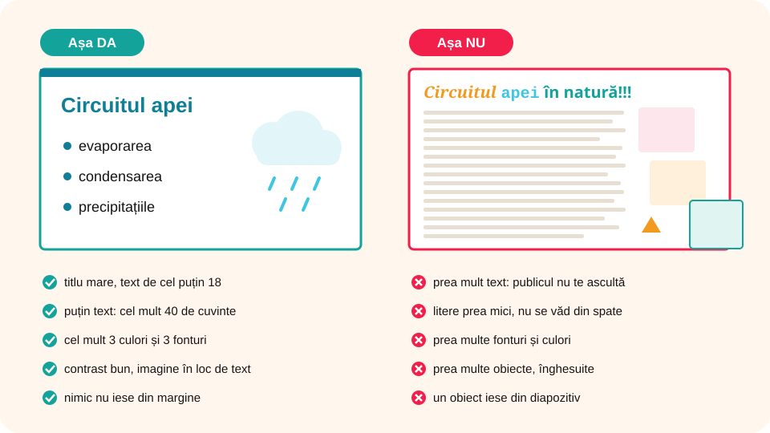

> **Competențe specifice (Anexa 15):** CS 1.1, CS 3.1

## Ce vei învăța azi

- care sunt **criteriile** unei prezentări atractive;
- să formatezi **diapozitivele**, **textul** și **obiectele**;
- să adaugi **animații** și **tranziții** și să le **temporizezi** (start, durată, întârziere, ordine);
- care sunt **regulile de design** și **greșelile** de evitat;
- ce înseamnă **ergonomia** unei prezentări și cum o **structurezi** după cerință.

## Să ne amintim

Fila **Proiectare** conține temele, fila **Animații** mișcarea obiectelor, iar fila **Tranziții** trecerea de la un diapozitiv la altul.

## Lecția pe scurt

### Patru criterii de design

- **Claritate**: literele sunt destul de mari ca să se vadă de departe;
- **Structurare**: informația e scurtă și ordonată, pe diapozitive simple;
- **Impact vizual**: imagini, culori, grafice și animații folosite cu rost;
- **Impact emoțional**: sunete, culori și contraste potrivite cu imaginile.

### Formatarea diapozitivelor

Din fila **Proiectare**, grupul **Particularizare**:

- **Dimensiune diapozitiv**: **standard (4:3)** sau **lat (16:9)**, după ecranul pe care prezinți;
- **Formatare fundal**: culoare, degrade, imagine, textură sau model.

Ordinea diapozitivelor o schimbi trăgând miniaturile cu mouse-ul (**Drag & Drop**).

### Formatarea textului

Pe lângă **Pornire → Font**, când scrii într-o casetă de text apare fila **Format formă**:

- **Stiluri rapide** (grupul **Stiluri WordArt**): litere cu aspect 3D;
- **Efecte text**: umbră, reflexie, strălucire.

### Formatarea obiectelor

Clic dreapta pe obiect, apoi:

- **Formatare formă**: pentru text, tabele, forme;
- **Formatare imagine**: pentru imagini;
- **Formatare video**: pentru filme;
- **Formatare fundal**: pentru fundalul diapozitivului.

Se deschide un panou în care alegi mărimea, poziția și alte caracteristici.

### Animații și tranziții

- **Animația** stabilește cum **se mișcă un obiect** pe diapozitiv în timpul expunerii. O alegi din fila **Animații**, o vezi cu **Previzualizare** și o reglezi din **Opțiuni efect** (de exemplu, direcția). Pentru setări avansate există grupul **Animație avansată**.
- **Tranziția** este efectul care apare când **se încarcă un diapozitiv**. O alegi din fila **Tranziții**, grupul **Tranziție la acest diapozitiv**.

**Patru tipuri de animații** (fiecare are culoarea ei în galerie):

| Tip | Ce face obiectul | Exemple |
|---|---|---|
| **Intrare** (verde) | **apare** pe diapozitiv | Apariție, Estompare, Zbor înăuntru |
| **Evidențiere** (galben) | atrage atenția, deși era deja acolo | Puls, Învârtire, Creștere/Micșorare |
| **Ieșire** (roșu) | **dispare** de pe diapozitiv | Dispariție, Zbor în afară |
| **Căi de mișcare** | se deplasează pe un drum desenat | Linii, Arce, Rotiri, Cale particularizată |

Un obiect poate avea **mai multe animații**: le adaugi cu **Adăugare animație** (grupul **Animație avansată**).

### Temporizarea efectelor

**Temporizarea** înseamnă să stabilești **când** pornește un efect, **cât durează** și **în ce ordine** vin efectele. O reglezi din fila **Animații**, grupul **Temporizare**:

- **Start**:
  - **La clic**: efectul pornește când apeși clic (sau o tastă);
  - **Cu anteriorul**: pornește **în același timp** cu efectul de dinainte;
  - **După anteriorul**: pornește **imediat după ce s-a terminat** efectul de dinainte;
- **Durată**: cât ține efectul, în secunde (de exemplu, **00,50** = o jumătate de secundă). O durată mare face efectul lent;
- **Întârziere**: câte secunde **aștepți** înainte să pornească efectul;
- **Reordonare animație**: **Mutare mai devreme** / **Mutare mai târziu** schimbă **ordinea** efectelor.

Toate efectele unui diapozitiv apar în **Panou animație** (grupul **Animație avansată**), în ordinea în care rulează, fiecare cu un **număr**. Acolo poți trage un efect mai sus sau mai jos.

La **tranziții** ai tot un grup **Temporizare**: **Durată**, **Sunet** și **Avansare diapozitiv**: **La clic de mouse** sau **După** un timp (de exemplu, **00:05** = trece singur după 5 secunde). Butonul **Se aplică la toate** pune aceeași tranziție pe toate diapozitivele.

**Exemplu de temporizare:** pe diapozitivul „Circuitul apei”:

| Nr. | Obiect | Efect | Start | Durată | Întârziere |
|---|---|---|---|---|---|
| 1 | titlul | Estompare (intrare) | La clic | 0,5 s | 0 |
| 2 | imaginea soarelui | Zbor înăuntru (intrare) | După anteriorul | 1 s | 0 |
| 3 | săgeata „evaporare” | Ștergere (intrare) | Cu anteriorul | 1 s | 0,5 s |
| 4 | norul | Puls (evidențiere) | După anteriorul | 0,5 s | 0 |

Cu un singur clic, titlul apare, apoi soarele intră; în timp ce soarele intră, după o jumătate de secundă începe și săgeata; la sfârșit norul „pulsează”.

### Reguli de design



- diapozitivele au un **design unitar**, armonios;
- **puțin text**: cel mult **40 de cuvinte**, pe cel mult **6–7 rânduri**; ce se poate arăta printr-o imagine, se arată prin imagine;
- cel mult **trei fonturi** pe diapozitiv, de mărime **cel puțin 18**;
- cel mult **trei culori** pe diapozitiv;
- **contrast** bun între fundal și text;
- nimic nu iese din marginea diapozitivului;
- grafice clare și tabele mici;
- sunete discrete, fără sunete stridente;
- **tranziții simple**, de preferat aceleași peste tot; una diferită doar pentru un diapozitiv important.

### Reguli de conținut și structură

O prezentare se **organizează după cerința dată** (tema, timpul, publicul). Structura obișnuită:

1. **diapozitivul de titlu**: titlul, autorul, evenimentul și data;
2. **cuprinsul**: ideile principale, în ordine (la prezentările lungi);
3. **conținutul**: câte o idee pe diapozitiv, în ordinea din cuprins;
4. **concluzia**: ce trebuie să rețină publicul;
5. **bibliografia**: sursele textelor și imaginilor;
6. **ultimul diapozitiv**: **Mulțumesc!**, eventual o întrebare pentru public.

Totul **fără greșeli** de ortografie sau de gramatică. Ca reper de timp: cam **un minut** pentru un diapozitiv de conținut. Pentru o prezentare de 5 minute, 5–7 diapozitive sunt suficiente.

### Ergonomia prezentării

**Ergonomia** înseamnă ca prezentarea să fie **ușor și comod de urmărit**, fără să obosească publicul, și **ușor de folosit** de prezentator.

- **Lizibilitate de la distanță**: titluri de cel puțin **32–40**, text de cel puțin **24** (minimum 18); fonturi simple, fără înflorituri (Arial, Calibri, Verdana);
- **Contrast** puternic: text închis pe fundal deschis sau invers; nu pui text peste o fotografie încărcată;
- **Așezare constantă**: titlul stă în același loc pe toate diapozitivele, ca ochiul să-l găsească imediat;
- **Ritm potrivit**: efecte scurte (0,5–1 s); nu pui animații pe fiecare cuvânt și **nu folosești efecte care clipesc rapid**, pentru că obosesc ochii și pot face rău unor persoane;
- **Nu te bazezi doar pe culoare**: dacă marchezi ceva cu roșu, adaugă și un cuvânt sau un simbol (de exemplu, ✔ / ✘), pentru cei care nu disting culorile;
- **Text alternativ** la imagini și **sunete discrete**;
- **Ușor de controlat**: animațiile importante pornesc **La clic**, ca să poți vorbi în ritmul tău; folosești **Expunere diapozitive → Repetiție temporizări** ca să vezi cât stai pe fiecare diapozitiv.

**Estetica** (frumusețea) și **ergonomia** (comoditatea) merg împreună: o prezentare frumoasă, dar greu de citit, nu își atinge scopul.

### Greșeli de evitat

1. **Prea mult text sau prea multe obiecte**: publicul citește ecranul și nu te mai ascultă.
2. **Litere prea mici**: cei din spatele sălii nu văd.
3. **Grafice încărcate cu detalii**: întâi arăți concluzia, apoi detaliile.

## Exemplu rezolvat

Îmbunătățești `Prezentarea mea` din lecția trecută:

1. Adaugi un diapozitiv nou și îl muți pe **primul loc**.
2. Scrii pe el titlul, iar dedesubt numele tău, clasa și data. Titlul: **24**, **Aldin (Bold)**.
3. Toate celelalte texte: **18**.
4. Creezi un diapozitiv final cu **Mulțumesc!** și o imagine.
5. Pui aceeași **tranziție** (de exemplu, *Estompare*) la toate diapozitivele.
6. Adaugi o **animație** pe textul de pe al doilea diapozitiv și o verifici cu **Previzualizare**.
7. Salvezi și pornești expunerea cu **F5**.

## Aplicații interactive

```categorii
# Respectă regulile de design?
Respectă: font de 24 pentru titlu, cel mult trei culori, aceeași tranziție peste tot, text închis pe fundal deschis
Nu respectă: 120 de cuvinte pe un diapozitiv, font de 10, șapte fonturi diferite, text galben pe fundal alb
```

```quiz
# Alege răspunsul corect.
De unde schimbi dimensiunea diapozitivului la 4:3?
- fila Tranziții
* fila Proiectare → Dimensiune diapozitiv
- fila Expunere diapozitive → De la început

Ce trebuie să conțină ultimul diapozitiv?
- bibliografia și cuprinsul
* Mulțumesc!, alături de o concluzie sau un mesaj
- doar titlul prezentării

Ce diferență este între animație și tranziție?
* animația se aplică unui obiect, tranziția se aplică trecerii la un diapozitiv
- sunt același lucru
- tranziția se aplică textului, animația imaginilor
```

```adevarat-fals
F: Pot adăuga o animație pentru o imagine din fila Tranziții. | Animațiile se adaugă din fila Animații.
F: Pot adăuga o tranziție din fila Expunere diapozitive, butonul De la început. | Butonul De la început pornește expunerea; tranzițiile sunt în fila Tranziții.
A: Pot modifica dimensiunea diapozitivului la 4:3 din fila Proiectare.
A: Pot adăuga un efect de rotație obiectelor de pe primul diapozitiv.
```

```ordonare
# Cum aplici o animație unui text? Pune pașii în ordine.
Selectezi caseta de text și deschizi fila Animații
Alegi o animație din grupul Animație
Apeși Previzualizare ca să vezi efectul
```

```categorii
# Ce tip de animație este?
Intrare: textul apare din stânga, imaginea se estompează spre vizibil
Evidențiere: titlul pulsează, steaua se învârte pe loc
Ieșire: norul dispare, săgeata zboară în afara diapozitivului
Căi de mișcare: mingea se deplasează pe un arc
```

```quiz
# Temporizarea efectelor
Vrei ca imaginea să apară automat imediat după ce s-a terminat animația titlului. Ce alegi la Start?
- La clic
- Cu anteriorul
* După anteriorul

Vrei ca două săgeți să apară în același timp. Ce alegi la Start pentru a doua săgeată?
* Cu anteriorul
- După anteriorul
- La clic

Ce înseamnă Întârziere = 2 secunde?
- efectul durează 2 secunde
* efectul așteaptă 2 secunde înainte să pornească
- efectul se repetă de 2 ori

Unde vezi toate efectele unui diapozitiv, în ordinea lor?
- în panoul de note
* în Panou animație
- în fila Proiectare

Cum faci ca un diapozitiv să treacă singur la următorul după 5 secunde?
- Animații → Durată 5
* Tranziții → Avansare diapozitiv → După: 00:05
- Expunere diapozitive → De la început
```

```adevarat-fals
A: Durata unei animații arată cât timp ține efectul.
F: Ordinea animațiilor nu mai poate fi schimbată după ce le-ai adăugat. | O schimbi cu Mutare mai devreme / Mutare mai târziu sau din Panou animație.
A: Un obiect poate avea și o animație de intrare, și una de ieșire.
F: Efectele care clipesc rapid fac prezentarea mai ușor de urmărit. | Obosesc ochii și pot face rău unor persoane.
A: Titlul așezat în același loc pe toate diapozitivele face prezentarea mai ușor de urmărit.
```

```ordonare
# Ordinea diapozitivelor într-o prezentare bine structurată
Diapozitivul de titlu
Cuprinsul
Diapozitivele de conținut
Concluzia
Bibliografia
Mulțumesc!
```

```eseu
Sarcină de creație: ai 3 minute ca să le prezinți colegilor de clasa a V-a „Regulile din laboratorul de informatică”. Descrie prezentarea pe care o faci: câte diapozitive are și ce pui pe fiecare, ce imagini imporți, ce animații pui pe un diapozitiv ales (tipul, Start, Durată, Întârziere, ordinea) și două reguli de ergonomie pe care le respecți.
Cuvinte: 60-180
Barem: 3p structură corectă (titlu, conținut, concluzie/bibliografie, Mulțumesc!) potrivită pentru 3 minute (3–5 diapozitive); 2p imagini importate legate de temă, cu sursă; 3p temporizare descrisă corect (tip de efect, Start, Durată, Întârziere, ordine logică); 2p două reguli de ergonomie corecte (font mare, contrast, efecte scurte, titlu în același loc etc.).
```

## Exersează

1. Precizează patru reguli de design ale unei prezentări electronice.
2. Explică de ce nu e bine să încarci diapozitivele cu mult text.
3. Pune un fundal cu **degrade** pe un diapozitiv, din **Formatare fundal**.
4. Scrie un titlu cu **Stiluri rapide** și adaugă-i o **umbră** din **Efecte text**.
5. Pe un diapozitiv cu un titlu, o imagine și trei casete de text, pune animații astfel încât, **cu un singur clic**, să apară titlul, apoi imaginea, apoi cele trei texte, **unul după altul**, la câte **1 secundă** distanță. Verifică ordinea în **Panou animație**.
6. Setează toate diapozitivele să treacă singure după **4 secunde** și pornește expunerea. Când e utilă o astfel de prezentare (de exemplu, la un stand, la serbare)?
7. **Dezbatere:** „Sunet și imagine sau text și imagine într-o prezentare?”
8. **Portofoliu:** refă designul prezentării „Cinci lucruri care ne fac mândri că suntem români” după regulile învățate. Adaugă cel puțin un efect de **animație** și unul de **tranziție**.

## Verifică-te

- Ce conține primul diapozitiv? Dar ultimul?
- Câte cuvinte, fonturi și culori sunt recomandate, cel mult, pe un diapozitiv?
- Ce diferență este între **Cu anteriorul** și **După anteriorul**? Ce înseamnă **Durată** și **Întârziere**?
- Dă trei exemple de reguli de **ergonomie**.

## Pe scurt

O prezentare bună are **claritate**, **structură**, **impact vizual** și **emoțional**. Formatezi diapozitivele din **Proiectare**, textul din **Pornire** și **Format formă**, obiectele cu clic dreapta. **Animațiile** (intrare, evidențiere, ieșire, căi de mișcare) mișcă obiectele, **tranzițiile** schimbă diapozitivele; le **temporizezi** cu **Start**, **Durată**, **Întârziere** și ordinea din **Panou animație**. O prezentare **ergonomică** se citește ușor de departe: puțin text, litere mari, puține culori, contrast bun, efecte scurte.
