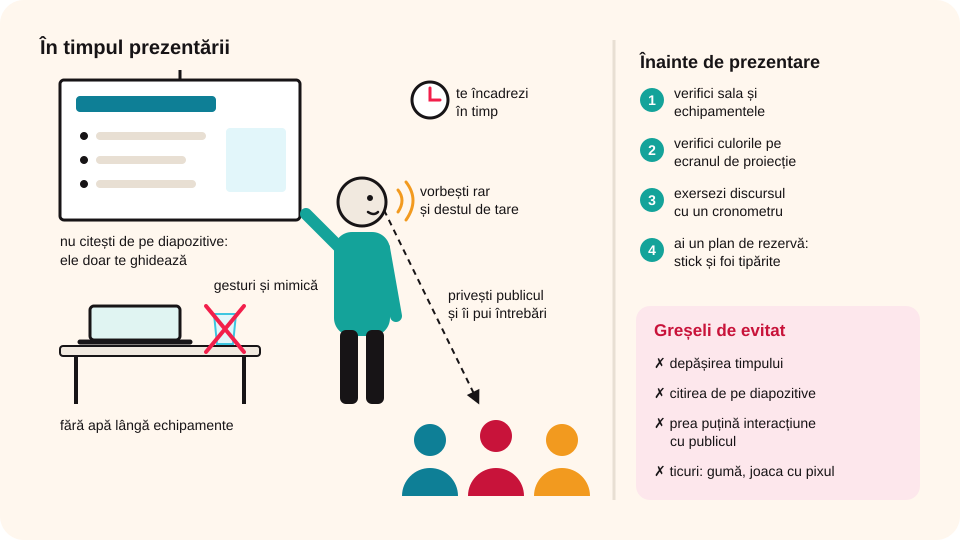

> **Competențe specifice (Anexa 15):** CS 1.1, CS 3.1

## Ce vei învăța azi

- de ce trebuie să ții cont pentru ca o prezentare să-și atingă **scopul**;
- **sfaturi** pentru o susținere reușită;
- **greșelile** frecvente și cum le eviți;
- cum **exersezi** înainte de prezentare.

## Să ne amintim

O prezentare electronică are două etape: **realizarea** ei și **susținerea** în fața publicului. Azi te ocupi de a doua.

## Lecția pe scurt

### Ce trebuie să știi dinainte

- **unde** prezinți și ce **echipamente** ai (calculator, videoproiector, boxe);
- **cui** te adresezi: cine este **publicul** (auditoriul);
- să **adaptezi** prezentarea la public și la sală;
- să respecți regulile de **ținută**, **comportament** și **exprimare**;
- să folosești mijloace prin care **păstrezi atenția** publicului.

### Înainte de prezentare



- **Verifici sala** și echipamentele. Un videoproiector care nu merge poate strica toată prezentarea, deci ai și un plan de rezervă (de exemplu, prezentarea pe un stick și câteva foi tipărite).
- **Verifici culorile** pe ecranul de proiecție: pot arăta altfel decât pe monitor.
- **Exersezi** discursul, ca să te încadrezi în timpul dat.

### În timpul prezentării

- **Ținută decentă**. Stai în picioare, aproape de public.
- **Fără apă lângă echipamente**: o poți vărsa și le poți strica. Bei apă doar în pauze, dacă e nevoie.
- **Fără ticuri** care distrag: joaca cu pixul, cu părul, guma de mestecat.
- Folosește **gesturi** și **mimică**.
- Vorbește **rar**, **destul de tare**, corect gramatical, cu propoziții scurte și cuvinte clare.
- Explică termenii noi prin **comparații**.
- **Privește publicul**, urmărește cum reacționează, pune-i întrebări.

**Ingredientele unei prezentări reușite:** naturalețe, umor, privire, gesturi, pauze, energie, entuziasm, grafică bună și interacțiune cu publicul.

### Greșeli de evitat

1. **Depășirea timpului.** E o chestiune de respect: după tine poate urma alt coleg, care nu ar mai avea timp.
2. **Citirea de pe diapozitive.** Diapozitivele te ghidează; tu vorbești liber și explici ce nu e scris acolo.
3. **Prea puțină interacțiune cu publicul.** Dacă nu comunici cu cei din sală, își pierd atenția.

## Exemplu rezolvat: repetiția

1. Pregătești un **cronometru** (poate fi aplicația de pe telefon).
2. Pornești expunerea prezentării din portofoliu și cronometrul.
3. Prezinți ca și cum ai avea public în față. Dacă poți, te uiți într-o **oglindă**.
4. Oprești cronometrul la final. Te-ai încadrat în timp? Ai citit de pe diapozitive?
5. Repeți, cu îmbunătățiri, până ești mulțumit. Așa câștigi **încredere în tine**.

## Aplicații interactive

```categorii
# Comportament corect sau greșit în timpul prezentării?
Corect: privești publicul, vorbești rar și tare, te încadrezi în timp, răspunzi la întrebări
Greșit: citești tot textul de pe diapozitive, stai cu spatele la public, mesteci gumă, depășești timpul
```

```quiz
# Alege răspunsul corect.
Ce faci dacă în sală este un videoproiector vechi, care s-ar putea strica?
- nu mai faci prezentarea
* îți pregătești un plan de rezervă: foi tipărite cu ideile principale
- aduci de acasă o sticlă de apă pentru videoproiector

De ce verifici culorile pe ecranul de proiecție?
* pot arăta diferit față de monitorul calculatorului
- ca să schimbi tema în timpul prezentării
- videoproiectorul nu afișează culori

Ce este bine să faci cu informațiile de pe diapozitive?
- le citești cuvânt cu cuvânt
* te ghidezi după ele și explici liber detaliile
- le ignori complet
```

```adevarat-fals
A: Este bine să exersezi prezentarea înainte, cu un cronometru.
F: Interacțiunea cu publicul nu este importantă. | Ea păstrează atenția publicului pe toată durata prezentării.
A: Depășirea timpului alocat poate încurca prezentarea colegului care urmează.
F: Poți ține un pahar cu apă lângă laptop în timpul prezentării. | Dacă îl verși, poți strica echipamentele.
```

```cartonase
# Sfaturi pentru prezentator
Sala = verifici dinainte echipamentele și culorile pe ecran
Publicul = afli dinainte cui te adresezi și adaptezi prezentarea
Vocea = vorbești rar, destul de tare, cu propoziții scurte
Diapozitivele = te ghidezi după ele, nu le citești
Timpul = te încadrezi în timpul alocat
```

## Exersează

1. Ce trei sfaturi i-ai da unui prieten care trebuie să susțină o prezentare?
2. Enumeră trei greșeli frecvente la susținerea unei prezentări. Cum le previi?
3. Este importantă interacțiunea cu publicul? Argumentează.
4. Mâine prezinți într-o sală cu un videoproiector vechi. Ce măsuri iei, ca prezentarea să reușească și dacă se strică videoproiectorul?
5. **Portofoliu:** scrie un text de 50–100 de cuvinte în care descrii cum te-ai prezenta în fața colegilor dacă ai candida la funcția de șef al clasei.

## Verifică-te

- Ce verifici în sală înainte de prezentare?
- Care sunt cele trei greșeli tipice de evitat?

## Pe scurt

O prezentare reușită se pregătește: verifici **sala** și **echipamentele**, cunoști **publicul**, **exersezi** cu cronometrul. În timpul ei vorbești **liber**, **rar** și **tare**, privești publicul și **interacționezi** cu el. Nu citești de pe diapozitive și te **încadrezi în timp**.
